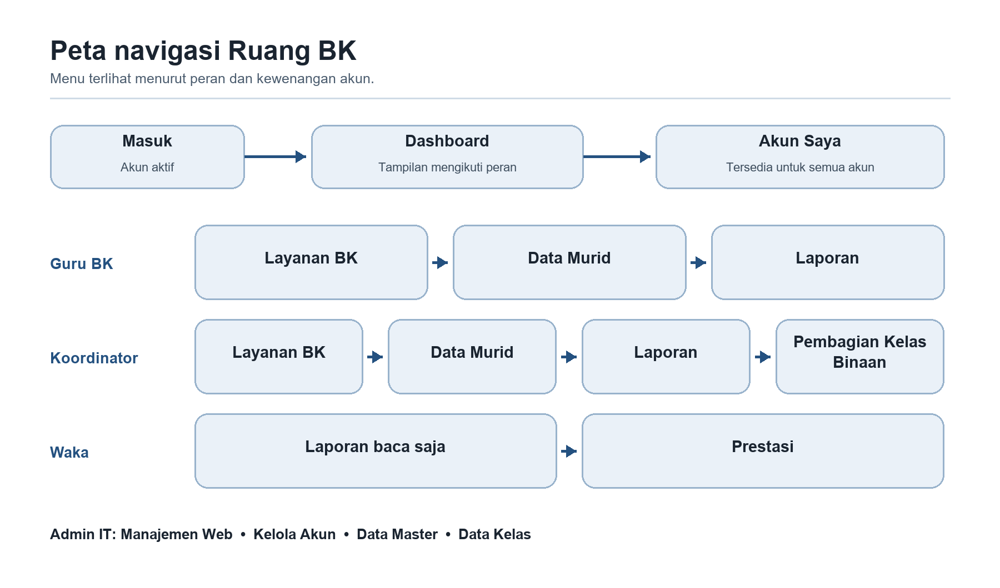
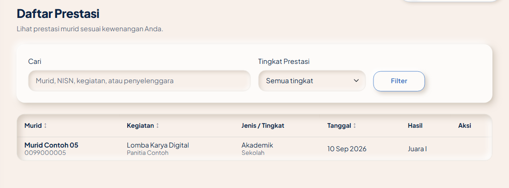
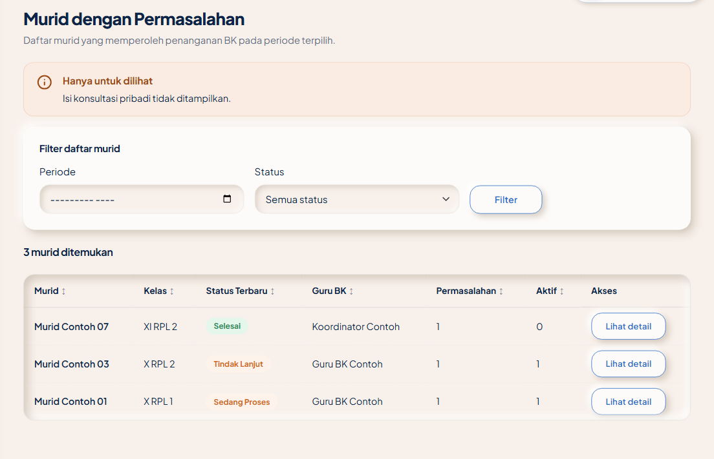
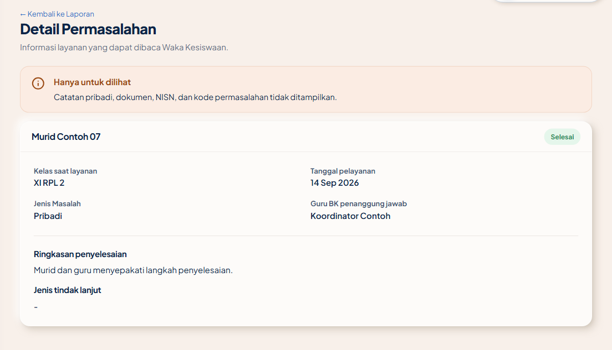
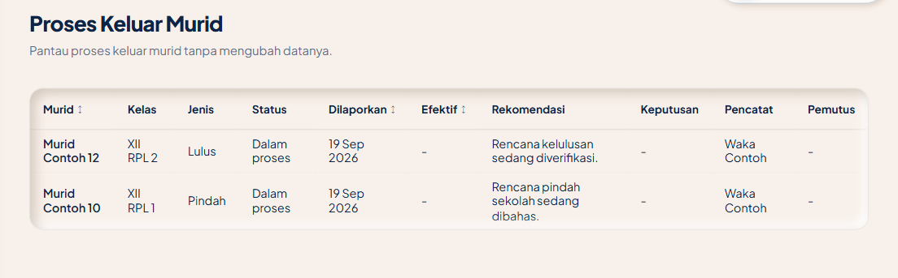

# Manualbook Ruang BK

Panduan penggunaan dan instalasi server sekolah

Edisi 22 Oktober 2026. Acuan aplikasi 688d658.

Buku ini memandu Admin IT menyiapkan akun dan sumber data, Koordinator BK membagi kelas serta mengaktifkan tahun ajaran, Guru BK mencatat layanan sampai rekap, dan Waka Kesiswaan memantau layanan serta mengelola prestasi. Setiap petunjuk fitur dilengkapi gambar yang relevan, langkah bernomor, hasil yang perlu diperiksa, dan batas pentingnya. Petugas server menggunakan Bab 6 untuk pemasangan serta pemulihan.

Tangkapan layar aplikasi memakai data contoh lokal, bukan identitas dan catatan murid sekolah. Warna, logo, nama, tanggal, pilihan tahun, dan angka pada instalasi sekolah dapat berbeda. Diagram server diberi label CONTOH untuk membedakannya dari bukti deployment. Gambar hanya menunjukkan layar yang sedang dibahas; ikuti langkah tertulis saat keadaan aplikasi berubah setelah simpan.

# 1 Alur aplikasi dan penggunaan dasar

## 1.1 Memilih panduan menurut peran



1. **Admin IT** menggunakan Bab 5 untuk akun, kelas, tahun persiapan, roster, API, sinkronisasi, logo, dan tema. Hak teknis tidak membuka isi konseling.
2. **Guru BK** menggunakan Bab 2 untuk murid binaan, pencatatan layanan, tindak lanjut, riwayat, dan rekap.
3. **Koordinator BK** menggunakan Bab 3 untuk pemantauan sekolah, pembagian kelas, dan aktivasi tahun. Hak baca lintas guru tidak memberi hak mengubah catatan guru lain. Untuk mencatat layanan, akun juga harus memiliki peran Guru BK dan kelas binaan aktif.
4. **Waka Kesiswaan** menggunakan Bab 4 untuk ringkasan pemantauan dan pengelolaan prestasi. Peran Waka tidak memberi hak mengunduh rekap konseling atau mengubah layanan Guru BK.

**Batas akun:** kombinasi peran yang diperbolehkan hanya Guru BK bersama Koordinator BK. Admin IT dan Waka memakai akun terpisah. Semua pengguna mempunyai Dashboard dan Akun Saya; menu lain mengikuti peran dan penugasan.

## 1.2 Memahami urutan kerja sekolah


1. Petugas memasang aplikasi, database, HTTPS, dan scheduler, lalu membuat Admin IT pertama.
2. Admin IT membuat akun, menata Data Kelas, menyiapkan tahun ajaran, serta meninjau dan mengimpor roster.
3. Koordinator menugaskan Guru BK pada kelas yang dipakai, memeriksa kesiapan, lalu mengaktifkan tahun ajaran.
4. Admin IT meninjau e-Tatib dan pencocokan identitas sebelum sinkronisasi atau aktivasi jadwal otomatis.
5. Guru BK mencatat dan menangani layanan; Waka memantau ringkasan dan mengelola prestasi. Guru atau Koordinator membuat rekap sesuai kewenangan.
6. Saat tahun berganti, ulangi persiapan roster dan penugasan pada tahun baru. Histori lama tetap mengikuti cakupan akses serta ketentuan retensi.

## 1.3 Masuk dan penggantian sandi pertama
### Masuk menggunakan akun sekolah


**Prasyarat:** akun pribadi sudah dibuat dan masih aktif. Gunakan alamat HTTPS aplikasi sekolah.

1. Buka halaman masuk pada alamat yang diserahkan sekolah.
2. Isi **Email** dan **Kata sandi** yang diberikan Admin IT. Gunakan ikon mata hanya bila berada di tempat privat dan perlu memeriksa ketikan.
3. Tekan **Masuk**. Akun yang sudah memakai sandi pribadi menuju Dashboard; akun baru/reset menuju penggantian sandi sementara.
4. Bila gagal, periksa ketikan dan status akun. Setelah beberapa percobaan gagal, tunggu pembatasan percobaan berakhir sebelum mencoba lagi.

**Hasil:** sesi masuk menggunakan peran akun sendiri. Bila sandi sementara sudah kedaluwarsa, Admin IT perlu menerbitkan ulang; tidak ada sandi produksi umum dalam buku ini.
### Mengganti sandi sementara


**Prasyarat:** berhasil masuk menggunakan sandi sementara yang belum kedaluwarsa. Masa berlaku bawaan adalah 24 jam.

1. Pada halaman penggantian sandi, isi **Kata sandi saat ini** dengan sandi sementara.
2. Isi sandi baru minimal delapan karakter yang mengandung huruf dan angka, serta berbeda dari sandi saat ini.
3. Ulangi sandi baru pada kolom konfirmasi, lalu tekan **Simpan**.
4. Jika ditolak, perbaiki kolom yang disebut. Setelah berhasil, lanjutkan ke Dashboard.

**Hasil:** sandi sementara diganti sandi pribadi. Jangan memotret, menyalin ke buku umum, atau membagikan sandi kepada pengguna lain.

## 1.4 Menggunakan daftar dan formulir
### Mencari memfilter mengurutkan dan membuka halaman daftar


Pola daftar serupa dipakai pada layanan, murid, akun, prestasi, dan laporan. Pilihan filter mengikuti fitur yang sedang dibuka.

1. Isi pencarian dan pilih filter yang tersedia, misalnya kelas, jenis, status, atau tahun ajaran.
2. Tekan **Filter**. Gunakan **Reset** bila tersedia untuk mengembalikan pilihan awal.
3. Klik judul kolom bertanda panah untuk mengurutkan. Kolom tanpa kontrol urut tidak dapat dipakai mengurutkan.
4. Gunakan nomor halaman untuk melihat bagian daftar berikutnya; bila daftar menyediakan ikon kaca pembesar, gunakan untuk membaca rincian yang diizinkan.

**Hasil:** daftar menampilkan data yang sesuai filter dan kewenangan. Tidak menemukan murid belum berarti datanya terhapus; periksa filter, tahun ajaran, dan cakupan kelas terlebih dahulu.
### Memeriksa draf dan hasil simpan formulir


Beberapa formulir mempunyai draf pada browser perangkat. Draf belum menjadi catatan resmi sampai penyimpanan berhasil.

1. Lengkapi kolom bertanda bintang. Untuk murid, pilih saran yang benar agar identitas tidak salah.
2. Tekan **Simpan** dan periksa pesan berhasil serta catatan pada daftar.
3. Bila pesan **belum tersimpan** muncul, koreksi kolom yang disebut dan simpan lagi. Jangan menganggap draf sebagai bukti data sudah masuk.
4. Gunakan **Kosongkan** untuk membuang draf yang tidak dipakai. Penutupan form yang berubah dapat meminta konfirmasi.
5. Jika perubahan ditolak karena versi catatan sudah berubah, muat ulang dan bandingkan pembaruan terbaru sebelum mengulang.

**Batas:** draf berada pada browser perangkat; jangan meninggalkan catatan pada komputer bersama. Proses **Keluar** membersihkan draf pengguna pada browser tersebut.

## 1.5 Akun Saya dan keluar
### Memeriksa akun sendiri


Tampilan akun menyesuaikan pengguna yang sedang masuk. Contoh gambar dapat memakai peran berbeda dari akun Anda.

1. Buka **Akun Saya** melalui menu samping atau menu profil kanan atas.
2. Periksa nama, email, peran, status, login terakhir, dan konteks tahun ajaran yang ditampilkan.
3. Untuk koreksi nama, email, atau peran, hubungi Admin IT sesuai penugasan sekolah.

**Hasil:** identitas akun dapat diperiksa tanpa memakai akun pengguna lain. Pengguna tidak mengubah perannya sendiri melalui halaman ini.
### Mengganti sandi pribadi


**Prasyarat:** masih mengetahui sandi saat ini. Untuk sandi yang terlupa, gunakan prosedur reset melalui Admin IT.

1. Pada **Akun Saya**, tekan **Ubah Sandi**.
2. Isi sandi saat ini, sandi baru, dan konfirmasinya. Sandi baru mengikuti ketentuan pada bagian 1.3.
3. Tekan **Simpan** dan periksa pesan berhasil. Jika sandi saat ini atau konfirmasi tidak sesuai, perbaiki dahulu.

**Hasil:** sandi baru berlaku dan sesi lain akun diputus. Simpan sandi secara privat; jangan menaruhnya di panduan atau tangkapan layar.
### Keluar dari aplikasi


Keluar setelah pekerjaan selesai, terutama pada komputer bersama.

1. Selesaikan penyimpanan catatan atau buang draf yang tidak dipakai.
2. Buka menu profil kanan atas atau **Akun Saya**, lalu tekan **Keluar**.
3. Pastikan halaman masuk kembali tampil sebelum meninggalkan perangkat.

**Hasil:** sesi perangkat diakhiri dan draf pengguna pada browser dibersihkan. Menutup tab saja tidak menggantikan tombol Keluar.

# 2 Panduan Guru BK

Guru BK bekerja pada murid di kelas binaan aktifnya. Koordinator BK dapat membaca catatan lintas guru, tetapi hak itu tidak memindahkan kepemilikan catatan. Akun rangkap Koordinator dan Guru BK tetap memerlukan kelas binaan aktif untuk membuat layanan. Tahun ajaran lama dan layanan sebelum murid resmi keluar tetap menjadi riwayat sesuai kewenangan baca; catatan lama tidak dapat diubah atau diarsipkan. Menu kerja Guru BK adalah **Dashboard**, **Layanan BK**, **Data Murid**, dan **Laporan**. Pengelolaan akun pribadi dijelaskan pada Bab 1.

## 2.1 Dashboard dan kelas binaan

### Memeriksa ringkasan dan kelas binaan


**Tujuan:** melihat murid binaan dan layanan terbaru. **Prasyarat:** akun Guru BK aktif; penugasan diperlukan agar kelas binaan terisi.

1. Buka **Dashboard**, pilih **Tahun Ajaran**, lalu tekan **Filter** atau **Reset** untuk kembali ke bawaan.
2. Baca kartu murid binaan, permasalahan, tindak lanjut, dan e-Tatib. Aktivitas terbaru adalah ringkasan, bukan tombol edit.
3. Pada **Kelas Binaan**, pilih **Kelas 10**, **Kelas 11**, atau **Kelas 12**; tekan **Lihat Semua** jika daftar kelas melebihi yang tampak.
4. Untuk mencatat layanan, gunakan **Catat Permasalahan** atau **Catat Konsultasi**; form yang terbuka sama dengan di Layanan BK.

**Hasil:** angka dan kelas mengikuti tahun serta cakupan Guru BK. **Jika kosong:** periksa tahun aktif, roster murid, dan penugasan Koordinator.

## 2.2 Catatan Permasalahan

### Mencari dan membaca permasalahan


**Tujuan:** menemukan kasus dan membaca penanganannya. **Prasyarat:** akun dapat membaca layanan murid terkait.

1. Buka **Layanan BK > Catatan Permasalahan**.
2. Isi **Cari Murid** atau pilih **Tindak Lanjut**, lalu tekan **Filter**; tekan **Reset** bila tersedia untuk menghapus filter.
3. Klik label di kolom **Tindak Lanjut** untuk riwayat. Klik kaca pembesar untuk sumber dan narasi di bawah baris.
4. Tekan ikon **Lihat selengkapnya** untuk detail penuh; klik area baris saja tidak membukanya.

**Hasil:** daftar dan detail hanya memuat kasus yang boleh dibaca. **Jika tidak ditemukan:** periksa filter, tahun/kelas binaan, dan status catatan.

### Mencatat permasalahan dari murid atau rujukan


**Tujuan:** membuat catatan awal kasus. **Prasyarat:** peran Guru BK, tahun ajaran aktif, dan kelas binaan aktif.

1. Tekan **Catat Permasalahan** pada tab atau Dashboard; pilih **Sumber** berupa murid datang sendiri, temuan Guru BK, atau rujukan. Jika rujukan, isi **Sumber Rujukan**.
2. Pada **NISN**, cari NISN atau nama dan pilih saran agar identitas serta rombel terisi. Bila murid belum masuk master, isi NISN dan nama sementara, lalu pilih rombel dari kelas binaan Anda.
3. Periksa **Tanggal Layanan** dan pilih **Jenis Masalah**.
4. Isi **Latar Belakang** dan **Penanganan**; **Ringkasan** dapat diisi saat hasil tersedia. Tekan **Simpan**.

**Hasil:** kasus baru muncul berstatus **Sedang Proses**. **Jika ditolak:** periksa field wajib, identitas/NISN, dan rombel binaan; **Kosongkan** menghapus draft setelah konfirmasi bila sudah berubah.

### Mencatat permasalahan dengan referensi e-Tatib


**Tujuan:** mencatat layanan berdasarkan data pelanggaran resmi yang sudah tersinkron. **Prasyarat:** hak pencatatan Guru BK dan data e-Tatib yang dapat dipilih.

1. Buka **Catat Permasalahan**, lalu pilih **Sumber: e-Tatib**.
2. Cari NISN atau nama, pilih pelanggaran yang tepat, dan periksa tanggal, kategori, poin, serta muridnya. Tekan **Ganti** bila salah pilih.
3. Jika rombel e-Tatib tidak cocok dengan penugasan, pilih **Rombel Layanan** yang Anda bina.
4. Pilih **Tanggal Layanan** dan **Jenis Masalah**, isi **Latar Belakang** serta **Penanganan**, lalu **Simpan**.

**Hasil:** kasus tersimpan dengan sumber e-Tatib; data pelanggaran sumber tetap dibaca sebagai referensi. **Jika data tidak ada:** periksa sinkronisasi bersama Admin IT; jangan mengarang ulang pelanggaran sumber.

### Mengedit permasalahan


**Tujuan:** memperbaiki tanggal, jenis, atau narasi kasus sendiri. **Prasyarat:** Anda pemilik kasus dan tahun catatan masih aktif.

1. Pada tab **Catatan Permasalahan**, cari kasus dan tekan ikon **Edit**.
2. Periksa nama, NISN, rombel, serta sumber yang tampil sebagai informasi tetap.
3. Perbarui tanggal layanan, jenis masalah, **Latar Belakang**, **Penanganan**, atau **Ringkasan**, lalu **Simpan**.
4. Jika kasus sudah **Selesai**, setujui konfirmasi sebelum form edit dibuka.

**Hasil:** catatan terbaru tersimpan tanpa mengganti murid, sumber, pemilik, atau status. **Jika konflik perubahan:** muat ulang sebelum mengedit lagi; perubahan pengguna lain tidak ditimpa.

### Menambahkan tindak lanjut kasus


**Tujuan:** mencatat langkah penanganan lanjutan. **Prasyarat:** kasus milik Anda masih aktif dan jenis tindak lanjut belum dipakai pada kasus itu.

1. Pada baris kasus, klik label **Tindak Lanjut** untuk membuka riwayat.
2. Tekan **Tambah Tindak Lanjut**, pilih **Jenis Tindak Lanjut** yang tersedia, dan isi **Tanggal Tindak Lanjut**.
3. Tekan **Simpan**, lalu buka lagi label pada baris untuk memastikan entri masuk.

**Hasil:** riwayat bertambah; penambahan pertama mengubah status kasus menjadi **Tindak Lanjut**. **Jika jenis tidak tersedia:** jenis itu sudah dipakai atau semua jenis aktif telah habis; tidak ada jenis yang boleh digandakan pada satu kasus.

### Menyelesaikan permasalahan


**Tujuan:** menetapkan hasil akhir kasus sendiri. **Prasyarat:** kasus belum selesai dan **Ringkasan** hasil telah disimpan; tindak lanjut tidak wajib.

1. Bila hasil belum ada, tekan **Edit**, isi **Ringkasan**, dan **Simpan**.
2. Kembali ke baris kasus, tekan ikon **Selesaikan Permasalahan**.
3. Periksa nama murid pada konfirmasi, lalu tekan **Selesaikan**.

**Hasil:** status menjadi **Selesai** dan riwayat tetap dapat dibaca di profil murid. **Jika aksi ditolak:** periksa Ringkasan, kepemilikan, dan apakah versi kasus berubah sejak dibuka.

### Mengarsipkan permasalahan


**Tujuan:** mengeluarkan catatan yang tidak perlu tampil dari daftar aktif. **Prasyarat:** kasus milik Anda, tahun aktif, dan kasus belum selesai.

1. Temukan kasus di **Catatan Permasalahan** dan tekan ikon **Arsipkan**.
2. Periksa murid dan kelas pada dialog.
3. Setujui tindakan dengan tombol **Hapus** pada dialog aplikasi.

**Hasil:** kasus diarsipkan secara lunak, bukan dihapus permanen. **Jika ikon tidak aktif:** kasus sudah selesai atau Anda tidak mempunyai hak arsip.

## 2.3 Sesi Bimbingan & Konsultasi

### Mencari dan membaca konsultasi


**Tujuan:** membaca catatan konsultasi yang boleh diakses. **Prasyarat:** murid berada dalam cakupan profesional Guru BK; Koordinator dapat membaca lintas guru.

1. Buka **Layanan BK > Sesi Bimbingan & Konsultasi**.
2. Cari nama murid atau pilih **Jenis Masalah**, lalu tekan **Filter**; gunakan header kolom untuk urutan.
3. Baca **Ringkasan / Hasil** pada daftar. Klik kaca pembesar untuk latar belakang dan penanganan; gunakan tombol detail bila perlu.

**Hasil:** konsultasi tampil sebagai catatan mandiri tanpa status atau tindak lanjut kasus. **Jika kosong:** periksa pencarian dan cakupan murid.

### Mencatat konsultasi


**Tujuan:** mencatat satu sesi layanan. **Prasyarat:** peran Guru BK dan kelas binaan aktif.

1. Tekan **Catat Konsultasi** pada tab atau Dashboard.
2. Pada **NISN**, ketik NISN atau nama dan pilih murid dari saran; bila belum tersedia, isi NISN/nama dan pilih rombel binaan secara manual.
3. Isi tanggal, **Jenis Masalah**, **Latar Belakang Masalah / Permasalahan**, **Penanganan**, serta **Ringkasan / Hasil**.
4. Tekan **Simpan**.

**Hasil:** satu catatan konsultasi muncul di daftar dan profil murid. **Jika gagal:** semua narasi termasuk Ringkasan / Hasil wajib diisi pada versi ini; **Kosongkan** membersihkan isian dan draft lokal.

### Mengedit konsultasi


**Tujuan:** memperbaiki catatan konsultasi sendiri. **Prasyarat:** Anda pencatat, masih berwenang atas murid, dan tahun catatan aktif.

1. Pada tab konsultasi, tekan ikon **Edit** pada baris milik Anda.
2. Periksa identitas murid yang tidak dapat diganti; ubah tanggal, jenis, atau narasi yang diperlukan.
3. Tekan **Simpan Perubahan** dan periksa Ringkasan / Hasil di daftar.

**Hasil:** konsultasi diperbarui. **Jika konflik:** muat ulang catatan sebelum mencoba lagi; layanan tahun lama dan catatan guru lain tidak dapat diedit.

### Mengarsipkan konsultasi


**Tujuan:** mengarsipkan konsultasi sendiri. **Prasyarat:** pencatat masih berwenang dan tahun catatan aktif.

1. Cari konsultasi pada tab **Sesi Bimbingan & Konsultasi**.
2. Tekan ikon **Arsipkan** lalu periksa identitas murid pada dialog.
3. Konfirmasi dengan tombol **Hapus** yang ditampilkan dialog.

**Hasil:** konsultasi tidak tampil sebagai catatan aktif; penghapusan permanen bukan fungsi ini. **Jika ikon tidak ada:** periksa kepemilikan dan tahun ajaran.

## 2.4 Progres penanganan pengunduran diri

### Mencari catatan dan riwayat progres


**Tujuan:** memeriksa perkembangan berkas dan catatan awal. **Prasyarat:** akses baca layanan murid; Koordinator membaca lintas guru.

1. Buka **Layanan BK > Pengunduran Diri**.
2. Isi **Cari Murid** atau pilih **Progres**, lalu tekan **Filter**.
3. Klik label progres untuk **Riwayat Progres Penanganan**. Klik kaca pembesar untuk **Catatan** awal di bawah baris.

**Hasil:** progres terbaru dan riwayatnya terlihat. **Jika kosong:** periksa filter; catatan pengunduran diri berbeda dari keputusan resmi keluar.

### Mencatat penanganan pengunduran diri


**Tujuan:** membuat catatan awal penanganan. **Prasyarat:** peran Guru BK, murid dalam penugasan aktif, dan belum mempunyai catatan pengunduran diri.

1. Tekan **Catat Pengunduran Diri** dari tab.
2. Ketik nama atau NISN, pilih murid dari saran, lalu periksa nama dan rombel terisi.
3. Isi **Tanggal pencatatan** dan **Catatan**, kemudian tekan **Simpan**.

**Hasil:** satu catatan awal tersimpan dengan progres **Berkas masih diproses**; status aktif murid tidak berubah. **Jika murid tidak tersedia:** periksa penugasan atau apakah ia sudah memiliki catatan awal.

### Menambahkan progres penanganan


**Tujuan:** merekam perkembangan setelah catatan awal. **Prasyarat:** murid masih dalam penugasan Guru BK aktif dan catatan awal tersedia.

1. Klik label progres pada baris untuk membuka riwayat.
2. Tekan **Tambah Progres Penanganan**.
3. Pilih **Berkas masih diproses**, **Berkas masih di BK**, atau **Berkas sudah masuk TU**; isi **Tanggal** sejak catatan awal sampai hari ini.
4. Tekan **Simpan**, lalu buka riwayat lagi untuk memeriksa entri.

**Hasil:** riwayat bertambah; progres yang tampil mengikuti entri bertanggal terbaru. **Jika menambah tanggal lebih lama:** entri tetap disimpan tetapi progres terkini tidak berubah.

### Mengedit catatan awal pengunduran diri


**Tujuan:** mengoreksi catatan awal, bukan menimpa riwayat progres. **Prasyarat:** murid masih dalam penugasan Guru BK aktif.

1. Tekan ikon **Edit** pada tab **Pengunduran Diri**.
2. Periksa nama/NISN yang hanya-baca, lalu ubah **Tanggal pencatatan** atau **Catatan**.
3. Tekan **Simpan Perubahan**.

**Hasil:** catatan awal diperbarui dan riwayat progres tetap terpisah. **Jika ditolak:** periksa tanggal yang tidak boleh melewati hari ini dan kewenangan kelas.

### Menghapus catatan penanganan pengunduran diri


**Tujuan:** menghapus catatan penanganan yang dibuat keliru. **Prasyarat:** murid masih dalam penugasan Guru BK aktif.

1. Cari baris murid pada tab **Pengunduran Diri**.
2. Tekan ikon **Hapus**, lalu periksa nama murid pada dialog.
3. Konfirmasi **Hapus** hanya setelah memastikan catatan yang dipilih.

**Hasil:** catatan penanganan keluar dari daftar; ini tidak mengubah keputusan resmi keluar murid. **Jika aksi tidak ada:** periksa hak atas murid.

## 2.5 Data Murid dan prestasi baca

### Mencari murid


**Tujuan:** menemukan profil murid dalam cakupan. **Prasyarat:** akun Guru BK atau Koordinator BK aktif.

1. Buka **Data Murid**.
2. Isi **Cari murid** dengan nama atau NISN dan pilih **Kelas**, lalu tekan **Filter**.
3. Baca jumlah permasalahan, poin pelanggaran, konsultasi, dan prestasi; klik nama murid.

**Hasil:** **Profil Murid** terbuka. **Jika tidak ditemukan:** periksa kelas/tahun aktif atau minta Admin IT memeriksa roster.

### Membaca profil dan riwayat permasalahan


**Tujuan:** melihat konteks murid sebelum menangani layanan. **Prasyarat:** profil murid dapat dibaca menurut cakupan peran.

1. Klik nama murid pada **Data Murid**.
2. Periksa NISN, kelas, tahun ajaran, ringkasan layanan, poin, prestasi, dan histori kelas.
3. Buka tab **Permasalahan**; klik kaca pembesar pada baris untuk sumber, latar belakang, dan penanganan yang diizinkan.

**Hasil:** histori layanan murid terbaca tanpa mengubah catatan. **Jika catatan lama tidak dapat diedit:** pengelolaan hanya melalui **Layanan BK** sesuai pemilik dan tahun aktif.

### Membaca data e-Tatib murid


**Tujuan:** memeriksa referensi pelanggaran yang sudah disinkron. **Prasyarat:** akses profil murid.

1. Buka **Profil Murid > Data e-Tatib**.
2. Baca tanggal, jenis pelanggaran, kategori, poin, riwayat kelas, dan pencatat.
3. Perhatikan label **Dibatalkan sumber** atau **Arsip**; catatan yang dibatalkan sumber tidak menambah poin aktif.

**Hasil:** konteks e-Tatib tersedia sebagai data baca saja. **Jika data belum tersedia:** tanyakan sinkronisasi kepada Admin IT; jangan menyunting data sumber dari profil.

### Membaca riwayat konsultasi murid


**Tujuan:** melihat layanan konsultasi sebelumnya yang sah. **Prasyarat:** akses profesional atas murid atau peran Koordinator BK.

1. Buka **Profil Murid > Konsultasi**.
2. Baca tanggal, jenis, Guru BK, dan **Hasil/Ringkasan**.
3. Klik kaca pembesar untuk latar belakang dan penanganan yang boleh dibaca.

**Hasil:** riwayat konsultasi tampil sesuai kewenangan. **Jika tab tidak muncul:** akun tidak mempunyai hak baca konsultasi pada profil tersebut.

### Membaca prestasi pada profil murid


**Tujuan:** mempertimbangkan riwayat prestasi saat memberi layanan. **Prasyarat:** akses profil murid.

1. Buka **Profil Murid > Prestasi**.
2. Baca kegiatan, penyelenggara, jenis/tingkat, tanggal, dan hasil.
3. Gunakan kembali tab layanan bila perlu membandingkan riwayat; prestasi tidak mengubah status kasus secara otomatis.

**Hasil:** prestasi terbaca tanpa hak edit. **Jika kosong:** belum ada prestasi yang tercatat atau dapat dibaca.

### Mencari prestasi dalam daftar



**Tujuan:** mencari prestasi beberapa murid. **Prasyarat:** Guru BK membaca sesuai cakupan profesional; Koordinator BK membaca seluruh murid.

1. Buka alamat **/achievements**; halaman ini tidak berada pada menu samping kedua peran.
2. Gunakan pencarian dan pilihan **Tingkat Prestasi**, lalu tekan **Filter**.
3. Baca kegiatan, jenis/tingkat, penyelenggara, tanggal, dan hasil pada daftar.

**Hasil:** daftar terbatas menurut hak baca. **Jika tombol catat/impor/edit tidak ada:** pengelolaan prestasi milik Waka Kesiswaan.

## 2.6 Laporan dan dokumen rekap

### Menyaring dan membaca laporan layanan


**Tujuan:** meninjau catatan sebelum membuat dokumen. **Prasyarat:** Guru BK atau Koordinator BK aktif; data mengikuti cakupan masing-masing.

1. Buka **Laporan**.
2. Pilih **Tahun ajaran**, cari **Kelas**, lalu pilih **Jenis layanan BK**: permasalahan, konsultasi, atau pengunduran diri.
3. Tekan **Filter**, buka kaca pembesar untuk narasi yang diizinkan, dan pindah halaman bila perlu.
4. Gunakan **Reset** untuk kembali ke pilihan bawaan.

**Hasil:** daftar berhalaman tampil, dengan Guru BK sesuai cakupan dan Koordinator gabungan sekolah. **Jika filter ditolak:** kelas harus cocok dengan tahun dan hak akses; edit/arsip dilakukan di Layanan BK.

### Membuat pratinjau dan mengatur periode


**Tujuan:** menyiapkan rekap satu semester dengan periode yang dibutuhkan. **Prasyarat:** filter daftar sudah tepat dan hasil dokumen berada dalam batas kapasitas.

1. Tekan **Buat rekap** pada **Laporan**; pratinjau awal memakai hingga 30 hari terakhir yang tersedia dalam satu semester.
2. Buka **Atur periode**, pilih **Semester 1 (Juli-Desember)** atau **Semester 2 (Januari-Juni)**, lalu isi **Dari tanggal** dan **Sampai tanggal**.
3. Tekan **Filter** dalam modal dan tunggu pratinjau terbaru selesai.
4. Periksa jenis layanan, rentang tanggal, catatan, dan penandatangan sebelum mencetak.

**Hasil:** pratinjau lengkap mengikuti filter dan periode. **Jika gagal:** tanggal harus berurutan dalam satu semester; bila melebihi batas dokumen, persempit periode atau kelas. **Coba lagi** atau **Buka di halaman baru** tersedia jika pemuatan gagal.

### Mengatur periode rekap di ponsel


**Tujuan:** mengubah periode tanpa kehilangan konteks daftar pada layar sempit. **Prasyarat:** modal pratinjau terbuka di ponsel.

1. Ketuk ringkasan tanggal pada **Atur periode** untuk membuka isian.
2. Pilih semester dan isi **Dari tanggal** serta **Sampai tanggal** di dalam semester itu.
3. Ketuk **Filter** dan tunggu ringkasan tanggal/pratinjau diperbarui.

**Hasil:** pengaturan kembali terlipat dan periode terpilih tetap terlihat. **Jika tombol unduh/cetak nonaktif:** tunggu pratinjau valid yang terbaru.

### Mengunduh Excel atau mencetak PDF


**Tujuan:** menyimpan dokumen rekap yang sudah diperiksa. **Prasyarat:** pratinjau terbaru berhasil dimuat.

1. Periksa kembali periode dan jumlah catatan pada **Pratinjau Rekap**.
2. Tekan **Unduh Excel** untuk berkas tabel, atau **Cetak / Simpan PDF** lalu pilih pencetak/PDF di dialog browser.
3. Simpan berkas hanya pada lokasi sekolah yang diizinkan; tekan **Tutup** untuk kembali ke daftar dengan filter dan posisi tetap.

**Hasil:** dokumen memakai seluruh data yang lolos filter, bukan hanya halaman daftar yang tampak. **Jika tombol nonaktif:** periode sedang diubah, dimuat, atau pratinjau gagal. Excel tidak memuat blok tanda tangan seperti cetak.

# 3 Panduan Koordinator BK

Koordinator membaca Dashboard, Layanan BK, Data Murid, prestasi, dan Laporan lintas Guru BK dengan langkah baca pada Bab 2. Penugasan serta aktivasi tahun ajaran adalah tugas tambahannya. Peran Koordinator sendiri tidak memberi hak membuat layanan atau mengedit catatan guru lain; pada akun rangkap, hak membuat tetap bergantung pada kelas binaan aktif dan hak edit pada pemilik/pencatat yang sah.

## 3.1 Pemantauan sekolah

### Memeriksa Dashboard Koordinator dan mengganti tampilan akun rangkap


**Tujuan:** memantau kesiapan dan layanan sekolah; akun rangkap juga dapat melihat cakupan pribadi Guru BK. **Prasyarat:** akun Koordinator aktif; sakelar muncul bila akun juga Guru BK.

1. Buka **Dashboard**, pilih **Tahun Ajaran**, lalu tekan **Filter**.
2. Baca indikator dan panel kesiapan penugasan pada tampilan Koordinator.
3. Jika ada, nyalakan **Tampilan Guru BK** untuk ringkasan, aktivitas, e-Tatib, dan kelas binaan sendiri; padamkan untuk kembali ke Koordinator.

**Hasil:** tahun pilihan dipertahankan, sedangkan angka mengikuti tampilan peran. **Jika sakelar tidak ada:** akun tidak mempunyai kedua peran; sakelar tidak memperluas izin menu lain.

## 3.2 Pembagian Kelas Binaan

### Memilih tahun dan memeriksa penugasan


**Tujuan:** memastikan setiap kelas mempunyai Guru BK yang sesuai. **Prasyarat:** akun Koordinator aktif; tahun dan kelas telah disiapkan Admin IT.

1. Buka **Pembagian Kelas Binaan**.
2. Pada bagian **Tahun Ajaran**, pilih tahun **Aktif** atau **Persiapan**, lalu **Tampilkan**.
3. Isi **Cari kelas** atau pilih **Status guru**: **Semua**, **Ditugaskan**, **Belum ditugaskan**; tekan **Filter**.
4. Periksa nama Guru BK, chip kelas, jumlah murid, dan status. Satu kelas berjalan hanya untuk satu Guru BK.

**Hasil:** daftar penugasan tahun terpilih terlihat. **Jika tahun kosong:** Admin IT perlu membuat tahun persiapan/roster terlebih dahulu.

### Menambahkan kelas binaan


**Tujuan:** memberi kelas kepada Guru BK aktif. **Prasyarat:** Koordinator memilih tahun; kelas tersedia dan belum ditugaskan.

1. Pada baris guru yang tepat, tekan ikon **Tambah kelas**.
2. Cari kelas yang belum ditugaskan, lalu pilih satu atau beberapa kelas dalam modal.
3. Periksa **Kelas dipilih** dan tekan **Tambah kelas**.

**Hasil:** chip kelas muncul pada guru; pada tahun aktif cakupan muridnya segera bertambah. **Jika kelas tidak tersedia:** kelas sudah ditugaskan atau belum disiapkan pada katalog tahun itu.

### Menyalin kelas binaan dari tahun sebelumnya


**Tujuan:** memakai kelas yang sama sebagai awal penugasan tahun baru. **Prasyarat:** guru memiliki kelas pada tahun sebelumnya dan kelas target tersedia.

1. Pilih tahun **Persiapan** pada **Pembagian Kelas Binaan**.
2. Cari guru yang tepat dan tekan ikon **Salin kelas binaan tahun sebelumnya** pada barisnya.
3. Periksa chip kelas hasil penyalinan dan lengkapi kelas yang belum terisi secara manual.

**Hasil:** hanya kelas yang memenuhi syarat ditambahkan pada tahun target. **Jika tidak berubah:** tidak ada kelas sebelumnya yang dapat disalin atau kelas target telah ditugaskan.

### Melepas penugasan kelas


**Tujuan:** mengoreksi pembagian kelas. **Prasyarat:** kelas masih ditugaskan pada guru tersebut.

1. Klik ikon silang pada chip kelas yang hendak dilepas.
2. Baca dialog **Batalkan penugasan?** dan cocokkan nama kelas serta guru.
3. Tekan **Ya, batalkan penugasan**, lalu siapkan pengganti bila kelas tetap aktif.

**Hasil:** kelas kembali belum ditugaskan; pada tahun aktif hak baca/pencatatan murid guru segera berkurang, tetapi catatan lama tersimpan. **Jika salah target:** tekan **Kembali** sebelum konfirmasi.

## 3.3 Aktivasi tahun ajaran

### Mengaktifkan tahun ajaran persiapan


**Tujuan:** menjadikan roster dan penugasan baru sebagai tahun operasional. **Prasyarat:** Admin IT telah menyiapkan tahun, minimal satu murid, tidak ada penempatan aktif ganda, dan tiap rombel aktif memiliki tepat satu Guru BK aktif.

1. Di **Pembagian Kelas Binaan**, pilih tahun **Persiapan** dan tekan **Tampilkan**.
2. Baca masalah serta peringatan kesiapan; selesaikan masalah penugasan/roster bersama Admin IT. Peringatan **Perlu Konfirmasi** atau asal data tidak selalu menghalangi aktivasi.
3. Jika tombol tersedia, tekan **Aktifkan Tahun Ajaran**.
4. Periksa label **Aktif**, lalu minta Guru BK meninjau kembali kelas binaannya.

**Hasil:** target menjadi satu-satunya tahun aktif dan layanan baru memakai cakupan penugasan itu. **Jika tombol nonaktif:** masalah kesiapan yang ditampilkan harus diperbaiki terlebih dahulu.

### Membatalkan aktivasi untuk kembali ke tahun sebelumnya


**Tujuan:** mengembalikan tahun aktif sebelumnya bila aktivasi baru keliru. **Prasyarat:** pendahulu pasti dan siap, serta belum ada aktivitas operasional sejak aktivasi baru.

1. Buka **Pembagian Kelas Binaan** pada tahun yang baru aktif.
2. Jika tersedia, tekan **Batalkan aktivasi** dan baca tahun tujuan serta akibatnya pada dialog.
3. Konfirmasi pembatalan, lalu periksa kembali tahun bertanda **Aktif** dan cakupan guru.

**Hasil:** tahun sebelumnya aktif kembali. **Jika tombol tidak ada atau ditolak:** syarat pemulihan tidak terpenuhi; jangan memindahkan layanan dengan mengedit tanggal catatan.

**Batas proses keluar resmi:** tab **Pengunduran Diri** hanya mencatat progres penanganan. Kontrol pencatatan/finalisasi keluar resmi belum tampil pada profil murid di versi acuan ini; jangan mengubah database secara manual untuk menyiasatinya. Ketentuan retensi alumni ada pada Bab 6.

# 4 Panduan Waka Kesiswaan

Waka memantau ringkasan layanan BK dan mengelola prestasi. Menu utamanya **Dashboard**, **Laporan**, **Prestasi**, dan **Akun Saya**. Pencatatan dan perubahan konseling tetap dikerjakan Guru BK; Waka tidak memperoleh ekspor massal layanan konseling.

## 4.1 Dashboard Waka
### Memantau indikator dan tindak lanjut sekolah


**Prasyarat:** akun Waka aktif dan data layanan sudah tersedia pada tahun yang dipilih.

1. Buka **Dashboard Waka Kesiswaan**, pilih **Tahun Ajaran**, lalu terapkan **Filter** bila diminta.
2. Baca Murid Tercatat, Sedang Ditangani, Perlu Tindak Lanjut, dan Baru Bulan Ini. Indikator menghitung murid unik sesuai definisinya, bukan seluruh sesi.
3. Baca Grafik Catatan BK: setiap murid dihitung sekali pada setiap bulan yang memiliki layanan, bukan akumulasi kejadian. Periksa Murid per Tingkat dan maksimal tiga kelas pada Catatan Permasalahan Terbanyak.
4. Pada **Murid Perlu Tindak Lanjut**, baca Murid/Kelas, Jenis Layanan, Guru BK, Ringkasan, serta Tindak Lanjut. Satu murid dapat mempunyai lebih dari satu layanan yang masih ditangani.

**Hasil:** tersedia dasar koordinasi sekolah. Perbedaan angka dari daftar e-Tatib perlu diperiksa terhadap periode, jenis layanan, dan hitungan murid unik terlebih dahulu.

## 4.2 Laporan Layanan BK
### Menyaring dan membaca ringkasan layanan


**Prasyarat:** masuk sebagai Waka. Tidak adanya tombol Buat rekap atau edit merupakan pembatasan sesuai peran.

1. Buka **Laporan**, pilih **Tahun ajaran**, **Kelas**, dan **Jenis layanan BK**.
2. Tekan **Filter**, lalu baca daftar. Gunakan halaman berikutnya bila data banyak.
3. Untuk permasalahan/konsultasi, baca identitas layanan, Ringkasan / Hasil, Guru BK, dan Keterangan. Untuk pengunduran diri, Keterangan memuat progres berkas terbaru.
4. Koordinasikan kebutuhan lanjutan dengan Guru BK yang ditampilkan melalui prosedur sekolah.

**Batas:** Waka tidak dapat membuka narasi profesional yang dibatasi, mengubah layanan, membuka pratinjau kertas, atau mengunduh/cetak rekap layanan. Jangan memakai akun Guru BK untuk melewatinya.

## 4.3 Halaman tambahan pemantauan
### Melihat murid dengan permasalahan




Halaman ini masih tersedia melalui alamat langsung dan belum mempunyai pintasan pada menu samping versi acuan.

1. Tambahkan `/waka/students-with-cases` sesudah domain aplikasi sekolah.
2. Pilih **Periode** bulanan atau **Status**, lalu tekan **Filter**.
3. Baca jumlah permasalahan, jumlah yang aktif, dan guru terkait. Urutkan kolom atau pindah halaman jika diperlukan.
4. Tekan **Lihat detail** pada murid yang akan diperiksa. Tautan membuka ringkasan permasalahan terbarunya.

**Hasil:** daftar membantu menelusuri ringkasan murid, tanpa memberi hak perubahan layanan.
### Membaca detail kasus yang diizinkan




**Prasyarat:** membuka Lihat detail dari daftar pemantauan yang diizinkan.

1. Periksa murid, **Kelas saat layanan**, **Jenis Masalah**, status, **Guru BK penanggung jawab**, dan **Tanggal pelayanan**.
2. Baca **Ringkasan penyelesaian** dan **Jenis tindak lanjut** yang tersedia.
3. Gunakan **Kembali ke Laporan** untuk membuka halaman Laporan; bahas kebutuhan lebih lanjut dengan Guru BK terkait.

**Batas:** latar belakang, tindakan awal, catatan internal, NISN, dan kode kasus tidak ditampilkan pada proyeksi detail Waka.
### Memantau proses keluar yang sudah tercatat




Halaman baca tambahan ini dibuka melalui alamat langsung, bukan menu samping.

1. Tambahkan `/waka/student-departures` sesudah domain aplikasi.
2. Baca jenis, status, tanggal dilaporkan/efektif, rekomendasi, keputusan, pencatat, dan pemutus bila sudah tersedia.
3. Gunakan pengurutan kolom atau halaman berikutnya jika diperlukan.

**Batas:** Waka tidak membuat/finalisasi keputusan keluar melalui halaman ini. Progres penanganan pengunduran diri tidak otomatis menjadi keputusan resmi keluar atau lulus.

## 4.4 Pencatatan prestasi
### Mencatat prestasi secara manual


**Prasyarat:** murid resmi masih aktif; jenis dan tingkat prestasi aktif tersedia. Tanggal tidak boleh berada di masa depan.

1. Buka **Prestasi**, lalu tekan **Catat Prestasi**.
2. Cari nama atau NISN dan pilih murid dari saran; periksa identitas serta rombelnya.
3. Isi Kegiatan/Nama Lomba, Jenis, Tingkat, Tanggal, Penyelenggara, dan Hasil/Peringkat.
4. Tekan **Simpan**, lalu periksa kegiatan baru pada daftar. **Batal** menutup form; **Kosongkan** membuang isian/draf yang tidak dipakai.

**Hasil:** prestasi tampil pada daftar dan histori murid sesuai hak baca. Bila murid tidak ditemukan, periksa roster bersama Admin IT; jangan memakai identitas pengganti. Tidak ada unggahan bukti atau tahapan verifikasi pada versi ini.

## 4.5 Template dan impor prestasi
### Mengunduh mengisi dan mengimpor template prestasi


**Prasyarat:** daftar murid aktif dan referensi jenis/tingkat sudah tersedia.

1. Pada **Prestasi**, tekan **Impor Excel**, lalu **Unduh template Excel prestasi**.
2. Pertahankan header `nisn`, `jenis`, `tingkat`, `kegiatan`, `penyelenggara`, `tanggal`, `hasil`. Simpan NISN sebagai teks termasuk nol awal.
3. Isi kode jenis dan tingkat dari **Format dan kode isian Excel**; gunakan tanggal `YYYY-MM-DD` atau tanggal Excel yang sah. Jangan memakai tanggal masa depan atau rumus.
4. Simpan sebagai `.xlsx` maksimal 1.000 baris data dan 2 MB. Pilih **Berkas Excel**, lalu **Impor Prestasi**.
5. Jika ditolak, baca daftar kesalahan, perbaiki berkas, pilih kembali, lalu ulangi. Seluruh baris diperiksa sebelum transaksi sehingga kegagalan validasi tidak menyimpan sebagian.
6. Setelah berhasil, periksa jumlah dan contoh kegiatan pada daftar. Jangan mengunggah ulang berkas yang sama hanya untuk mengecek hasil.

**Hasil:** data prestasi valid tersimpan bersama. Berkas yang dipilih ulang harus sudah berisi koreksi; perubahan pada file saja belum mengirimnya ke aplikasi.

## 4.6 Mencari mengoreksi dan menghapus prestasi
### Mencari dan mengurutkan daftar prestasi


Pencarian dapat memakai murid, NISN, kegiatan, atau penyelenggara.

1. Buka **Prestasi**, isi **Cari** atau pilih **Tingkat Prestasi**.
2. Tekan **Filter** untuk melihat hasil.
3. Klik kolom Murid, Kegiatan, atau Tanggal untuk mengurutkan; gunakan pagination bila diperlukan.

**Hasil:** daftar menyempit sesuai pilihan. Tidak adanya hasil dapat disebabkan filter yang terlalu sempit.
### Mengedit prestasi


**Prasyarat:** catatan prestasi tersedia dan pengguna memiliki peran Waka.

1. Tekan ikon **Edit prestasi** pada baris target.
2. Koreksi kegiatan, jenis, tingkat, tanggal, penyelenggara, atau hasil. Identitas murid tidak diganti melalui edit.
3. Tekan **Simpan**, lalu periksa nilai terbaru pada daftar.

**Jika ditolak:** muat ulang bila data sudah diperbarui pengguna lain, lalu bandingkan sebelum mengulang. Guru BK/Koordinator hanya membaca prestasi sesuai cakupan.
### Menghapus catatan prestasi yang keliru


**Prasyarat:** sudah memastikan catatan mana yang harus dikeluarkan dari daftar aktif.

1. Tekan **Hapus prestasi** pada baris yang tepat.
2. Baca kembali kegiatan dan murid pada dialog konfirmasi.
3. Tekan **Ya, hapus** hanya bila target benar; gunakan **Batal** jika ragu.
4. Periksa bahwa catatan tidak lagi tampil pada daftar aktif.

**Batas:** penghapusan melalui arsip aplikasi dicatat dalam jejak perubahan. Halaman ini tidak menyediakan tombol pemulihan arsip.

# 5 Panduan Admin IT

Admin IT menyiapkan akun, katalog kelas, roster murid, sumber sinkronisasi, dan tampilan web. Menu yang dipakai ialah **Dashboard**, **Manajemen Web**, **Kelola Akun**, **Data Master**, **Data Kelas**, dan **Akun Saya**. Akses ini tidak membuka isi layanan BK. Penugasan Guru BK dan aktivasi tahun ajaran ditangani Koordinator BK.

> Urutan awal tahun: rapikan **Data Kelas**, buat tahun persiapan di **Data Master > Dapodik**, impor roster melalui API Siswa atau berkas, lalu minta Koordinator membagi kelas dan mengaktifkan tahun.

## 5.1 Dashboard Admin IT

### Membaca kesiapan akun dan integrasi


1. Buka **Dashboard**; pilih **Tahun Ajaran** bila perlu melihat periode tertentu.
2. Baca **Akun Aktif**, **Akun Nonaktif**, **Konflik Sinkronisasi**, dan **Integrasi Bermasalah**.
3. Klik jumlah konflik untuk membuka **Data Master > Sinkronisasi**; periksa **Status sinkronisasi terbaru** dan **Status Integrasi** sebelum menindaklanjuti.

**Hasil dan jika gagal:** indikator menunjukkan hal yang perlu diperiksa, bukan uji koneksi langsung. Jika e-Tatib otomatis gagal, periksa tab **e-Tatib** dan riwayat sebelum menjalankannya lagi.

## 5.2 Kelola Akun

### Mencari dan memeriksa akun


1. Buka **Kelola Akun**; isi **Cari nama atau email** atau pilih **Peran**, lalu **Filter**.
2. Urutkan **Nama** atau **Status** bila daftar panjang.
3. Klik ikon **Lihat Informasi** pada akun untuk memeriksa email, login terakhir, dan status sandi.

**Hasil:** data akun yang dituju terlihat tanpa mengubah aksesnya.

### Membuat akun


1. Klik **Tambah Akun**, isi **Nama** dan **Email**, lalu pilih minimal satu peran.
2. Pilih Admin IT, Waka Kesiswaan, Guru BK, atau Koordinator BK secara terpisah; hanya Guru BK dan Koordinator BK yang boleh digabung.
3. Klik **Buat akun**.

**Hasil dan jika gagal:** akun baru muncul di daftar. Jika email telah dipakai atau kombinasi peran ditolak, perbaiki isian sebelum mengulang.

### Memeriksa informasi akun


1. Buka informasi akun melalui ikon **Lihat Informasi** pada baris akun.
2. Periksa email, waktu login terakhir, dan status sandi.
3. Tutup panel informasi setelah selesai.

**Hasil:** detail status akun terlihat tanpa mengubah akun. Sandi sementara tidak ditampilkan pada panel ini; gunakan **Reset Sandi** untuk menerbitkan sandi baru.

### Mengedit identitas dan status akun


1. Klik ikon **Edit Akun** pada baris yang tepat.
2. Koreksi nama atau email, atau pilih **Status**: **Aktif** maupun **Nonaktif**.
3. Simpan dan periksa status baru pada daftar.

**Hasil dan batas:** akun nonaktif tidak dapat masuk. Admin IT tidak dapat menonaktifkan akunnya sendiri.

### Mengubah peran akun


1. Klik chip peran atau ikon **Tambah Peran** pada akun tujuan.
2. Pilih kombinasi peran yang diizinkan, lalu **Simpan peran**.
3. Periksa chip peran baru pada daftar.

**Hasil dan jika gagal:** hak akun mengikuti peran baru. Admin IT tidak dapat mengganti perannya sendiri; jika pilihan ditolak, periksa kombinasi peran.

### Mereset sandi akun lain


1. Klik ikon **Reset Sandi** pada akun tujuan dan periksa nama akun di konfirmasi.
2. Klik **Ya, Reset Sandi**.
3. Salin sandi sementara baru dari informasi akun yang terbuka seperti langkah sebelumnya.

**Hasil dan jika terlewat:** sandi lama tidak berlaku dan sesi lama diputus. Jika panel sandi tertutup sebelum disalin, reset kembali. Untuk sandi sendiri gunakan **Akun Saya**.

## 5.3 Data Kelas

### Melihat katalog rombel


1. Buka **Data Kelas** dan pilih jurusan yang akan diperiksa.
2. Klik **Lihat Rombel** untuk melihat nama, status, dan jumlah murid.
3. Cocokkan rombel aktif dengan daftar sekolah sebelum membuat tahun persiapan.

**Hasil:** rombel aktif tersedia untuk tahun berjalan dan persiapan. Jumlah murid yang tampil berasal dari tahun aktif.

### Menambah rombel


1. Pada **Data Kelas**, klik **Tambah Rombel** bila perlu membuka formulir.
2. Isi **Nama rombel** sesuai daftar sekolah.
3. Klik **Tambah Rombel** dan periksa baris baru.

**Hasil dan jika gagal:** rombel baru tersedia dalam katalog. Jika nama sudah dipakai, koreksi nama atau aktifkan kembali rombel lama yang sesuai.

### Mengedit atau menonaktifkan rombel


1. Klik nama rombel untuk membuka **Edit Rombel**.
2. Koreksi **Nama Rombel** atau pilih **Status** Aktif/Nonaktif.
3. Klik **Simpan** dan periksa hasil pada daftar.

**Hasil dan jika gagal:** katalog berubah tanpa mengganti nama histori tahun lalu. Rombel yang masih memiliki murid atau penugasan tidak dapat dinonaktifkan sebelum penempatan diselesaikan.

## 5.4 Tahun ajaran persiapan

### Membuat tahun persiapan


1. Pastikan rombel aktif sudah benar, lalu buka **Data Master > Dapodik**.
2. Isi nama tahun pada bagian **Buat Tahun Ajaran** sesuai sumber sekolah.
3. Klik **Buat Tahun Ajaran**, lalu siapkan roster melalui API Siswa atau berkas.

**Hasil:** tahun baru berstatus persiapan dan belum aktif; rombel aktif tersedia otomatis. Nama tahun dalam hasil API/berkas harus sama persis.

### Membatalkan persiapan yang keliru


1. Di daftar **Tahun Ajaran**, pilih aksi pembatalan untuk tahun persiapan yang keliru.
2. Periksa nama tahun dan akibatnya di dialog.
3. Klik **Ya, batalkan persiapan** hanya untuk tahun yang memang akan dibatalkan.

**Hasil dan batas:** persiapan beserta penempatan/penugasan khusus tahun itu dihapus jika memenuhi syarat. Tahun yang pernah aktif atau telah memiliki layanan/data terverifikasi tidak dapat dibatalkan di sini.

## 5.5 Tautan API Siswa dan e-Tatib

### Mengenali kolom tautan API


1. Buka tab **Dapodik** untuk **Tautan API Siswa** atau tab **e-Tatib** untuk tautan e-Tatib.
2. Pastikan alamat yang akan dipakai adalah HTTPS sumber resmi sekolah.
3. Pilih tindakan menyimpan, memakai sementara, mengubah, atau menampilkan sesuai kebutuhan di bawah.

**Batas:** kolom ini mengelola tautan yang dipakai aplikasi; status sumber pada halaman tidak berarti koneksi telah diuji langsung.

### Menyimpan tautan resmi


1. Isi **Tautan API Siswa/e-Tatib** pada tab yang tepat, lalu klik **Simpan**.
2. Pada modal, periksa alamat dan isi **Kata sandi saat ini**.
3. Klik **Simpan tautan**; setelah berhasil, kolom menampilkan penanda tersamar.

**Hasil dan jika gagal:** tautan tersimpan terenkripsi. Jika URL, sumber, atau kata sandi ditolak, koreksi tanpa menyalin URL rahasia ke laporan masalah.

### Memakai tautan tersimpan


1. Biarkan **Gunakan API tersimpan** tercentang.
2. Klik **Tinjau Data** pada tab sumber yang tepat.
3. Periksa pratinjau sebelum mengimpor atau menyinkronkan.

**Hasil:** peninjauan memakai URL tersimpan tanpa menampilkan alamat aslinya. Jika sumber gagal diambil, periksa status layanan/jaringan sekolah.

### Mengubah tautan tersimpan


1. Klik **Ubah** di kolom tautan tersimpan.
2. Isi alamat HTTPS baru serta **Kata sandi saat ini**.
3. Simpan dan lakukan **Tinjau Data** lagi sebelum menggunakan sumber baru.

**Hasil dan batas:** tautan e-Tatib yang diganti menghentikan otomatisasi sampai pratinjau dan aktivasi ulang berhasil.

### Menampilkan lalu menyembunyikan tautan


1. Klik **Tampilkan** hanya bila perlu memeriksa alamat tersimpan.
2. Masukkan **Kata sandi saat ini** dan baca alamat di tempat privat.
3. Klik **Sembunyikan** atau tutup modal segera setelah pemeriksaan.

**Hasil:** alamat dapat diperiksa tanpa mengganti penyimpanan. Jangan menampilkan alamat asli dalam gambar atau membagikannya lewat pesan masalah.

### Meninjau alamat sekali pakai


1. Lepas centang **Gunakan API tersimpan**.
2. Isi tautan HTTPS sementara pada kolom yang sama.
3. Klik **Tinjau Data** dan periksa pratinjau sumber.

**Hasil:** alamat sementara dipakai untuk peninjauan ini saja; tautan tersimpan tidak berubah.

## 5.6 Roster dari API Siswa

### Meninjau data API Siswa


1. Buat dahulu tahun yang tercantum di sumber; pada **Data Master > Dapodik** klik **Tinjau Data**.
2. Di **Pratinjau API Siswa**, periksa jumlah baris, murid baru/cocok, nama berbeda, dan kesiapan tiap tahun.
3. Baca konflik tahun, rombel, atau identitas sebelum melanjutkan.

**Hasil dan jika gagal:** pratinjau belum mengubah roster. Jika tahun/rombel tidak cocok atau API gagal, perbaiki sumber dan tinjau ulang.

### Memilih baris NISN ganda


1. Temukan setiap kelompok NISN yang muncul lebih dari sekali dalam tahun sama.
2. Bandingkan nama dan rombel dengan data resmi, lalu pilih **satu** baris yang benar per kelompok.
3. Pastikan tidak ada konflik pemblokir lain sebelum menekan impor.

**Hasil dan batas:** **Impor Data** tersedia setelah pilihan sah. Jangan menebak dari kemiripan nama saja.

### Mengimpor hasil tinjauan API


1. Dari pratinjau yang telah diperiksa, klik **Impor Data**.
2. Tunggu pemeriksaan ulang sumber dan baca pesan hasil jumlah baris, murid baru/cocok, dan rombel baru.
3. Beritahu Koordinator BK tentang rombel baru agar guru binaan ditugaskan.

**Hasil dan jika gagal:** identitas/riwayat yang cocok tidak digandakan. Jika respons sumber berubah sejak pratinjau, klik **Tinjau Data** lagi sebelum impor.

## 5.7 Roster dari CSV atau Excel

### Mengunduh dan mengisi template


1. Di **Data Master > Dapodik**, buka **Impor CSV atau Excel jika API belum tersedia** dan klik **Unduh template impor**.
2. Isi kolom `nisn`, `nama`, `rombel`, `tahun_pelajaran`; simpan NISN sebagai teks agar nol awal tetap ada.
3. Gunakan tahun yang telah dibuat dan rombel sekolah yang benar. Untuk CSV gunakan UTF-8 dengan urutan empat kolom sama.

**Prasyarat dan batas:** tahun persiapan harus ada. Berkas maksimal 2 MiB dan 5.000 baris; Excel `.xlsx` satu sheet tanpa rumus.

### Meninjau berkas Excel sebelum impor


1. Klik **Pilih berkas CSV atau Excel**, pilih berkas, lalu **Tinjau / Impor Berkas**.
2. Untuk Excel, baca **Pratinjau Excel Daftar Murid** dan periksa tahun, rombel, serta konflik.
3. Klik **Impor Data** hanya setelah isinya benar. Untuk CSV, ikuti hasil/validasi setelah pengiriman.

**Jika gagal:** periksa ekstensi, header, ukuran, format NISN, tahun, dan konflik rombel; bila berkas diubah, tinjau lagi.

### Memeriksa hasil impor berkas


1. Baca pesan jumlah baris, murid baru/cocok, dan rombel baru setelah impor.
2. Periksa contoh murid pada **Data Murid** bersama petugas yang berwenang.
3. Serahkan daftar rombel baru kepada Koordinator BK untuk penugasan.

**Hasil:** roster sah masuk tanpa mengganti identitas/riwayat murid yang cocok. Berkas mentah tidak disimpan aplikasi.

## 5.8 e-Tatib manual

### Meninjau catatan dan identitas sumber


1. Pastikan roster murid tersedia, lalu buka **Data Master > e-Tatib** dan klik **Tinjau Data**.
2. Periksa jumlah catatan, identitas yang belum cocok, catatan lama yang tidak dikirim lagi, dan kejadian tanpa tanggal.
3. Bila identitas berbeda, bandingkan NISN/nama/rombel; pilih kandidat hanya jika pasti. **Lewati dulu, belum tertaut** aman saat bukti kurang.

**Hasil:** pratinjau belum menyinkronkan data. Bantuan **Pilih berdasarkan NISN/nama** hanya mengisi kandidat tunggal untuk diperiksa lagi.

### Menyetujui kelompok kejadian identik


1. Pada pratinjau, periksa tiap kelompok baris identik terhadap sumber.
2. Bila memang satu kejadian, centang **anggap sebagai satu kejadian** pada kelompok itu.
3. Ulangi untuk semua kelompok baru sebelum sinkronisasi.

**Hasil dan batas:** kelompok yang belum diputus menahan sinkronisasi. Keputusan lama tersedia pada panel **Keputusan Duplikasi**.

### Membatalkan keputusan duplikasi lama


1. Pada tab **e-Tatib**, buka **Keputusan Duplikasi** dan temukan kelompok yang keliru disetujui.
2. Klik **Batalkan Keputusan** dan periksa kelompok pada dialog konfirmasi.
3. Konfirmasi pembatalan, lalu tinjau ulang sebelum sinkronisasi berikutnya.

**Hasil:** sinkronisasi berikutnya meminta peninjauan kelompok itu lagi; riwayat tersimpan tidak dihapus.

### Menjalankan sinkronisasi manual


1. Setelah pratinjau layak, klik **Sinkronkan Data**.
2. Baca pesan berhasil, peringatan, atau gagal setelah kembali ke halaman.
3. Bila otomatis sudah aktif, **Sinkronkan Sekarang** menjalankan pembaruan manual dari tautan tersimpan.

**Hasil dan jika gagal:** catatan sumber tersalin lokal tanpa menulis balik ke e-Tatib; catatan lama yang tak dikirim tidak otomatis terhapus. Periksa sumber, kesiapan master, dan kelompok duplikat, lalu tinjau ulang bila sumber berubah.

## 5.9 e-Tatib otomatis

### Mengaktifkan pembaruan otomatis


1. Pastikan tautan resmi tersimpan dan scheduler server berjalan.
2. Di **Data Master > e-Tatib**, klik **Tinjau Data** dan selesaikan identitas/duplikasi yang perlu diputus.
3. Klik **Aktifkan Otomatis**, isi **Kata sandi saat ini**, lalu konfirmasi.

**Hasil dan jika gagal:** aplikasi menyinkronkan terlebih dahulu, lalu mengaktifkan otomatisasi jika berhasil. Periksa pratinjau atau kata sandi bila aktivasi ditolak.

### Mengatur hari dan jam pembaruan


1. Pada **Jadwal Pembaruan e-Tatib**, pilih hari dan jam WIB; bawaan adalah setiap hari pukul 10.00, 13.00, dan 15.00.
2. Gunakan **Tambah jam** atau **Hapus** untuk mengubah jam.
3. Isi kata sandi saat ini dan klik **Simpan jadwal**.

**Hasil dan batas:** jadwal baru berlaku untuk pemicu berikutnya; minimal satu hari dan satu jam, maksimal 24 jam berbeda per hari. Menyimpan jadwal tidak mengaktifkan koneksi yang nonaktif.

### Menonaktifkan pembaruan otomatis


1. Pada **Nonaktifkan Pembaruan Otomatis**, isi kata sandi saat ini.
2. Klik **Nonaktifkan** dan baca konfirmasi.
3. Setujui untuk menghentikan jadwal otomatis.

**Hasil:** tautan tersimpan tetap dapat dipakai untuk pratinjau atau sinkronisasi manual. Jika jadwal tidak berjalan sebelum dinonaktifkan, periksa riwayat dan scheduler server.

## 5.10 Konflik identitas dan duplikasi e-Tatib

### Mencari identitas yang belum cocok


1. Klik **Perlu Ditinjau** dari Data Master atau buka **Konflik e-Tatib > Belum Cocok**.
2. Cari nama/NISN dan baca **Identitas Sumber**, **Rombel Sumber**, alasan, dan jumlah pelanggaran.
3. Tentukan apakah bukti cukup untuk pencocokan otomatis atau manual.

**Hasil:** konflik yang belum diputus tetap belum tertaut; jangan memilih kandidat berdasarkan nama saja jika ambigu.

### Mempratinjau pencocokan otomatis


1. Klik **Berdasarkan NISN** atau **Berdasarkan Nama**.
2. Periksa pasangan sumber dan master yang ditampilkan; kandidat ganda atau kosong tetap ditangani manual.
3. Centang konfirmasi dan klik **Terapkan Pencocokan** hanya untuk pasangan tunggal yang benar.

**Hasil:** keputusan pencocokan berlaku lokal dan tercatat; identitas di sumber tidak berubah.

### Mencocokkan satu identitas secara manual


1. Pada baris konflik, klik ikon **Cocokkan**.
2. Cari murid master dan bandingkan NISN, nama, serta rombel.
3. Pilih kandidat yang benar, centang konfirmasi, lalu simpan.

**Hasil dan batas:** tautan lokal dapat menghubungkan NISN sumber yang berbeda tanpa mengubah identitas master. Bila bukti kurang, biarkan belum cocok.

### Mengubah target pencocokan manual


1. Buka tab **Pencocokan Manual** dan temukan relasi yang salah.
2. Klik **Ubah Pencocokan**, bandingkan kandidat baru dengan sumber, lalu simpan keputusan yang benar.
3. Periksa target baru pada daftar.

**Jika gagal:** perubahan dapat ditolak bila record telah terkait kasus BK; ikuti koreksi data resmi sekolah.

### Membatalkan pencocokan manual


1. Pada tab **Pencocokan Manual**, pilih relasi yang tidak lagi sah.
2. Klik **Batalkan Pencocokan** dan periksa pasangan pada konfirmasi browser.
3. Setujui konfirmasi browser untuk melepas pencocokan.

**Hasil:** aturan pencocokan otomatis kembali berlaku; keputusan sebelumnya tetap tercatat dalam riwayat.

## 5.11 Masalah dan riwayat sinkronisasi

### Meninjau masalah


1. Buka **Data Master > Sinkronisasi**.
2. Pada **Masalah Sinkronisasi**, baca sumber, data, alasan, dan status pemeriksaan.
3. Klik ikon **Tinjau** untuk membuka rincian di bawah baris.

**Hasil:** detail masalah terlihat tanpa mengubah data sumber. Konflik identitas ditangani lewat **Cocokkan identitas murid**.

### Menyimpan tindakan untuk beda kelas


1. Bandingkan kelas e-Tatib dengan penempatan sekolah pada tanggal kejadian.
2. Jika bukti jelas, pilih kelas sekolah atau kelas e-Tatib yang benar **untuk kejadian itu**, lalu **Simpan tindakan**.
3. Jika belum jelas, pilih **Belum dapat menentukan; perlu koreksi data**, isi **Catatan singkat**, lalu simpan.

**Hasil dan batas:** keputusan tidak mengubah kelas murid di master; pilihan koreksi sumber membiarkan masalah terbuka. Jangan menebak kelas bila pembanding tidak tersedia.

### Membaca riwayat


1. Pada tab **Sinkronisasi**, klik **Tampilkan Riwayat** di **Riwayat Keputusan Kelas** atau **Riwayat Sinkronisasi**.
2. Baca keputusan dan hasil proses; gunakan halaman berikutnya bila perlu.
3. Cocokkan waktu dan sumber dengan masalah yang sedang diperiksa.

**Hasil:** admin dapat menelusuri keputusan terdahulu tanpa mengubahnya.

## 5.12 Status konektor Dapodik langsung


Panel koneksi Dapodik langsung belum tampil pada versi ini karena adaptor provider belum tersedia. Gunakan **API Siswa** atau berkas untuk roster seperti bagian 5.6–5.7. Jangan mencari tombol penerapan Dapodik langsung pada layar harian.

## 5.13 Manajemen Web

### Mengganti logo web/sekolah


1. Buka **Manajemen Web**, bagian **Logo web**.
2. Klik **Unggah logo baru**, pilih PNG/JPEG resmi maksimal 2 MB dan 2048 × 2048 piksel.
3. Klik **Simpan** dan periksa pratinjau.

**Hasil dan jika gagal:** logo dipakai pada aplikasi, ikon tab, dan sisi sekolah pada kop laporan. Jika ditolak, periksa tipe, ukuran, resolusi, dan keaslian berkas.

### Mengganti logo dinas pada kop


1. Pada halaman yang sama, buka **Logo dinas untuk kop laporan**.
2. Pilih gambar resmi PNG/JPEG dengan batas ukuran dan resolusi yang sama.
3. Klik **Simpan** dan periksa pratinjau.

**Hasil:** bila kedua logo tersedia, logo dinas berada di kiri dan logo sekolah di kanan pada kop laporan.

### Memilih atau memulihkan tema


1. Di **Tema warna**, pilih **Bawaan**, **Hijau Pinus**, atau **Biru Sabak**.
2. Klik **Simpan tema** dan lihat hasil pada halaman.
3. Untuk kembali ke palet bawaan, klik **Kembalikan ke default**.

**Hasil:** tema berlaku pada aplikasi dan halaman masuk. Pilihan warna bebas tidak tersedia; warna status dan kertas laporan tetap.

## 5.14 Akun pribadi dan keluar

Gunakan gambar serta langkah **Akun Saya**, **Ubah Sandi**, dan **Keluar** pada bagian 1.5; kontrol yang dipakai Admin IT sama. Pada akun sendiri, periksa nama, peran, email, status, dan login terakhir; ubah sandi melalui **Akun Saya**, lalu **Keluar** saat selesai. Admin IT tidak dapat mereset sandinya sendiri melalui **Kelola Akun**. Jika sandi sementara kedaluwarsa, minta Admin IT lain yang berwenang menerbitkan ulang.

# 6 Instalasi dan operasional server sekolah

Bab ini memberi **contoh** satu VPS Ubuntu/Debian dengan Nginx, PHP-FPM, MySQL, dan satu akun Linux aplikasi. Gunakan alur VPS bila petugas memegang akses sistem; gunakan alur panel bila penyedia server telah menyediakan pengaturan web dan terminal. Ganti domain `bk.example.sch.id`, lokasi `/var/www/sibk`, nama akun, dan database sesuai lingkungan sekolah. Perintah di sini dijalankan operator pada saat pemasangan. Gunakan paket rilis resmi dan cocokkan versinya dengan `RELEASE.json`.


Semua diagram pada bab ini adalah ilustrasi alur, bukan tangkapan layar hasil pemasangan di server sekolah.

## 6.1 Siapkan server


1. Arahkan DNS domain ke VPS dan siapkan sertifikat HTTPS. Sediakan Nginx, MySQL, PHP-FPM dan PHP CLI **8.4.1 atau lebih baru dalam seri PHP 8**, Composer 2, serta layanan `cron` aktif. Web dan CLI harus memakai versi/ekstensi yang sesuai. Pasang cURL (libcurl minimal 7.49), GD untuk logo dan Excel, dan ekstensi lain yang diminta lockfile. Periksa `php -v`, `php -m`, `composer -V`, lalu `composer check-platform-reqs --no-dev` setelah dependensi terpasang. Node.js/npm kompatibel dengan Vite diperlukan di server atau mesin builder untuk aset. Jangan memakai `php artisan serve` atau `npm run dev` sebagai layanan produksi.
2. Buat akun Linux aplikasi, misalnya `sibk`, tanpa hak root. Taruh source rilis di `/var/www/sibk`. Proses PHP dan akun cron perlu baca source serta tulis ke `storage/` dan `bootstrap/cache/`; `storage/app/private/branding` harus dapat ditulis untuk logo. Atur owner/grup sesuai akun proses PHP, tanpa izin `777`. Berkas `.env` hanya boleh dibaca akun yang memerlukannya.
3. Buat database MySQL khusus SIBK dan akun database khusus dengan hak hanya pada database itu, bukan root/hak global. Migrasi memerlukan hak perubahan skema (`CREATE`, `ALTER`, `INDEX`, `DROP`) selain baca/tulis. Sesudahnya, akun runtime dapat dipersempit. Siapkan akun backup terpisah. Jangan memakai database pengembangan bersama.


Contoh blok Nginx, dengan socket PHP-FPM dan jalur sertifikat disesuaikan server. Terbitkan sertifikat sebelum membuka akses pengguna:

```nginx
server {
    listen 80;
    server_name bk.example.sch.id;
    return 301 https://$host$request_uri;
}
server {
    listen 443 ssl;
    server_name bk.example.sch.id;
    root /var/www/sibk/public;
    index index.php;
    ssl_certificate /etc/letsencrypt/live/bk.example.sch.id/fullchain.pem;
    ssl_certificate_key /etc/letsencrypt/live/bk.example.sch.id/privkey.pem;
    location / { try_files $uri $uri/ /index.php?$query_string; }
    location ~ \.php$ {
        try_files $uri =404;
        include fastcgi_params;
        fastcgi_param SCRIPT_FILENAME $realpath_root$fastcgi_script_name;
        fastcgi_pass unix:/run/php/php8.4-fpm.sock;
    }
    location ~ /\. { deny all; }
}
```

Pada panel hosting, pilih PHP 8.4.1+ dan ekstensi yang sama untuk web/CLI, aktifkan HTTPS, dan atur *document root* tepat ke `public/`. Jalankan langkah terminal berikut melalui terminal panel atau bantuan administrator hosting. Jangan arahkan domain ke root proyek.

Setelah menyimpan konfigurasi Nginx sebagai situs aplikasi, jalankan `sudo nginx -t`. Hanya bila hasilnya sukses, muat ulang dengan `sudo systemctl reload nginx`. Pada VPS berbasis systemd, `sudo systemctl enable --now cron` memasang layanan cron agar aktif setelah boot. Langkah pengelolaan layanan memerlukan petugas yang mempunyai akses administratif; pemasang cron aplikasi sendiri tetap dijalankan sebagai akun aplikasi, bukan root.

**Batas unggahan.** Atur PHP-FPM agar `upload_max_filesize` minimal 2M dan `post_max_size` lebih besar, misalnya 8M. Pada Nginx, `client_max_body_size 8m;` di blok server memberi ruang untuk formulir multipart. Batas aplikasi tetap 2 MB untuk unggahan yang bersangkutan. Muat ulang PHP-FPM/Nginx sesudah mengubah konfigurasinya. Sesuaikan nama unit PHP-FPM dengan versi CLI yang dipilih.

**Lokasi yang dipakai contoh.** Domain `bk.example.sch.id` diganti domain sekolah, `/var/www/sibk` adalah direktori aplikasi, akun Linux `sibk` adalah pemilik proses aplikasi/cron, dan MySQL memakai database khusus. Ini parameter pemasangan yang ditetapkan petugas, bukan perubahan fitur aplikasi. Untuk paket PHP, gunakan kanal resmi OS/panel yang menyediakan versi kompatibel dan periksa `composer check-platform-reqs --no-dev`; nama paket tidak selalu sama pada setiap OS.

## 6.2 Instalasi pertama


1. Masuk sebagai akun aplikasi ke `/var/www/sibk`. Pada paket rilis klien, salin `.env.example` ke `.env` **hanya bila belum ada**. Jika memakai repo pengembangan penuh, gunakan `scripts/client-release/.env.example` sebagai template produksi. Isi domain dan akses database asli secara privat. Pertahankan `APP_ENV=production`, `APP_DEBUG=false`, `APP_URL=https://bk.example.sch.id`, `DB_CONNECTION=mysql`, `SESSION_DRIVER=database`, `CACHE_STORE=database`, `QUEUE_CONNECTION=sync`, dan `FILESYSTEM_DISK=local`. Jangan simpan credential di buku, repo, atau tiket.
2. Buat nilai rahasia `ALUMNI_RETENTION_KEY` untuk instalasi baru dengan perintah berikut dan salin hasilnya ke `.env`. Simpan bersama backup rahasia. Kunci 32 byte ini harus tetap sama ketika `APP_KEY` dirotasi atau server dipindah.

   ```sh
   php -r "echo 'base64:'.base64_encode(random_bytes(32)),PHP_EOL;"
   ```


3. Jalankan di server. Dua perintah npm boleh dijalankan di mesin builder; kirim `public/build` hasil build dari rilis source yang sama ke server. Jangan memakai `composer setup` karena skripnya otomatis membuat kunci dan menjalankan migrasi.

   ```sh
   composer install --no-dev --prefer-dist --optimize-autoloader
   composer check-platform-reqs --no-dev
   npm ci --ignore-scripts
   npm run build
   # Hanya instalasi baru ketika APP_KEY masih kosong:
   php artisan key:generate --force
   php artisan migrate --force
   php artisan db:seed --force
   php artisan storage:link
   php artisan config:cache
   php artisan view:cache
   ```

   `key:generate` hanya untuk pemasangan pertama tanpa `APP_KEY`. `migrate --force` memperbarui skema tanpa mereset data. Dalam produksi, `db:seed --force` hanya mengisi peran dan referensi; akun dan data murid tidak dibuat. Jangan gunakan `migrate:fresh`, reset database, atau seeder akun uji. `storage:link` membuat tautan disk publik; logo unggahan aplikasi justru tersimpan di `storage/app/private/branding` dan dilayani lewat route aplikasi.


4. Buat Admin IT pertama: jalankan `php artisan tinker` di terminal server, lalu masukkan kode berikut. Ganti nama dan email contoh dengan petugas sekolah yang sah. Kode menolak pembuatan jika Admin IT sudah ada.

   ```php
   $admin = Illuminate\Support\Facades\DB::transaction(function () {
       if (App\Models\User::whereHas('roles', fn ($q) => $q->where('slug', 'admin_it'))->exists()) {
           throw new RuntimeException('Admin sudah ada; gunakan akun tersebut.');
       }
       $role = App\Models\Role::where('slug', 'admin_it')->firstOrFail();
       $user = App\Models\User::create([
           'name' => 'Administrator Sekolah',
           'email' => 'admin@example.sch.id',
           'password' => Illuminate\Support\Str::random(64),
           'is_active' => true,
       ]);
       $user->roles()->attach($role);
       return $user;
   });
   $result = app(App\Services\TemporaryPasswordService::class)->issue($admin);
   echo $result->plainTextPassword;
   ```

   Sampaikan sandi sementara lewat saluran privat; pengguna wajib menggantinya saat login. Untuk akun Admin IT aktif yang kehilangan akses, gunakan `php artisan sibk:reset-admin-password` secara interaktif pada terminal server. Jangan gunakan akun demo.

**Contoh nilai lingkungan.** Salin template produksi utuh, lalu isi bidang berikut. Nilai dalam huruf besar adalah placeholder; jangan menyalinnya sebagai sandi sungguhan.

```dotenv
APP_NAME="Ruang BK"
APP_ENV=production
APP_DEBUG=false
APP_URL=https://bk.example.sch.id
DB_CONNECTION=mysql
DB_HOST=127.0.0.1
DB_PORT=3306
DB_DATABASE=NAMA_DATABASE_SEKOLAH
DB_USERNAME=AKUN_DATABASE_APLIKASI
DB_PASSWORD="ISI_RAHASIA_DI_SERVER"
SESSION_DRIVER=database
SESSION_ENCRYPT=true
SESSION_SECURE_COOKIE=true
CACHE_STORE=database
FILESYSTEM_DISK=local
QUEUE_CONNECTION=sync
```

`APP_KEY` dibuat melalui perintah instalasi pertama di atas dan `ALUMNI_RETENTION_KEY` diisi sekali dengan nilai acak yang dibuat khusus. Pertahankan seluruh opsi lain pada template produksi, termasuk pengamanan integrasi dan batas dokumen. Setelah `.env` diperbarui, jalankan ulang `php artisan config:cache`. Jangan menyalin `.env` lokal, alamat database demo, atau konfigurasi hosting demo ke server sekolah.

## 6.3 Scheduler dan retensi


1. Sebelum mengaktifkan cron pada database yang sudah berisi data, jalankan `php artisan sibk:hapus-alumni`. Ini hanya pratinjau jumlah **memenuhi syarat** dan **ditunda**. Jangan menghapus relasi/penanda secara manual untuk memaksa retensi. `--execute` menghapus permanen data BK alumni yang memenuhi syarat dalam transaksi per murid; scheduler menjalankannya setiap hari pukul 02.00 WIB. Hanya alumni dengan keputusan **lulus** berstatus **resmi keluar** dan tanggal efektif yang mencapai satu tahun kalender yang dapat diproses. Data identitas, layanan/arsip/tindak lanjut, prestasi, mirror e-Tatib, dan relasi audit lokal terkait dibersihkan setelah pemeriksaan keselamatan; murid aktif, pindah, pengunduran diri, proses/batal, dan alumni belum jatuh tempo tidak ikut dihapus. Konflik relasi atau keanggotaan yang masih aktif dapat menunda penghapusan. Sumber Dapodik dan e-Tatib tidak menerima perintah hapus dari proses ini. Penanda HMAC menolak impor ulang identitas terhapus. Jika `ALUMNI_RETENTION_KEY` hilang atau berubah saat penanda sudah ada, impor dan penghapusan berhenti sampai kunci asli dipulihkan.


2. Pastikan layanan `cron` aktif. Jalankan sebagai akun aplikasi `sibk`, **bukan root**, dari `/var/www/sibk`:

   ```sh
   php artisan sibk:pasang-scheduler --dry-run
   php artisan sibk:pasang-scheduler
   crontab -l
   php artisan schedule:list
   ```

   Dry run hanya memperlihatkan rencana. Pemasang menambah satu pemicu `schedule:run` setiap menit pada crontab akun itu, memakai path PHP/aplikasi yang terdeteksi, dan mengarahkan output ke `storage/logs/scheduler.log`. Ia mempertahankan entri lain dan berhenti jika ada entri scheduler yang berbeda. Periksa dulu cron/timer/panel lain agar tidak ada pemicu ganda. `schedule:list` hanya menampilkan definisi jadwal: tunggu satu menit, periksa waktu/log `storage/logs/scheduler.log` serta log layanan cron, kemudian periksa hasil tugas yang memang jatuh tempo. Jangan menjalankan penghapusan `--execute` hanya untuk membuktikan cron.
3. Jika panel hosting tidak menyediakan `crontab`, buat **satu** tugas panel setiap menit dengan akun aplikasi dan PHP CLI yang sesuai:

   ```cron
   * * * * * cd /var/www/sibk && /usr/bin/php artisan schedule:run >> storage/logs/scheduler.log 2>&1
   ```

   Sesuaikan path PHP. Hari/jam sinkronisasi e-Tatib diatur lewat Data Master (WIB) dan memakai pemicu Laravel yang sama; jangan buat cron e-Tatib terpisah. Driver konektor provider resmi tetap `unavailable` sampai kontraknya disahkan. API Siswa dan tautan e-Tatib yang dikelola lewat UI mempunyai alur terpisah dan tetap harus ditinjau serta diaktifkan secara sah; status driver provider tidak boleh ditafsirkan bahwa jadwal UI otomatis sudah aktif. Dengan `QUEUE_CONNECTION=sync`, instalasi dasar tidak membutuhkan worker queue terpisah.


## 6.4 Pemeriksaan dan pembaruan


1. Buka `https://bk.example.sch.id/up` dan halaman login melalui HTTPS. Pastikan HTTP dialihkan ke HTTPS, aset tampil, dan source tidak dapat dibuka langsung. Login Admin IT sekolah, ganti sandi sementara, buat tahun ajaran, lalu periksa Data Master. Dengan akun sah per peran, periksa menu dan izin Guru BK, Koordinator BK, serta Waka Kesiswaan; akses tanpa izin harus ditolak. Uji impor murid, layanan, laporan, unggah logo, dan logout dengan data uji yang disetujui sekolah.
2. Pantau kapasitas disk, backup, MySQL/PHP-FPM/Nginx, `storage/logs/laravel.log`, `storage/logs/scheduler.log`, dan log cron. Rotasikan `scheduler.log` melalui kebijakan rotasi log server agar log setiap menit tidak memenuhi disk. Pastikan jam server sinkron; aplikasi menjadwalkan retensi dan e-Tatib dalam Asia/Jakarta. Jika pembaruan otomatis e-Tatib sudah diaktifkan, periksa status sinkronisasi terakhir pada UI dan error log.
3. Sebelum pembaruan, uji rilis di validasi dan ambil backup. Jalankan `php artisan down`, tempatkan source rilis baru tanpa menimpa `.env` atau `storage`, pasang dependensi sesuai lockfile, bangun/serahkan `public/build`, jalankan `php artisan migrate --force`, `php artisan config:cache`, `php artisan view:cache`, lalu `php artisan up`. Periksa login, logo, skema, dan cron. Jangan mengulang `key:generate` atau membuat ulang kunci retensi. Bila lokasi rilis berubah, perbarui cron sehingga hanya satu pemicu mengarah ke rilis aktif. Hentikan pemicu lama dahulu sesuai prosedur petugas; pemasang sengaja menolak entri yang berbeda agar tidak menimpa tugas lain. Jangan menyunting crontab bersamaan dengan proses pemasangan.

## 6.5 Backup dan pemulihan


1. Tentukan jadwal serta masa simpan backup sesuai kebijakan sekolah. Untuk snapshot konsisten, hentikan perubahan aplikasi sementara dengan `php artisan down`; jeda pemicu cron aplikasi selama backup dan pastikan tugas retensi tidak sedang berjalan. Cadangkan database, seluruh `storage/app/private` (termasuk logo), dan `.env` dengan **kedua kunci** dari titik waktu yang sama. Simpan backup terenkripsi di luar document root/server utama dengan akses terbatas dan uji pemulihannya berkala. Jalankan contoh berikut dari direktori aplikasi, dengan tujuan backup privat di luar `public/`, lalu pindahkan salinan terenkripsi ke tempat backup. Pastikan setiap perintah berhasil dan berkas tidak kosong sebelum melanjutkan; contoh bukan skrip otomatis yang boleh dibiarkan meneruskan kegagalan. Akun backup harus mempunyai hak baca dan hak tambahan yang diperlukan bila menyertakan routines/triggers. Contoh berikut meminta sandi MySQL lewat prompt `-p`, bukan lewat argumen atau shell history:

   ```sh
   umask 077
   mysqldump --single-transaction --no-tablespaces \
     --routines --triggers -h 127.0.0.1 \
     -u NAMA_AKUN_BACKUP -p NAMA_DATABASE > sibk-YYYYMMDD.sql
   tar -czf sibk-YYYYMMDD-files.tar.gz .env storage/app
   php artisan up
   ```

   Aktifkan kembali pemicu cron setelah backup. Lindungi SQL/arsip itu segera karena berisi data murid dan rahasia. Sertakan berkas lain di `storage/app` bila instalasi memakainya. Backup serta unduhan lama **tidak** dibersihkan oleh `sibk:hapus-alumni`; kelola masa simpannya terpisah.


2. Saat insiden, hentikan akses aplikasi, pilih **satu** backup utuh, dan siapkan source rilis yang cocok. Pulihkan SQL ke database kosong khusus pemulihan serta `storage/app/private` dan `.env` dari titik yang sama:

   ```sh
   mysql -h 127.0.0.1 -u NAMA_AKUN_PEMULIHAN -p \
     NAMA_DATABASE_PEMULIHAN < sibk-YYYYMMDD.sql
   ```

   Ubah hanya alamat database/domain dalam `.env` hasil pemulihan. Pertahankan `APP_KEY` untuk data terenkripsi dan `ALUMNI_RETENTION_KEY` untuk penanda HMAC. Jangan memulihkan tabel penanda saja atau mengganti kunci tanpa database pasangannya. Backup lama bisa memunculkan lagi alumni yang pernah dihapus; batasi akses, tinjau retensi/backup, dan jalankan pratinjau `php artisan sibk:hapus-alumni` sebelum mengaktifkan cron. Jangan impor backup lama ke produksi yang masih aktif.
3. Pulihkan owner/izin file, `vendor` dan `public/build` dari rilis cocok, lalu jalankan `php artisan storage:link`, `php artisan config:cache`, `php artisan view:cache`, dan `php artisan schedule:list`. Verifikasi `/up`, login, logo, data/hak akses per peran, dan satu eksekusi cron nyata sebelum membuka akses kembali. Bila skema backup lebih tua daripada source, jalankan migrasi forward-only `php artisan migrate --force` hanya setelah kecocokan rilis dan backup cadangan dipastikan. Jangan rollback penanda retensi atau memakai `migrate:fresh`.

## 6.6 Gangguan yang sering muncul


| Gejala | Periksa dan tindakan |
| --- | --- |
| 403 pada halaman tertentu | Periksa status akun, peran, dan izin; penolakan bisa memang benar. Jika seluruh situs gagal, periksa document root `public/` serta izin baca source. |
| 419 saat mengirim formulir | Periksa HTTPS, `APP_URL`, cookie sesi aman, waktu server, `SESSION_DRIVER=database`, dan tabel sesi. Hapus cookie lama setelah perubahan domain. |
| 500/halaman kosong | Periksa `storage/logs/laravel.log`, log PHP-FPM, izin `storage/` dan `bootstrap/cache/`, koneksi database, ekstensi PHP, dan cache konfigurasi. Jangan aktifkan `APP_DEBUG=true` untuk pengguna produksi. |
| CSS/JavaScript hilang | Pastikan `public/build/manifest.json` dan aset dari rilis yang sama ada; periksa HTTPS serta document root. |
| Logo hilang | Periksa berkas privat `storage/app/private/branding`, izin proses PHP, dan route logo. `storage:link` membuat tautan disk publik, bukan lokasi logo privat. |
| Tautan API dari Data Master ditolak | Periksa URL HTTPS publik, resolusi DNS, koneksi, serta format respons API Siswa/e-Tatib. Tujuan jaringan privat ditolak. Driver dan origin allowlist konektor provider tidak mengatur kolom tautan UI ini. |
| Konektor provider resmi ditolak | Periksa driver provider, origin yang disetujui, kontrak, HTTPS, dan jaringan sesuai konfigurasi konektor. Jangan melonggarkan proteksi tujuan hanya agar uji lolos. |
| Scheduler/e-Tatib berhenti | Periksa layanan cron, akun dan path PHP pada `crontab -l`, izin `storage/logs`, `scheduler.log`, serta hari/jam e-Tatib di UI. `schedule:list` bukan bukti eksekusi. |
| Impor tertahan setelah restore | Cocokkan `ALUMNI_RETENTION_KEY` dengan database penanda dari backup yang sama dan periksa log; pulihkan kunci asli, jangan hapus penanda. |

# 7 Latihan lengkap dan pemeriksaan serah terima

## 7.1 Skenario latihan satu siklus

Latihan memakai lingkungan uji dan murid sintetis yang disetujui. Jangan mengunggah data contoh atau menjalankan latihan hapus pada produksi sekolah. Contoh berikut merupakan urutan kerja; ikuti bidang dan tombol pada bab terkait.

1. **Admin IT:** buat akun Guru BK, Koordinator BK, dan Waka sesuai kombinasi peran yang sah. Siapkan dua rombel contoh dan satu tahun ajaran persiapan. Unduh template roster, isi murid uji dengan NISN sebagai teks, lalu tinjau dan impor. Pastikan pesan berhasil dan jumlah sesuai.

   
2. **Koordinator BK:** pilih tahun persiapan, tetapkan Guru BK untuk setiap rombel yang dipakai, periksa peringatan kesiapan, lalu aktifkan. Masuk sebagai Guru BK untuk memastikan kelas dan muridnya terbaca.

   
3. **Guru BK:** buat satu permasalahan dari sumber non-e-Tatib untuk murid uji. Periksa munculnya status Sedang Proses, tambahkan satu tindak lanjut, simpan Ringkasan, lalu selesaikan. Buat satu konsultasi dengan hasil yang lengkap dan periksa keduanya pada profil murid.

   
4. **Guru BK:** catat satu progres penanganan pengunduran diri pada murid uji lain dan tambahkan progres berkas. Pastikan ini tidak otomatis mengubah status murid menjadi alumni atau resmi keluar.

   
5. **Waka:** periksa Dashboard dan Laporan menggunakan tahun/kelas yang sama. Pastikan ringkasan terbaca dan tombol ubah/unduh narasi layanan tidak tersedia. Catat prestasi uji secara manual, lalu coba template impor prestasi dengan data uji berbeda.

   
6. **Guru BK atau Koordinator:** buka Laporan, pilih jenis layanan dan kelas, tekan Buat rekap, ubah rentang pada satu semester, lalu unduh Excel dan simpan PDF. Cocokkan identitas, jumlah, periode, kop, serta penandatangan. Uji pada ponsel dengan periode dilipat.

   
7. **Admin IT:** periksa logo dan tema. Jika memakai API uji resmi yang disetujui, tinjau e-Tatib terlebih dahulu, lalu uji sinkronisasi manual; jadwal otomatis baru diaktifkan setelah tujuan dan data benar.

   
8. **Petugas server:** verifikasi satu pemicu cron, bukti log berjalan, status sinkronisasi pada waktu yang ditetapkan, serta keberhasilan backup dan pemulihan pada database terisolasi. Pratinjau retensi cukup untuk pemeriksaan; jangan menghapus data alumni sekadar untuk menguji cron.

   

## 7.2 Daftar pemeriksaan sebelum digunakan sekolah


- Domain HTTPS, document root `public/`, PHP web/CLI, database, dan aset produksi berfungsi. Halaman error tidak menampilkan rahasia.
- Akun pribadi setiap peran dibuat dan penggantian sandi sementara berhasil. Email penandatangan serta jumlah akun aktif yang memegang peran terkait sudah benar.
- Tahun ajaran aktif, daftar murid, rombel, dan pembagian kelas telah diperiksa oleh Admin IT bersama Koordinator.
- Guru BK dapat mencatat murid sesuai kewenangannya; peran lain tidak memperoleh hak menulis layanan yang tidak semestinya.
- Waka dapat membaca ringkasan dan mengelola prestasi, sementara narasi dan ekspor layanan yang dibatasi tetap tidak tersedia.
- Template roster/prestasi dapat diunduh dan berkas yang salah menampilkan kesalahan yang jelas tanpa impor sebagian.
- Rekap dan dokumen contoh sesuai periode satu semester; logo, orientasi, dan penandatangan diperiksa.
- Cron aktif, tidak ganda, dan memiliki bukti eksekusi. Hari/jam e-Tatib sesuai UI, bukan sekadar tersimpan di server.
- Kunci aplikasi dan kunci retensi disimpan aman. Backup utuh sudah diuji pemulihannya dan masa simpan backup/unduhan ditetapkan.

## 7.3 Pertanyaan penggunaan sehari hari

### Murid tidak muncul saat dicari.


1. Periksa tahun ajaran, kelas binaan, status murid, dan keberhasilan impor.
2. Jika form mendukung identitas sementara, isi NISN/nama dan rombel yang sah. Jangan memakai identitas murid lain.

### Catatan guru lain tidak dapat diedit.


1. Periksa siapa pencatat atau pemilik catatan. Hak membaca tidak otomatis memberi hak menulis.
2. Koordinasikan koreksi dengan pemilik; jangan mengganti peran agar tombol edit muncul.

### Rekap kosong atau tidak dapat diunduh.


1. Periksa jenis layanan, kelas, tanggal, semester, dan catatan dalam cakupan.
2. Persempit filter bila lebih dari 2.500 catatan.
3. Tunggu pratinjau selesai dimuat sebelum memilih Excel atau cetak/PDF.

### Data e-Tatib belum berubah.


1. Periksa hasil dan waktu sinkronisasi terakhir serta pencocokan identitas.
2. Periksa hari/jam otomatis dan log scheduler. Data yang tak dikirim lagi oleh sumber tidak otomatis menghapus salinan lama.

### Alumni belum terhapus setelah satu tahun.


1. Periksa keputusan lulus resmi dan tanggal efektif yang sah.
2. Periksa scheduler dan alasan penundaan. Nama yang absen dari API atau progres pengunduran diri bukan penetapan alumni.

### Tema berbeda dengan contoh buku.


1. Minta Admin IT memeriksa preset tema pada **Manajemen Web**.
2. Gunakan menu dan alur sesuai peran; pilihan warna bebas tidak tersedia pada versi ini.

# 8 Istilah dan rujukan petugas

## 8.1 Istilah yang dipakai

- **Roster:** daftar murid dan penempatan rombel pada tahun ajaran tertentu.
- **Persiapan:** tahun ajaran/data sementara yang disiapkan sebelum operasional, dengan status verifikasi sesuai sumbernya.
- **Kelas binaan:** kelas yang ditugaskan kepada Guru BK dan menentukan kewenangan pencatatan aktif.
- **Mirror e-Tatib:** salinan lokal catatan sumber untuk dibaca; bukan aplikasi e-Tatib sumber dan tidak otomatis menjadi catatan konseling.
- **Pratinjau:** pemeriksaan isi/rencana sebelum diterapkan atau dicetak. Menutupnya bukan bukti bahwa impor sudah tersimpan.
- **Scheduler:** pengatur tugas aplikasi; satu pemicu server setiap menit memeriksa tugas yang jatuh tempo.
- **Retensi alumni:** pembersihan permanen data BK alumni yang memenuhi syarat setelah satu tahun kalender, disertai penanda pencocokan HMAC untuk mencegah impor ulang.
- **Arsip layanan:** pengeluaran catatan dari daftar aktif melalui mekanisme aplikasi; berbeda dari penghapusan permanen retensi dan tidak berarti ada tombol pemulihan di UI.

## 8.2 Rujukan instalasi


Ikuti konfigurasi rilis Ruang BK yang diserahkan. Persyaratan PHP mengikuti lockfile dan `composer check-platform-reqs`; gunakan rujukan berikut untuk platform server.

- [Laravel Deployment](https://laravel.com/framework/docs/13.x/deployment) untuk document root, direktori yang dapat ditulis, dan konfigurasi produksi.
- [Laravel Task Scheduling](https://laravel.com/framework/docs/13.x/scheduling) untuk pemicu penjadwalan dan pemeriksaan jadwal.
- [Laravel File Storage](https://laravel.com/framework/docs/13.x/filesystem) untuk perbedaan disk privat/publik dan tautan storage.
- [MySQL mysqldump](https://dev.mysql.com/doc/refman/8.4/en/mysqldump.html) untuk opsi serta hak akun backup.

Catat domain, versi rilis, lokasi aplikasi, penanggung jawab, jadwal sinkronisasi, lokasi backup, dan prosedur pemulihan dalam dokumen serah terima privat. Simpan sandi, APP_KEY, ALUMNI_RETENTION_KEY, dan URL API rahasia terpisah dari buku umum ini.
