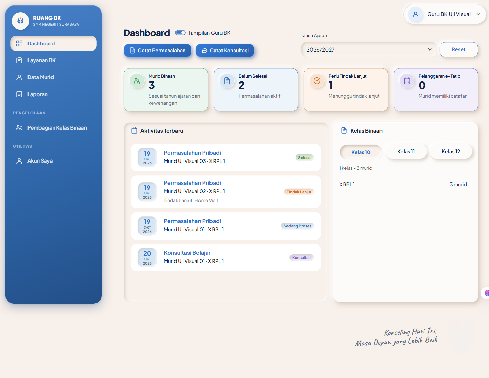
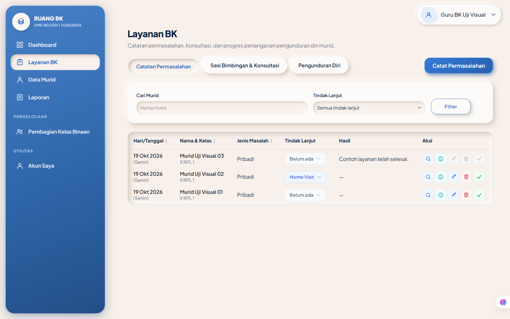
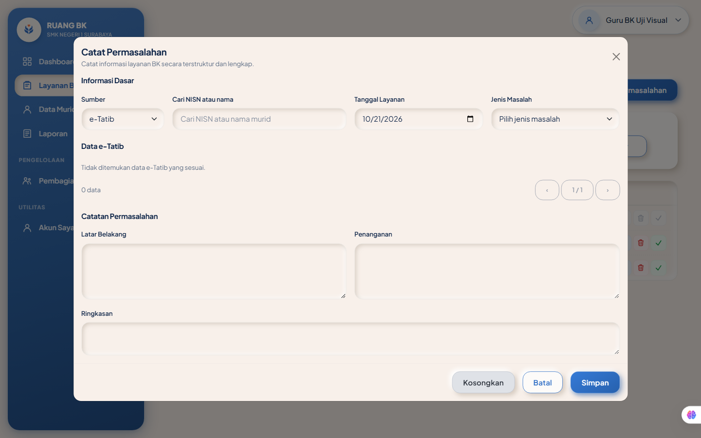
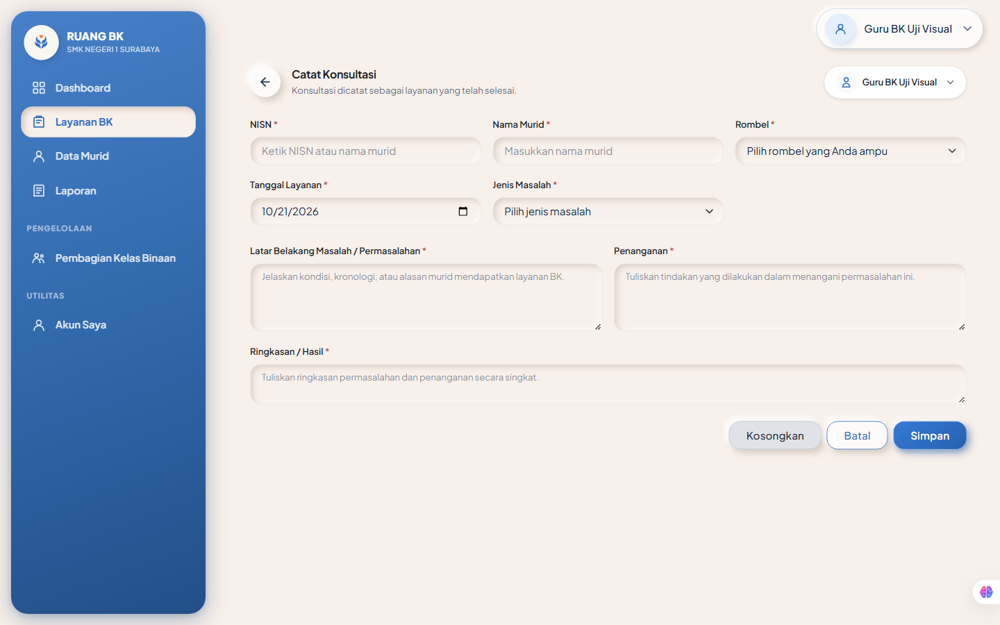
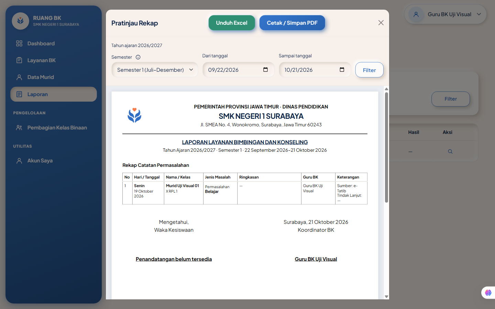
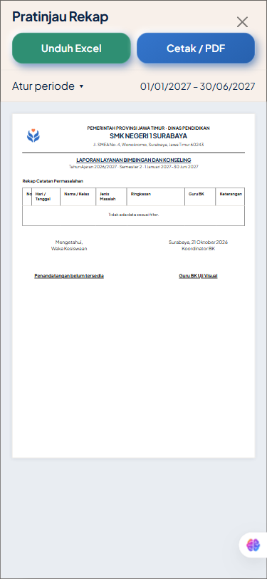
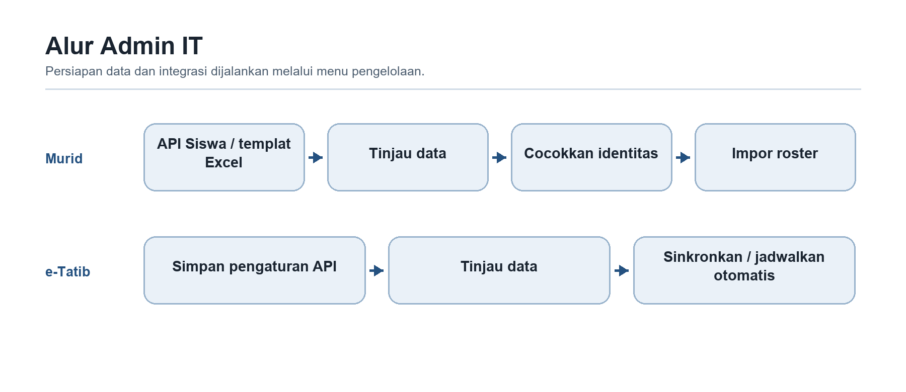
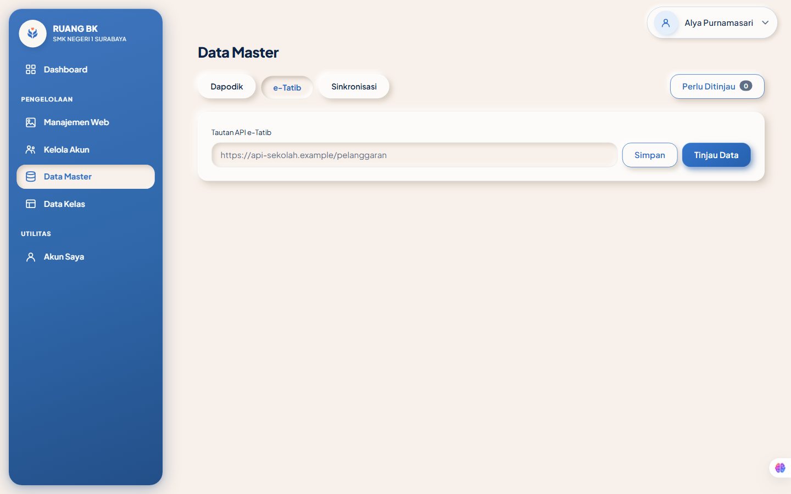
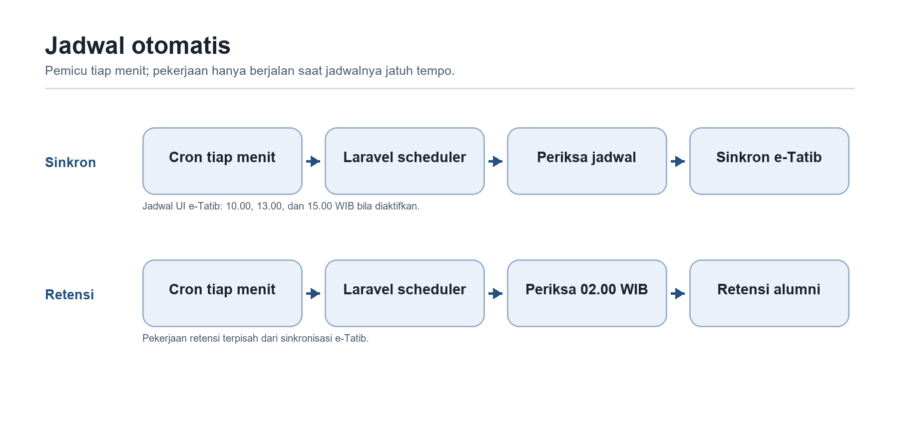

# Manualbook Ruang BK

Panduan penggunaan dan instalasi server sekolah

Edisi 22 Oktober 2026. Acuan aplikasi 688d658.

Buku ini membantu Admin IT menyiapkan aplikasi, Koordinator BK menata tahun ajaran dan kelas binaan, Guru BK mencatat layanan sampai rekap, serta Waka Kesiswaan memantau layanan dan mengelola prestasi. Bagian instalasi ditujukan kepada petugas pengelola server sekolah. Mulailah dari bab sesuai peran, lalu gunakan alur latihan untuk mencoba satu siklus lengkap.

Tangkapan layar memperlihatkan contoh pengujian lokal. Nama, angka, tanggal, pilihan tahun, logo, dan warna pada sekolah dapat berbeda. Gambar berjudul diagram menjelaskan alur, bukan tangkapan layar. Langkah tertulis menjelaskan kontrol pada versi acuan, termasuk perubahan yang tidak tampak pada contoh gambar.

# 1 Alur aplikasi dan persiapan pengguna

## 1.1 Empat peran pengguna

- **Admin IT** menyiapkan akun, katalog kelas, roster murid, koneksi dan sinkronisasi, logo, serta tema. Peran ini tidak memberi hak membaca isi layanan konseling.
- **Guru BK** mencatat dan menangani layanan untuk murid yang menjadi kewenangannya, membaca riwayat sesuai cakupan, serta membuat rekap.
- **Koordinator BK** membagi kelas binaan, mengaktifkan tahun ajaran, dan memantau layanan lintas guru. Hak memantau tidak otomatis memberi hak mengubah catatan guru lain.
- **Waka Kesiswaan** membaca ringkasan pemantauan dan laporan yang diizinkan serta mencatat, mengimpor, mengedit, dan menghapus prestasi.

Hanya Guru BK dan Koordinator BK yang dapat digabung dalam satu akun. Bila memegang kedua peran, pengguna tetap memerlukan kelas binaan aktif untuk pencatatan. Akun Admin IT dan Waka digunakan terpisah dari peran lain. Akun yang nonaktif tidak dapat dipakai untuk masuk.


**Baca gambar:** seluruh peran mempunyai Dashboard dan Akun Saya. Guru BK memakai Layanan BK, Data Murid, dan Laporan; Koordinator memperoleh tambahan Pembagian Kelas Binaan. Admin IT mempunyai empat menu pengelolaan teknis. Waka memakai Laporan dan Prestasi. Rincian tambahan dijelaskan pada bab masing-masing.

## 1.2 Alur awal sampai penggunaan harian


1. Petugas memasang aplikasi, database, HTTPS, dan scheduler sesuai Bab 6, lalu membuat Admin IT pertama.
2. Admin IT membuat akun untuk petugas sekolah, menata Data Kelas, menyiapkan tahun ajaran, dan memasukkan roster murid melalui API Siswa atau template berkas.
3. Koordinator BK menugaskan satu Guru BK aktif untuk setiap kelas yang digunakan, memeriksa kesiapan, lalu mengaktifkan tahun ajaran.
4. Admin IT meninjau sumber e-Tatib, menyelesaikan pencocokan yang sah, kemudian menyinkronkan manual atau mengaktifkan jadwal otomatis.
5. Guru BK mencatat permasalahan atau konsultasi, memperbarui penanganan, dan memeriksa riwayat murid. Sinkronisasi e-Tatib menyediakan referensi; pencatatan layanan BK tetap dilakukan petugas.
6. Waka memantau ringkasan layanan serta mengelola prestasi. Guru BK atau Koordinator membuat rekap sesuai cakupan dan periode.
7. Saat tahun berganti, siapkan roster dan penugasan tahun baru, lalu aktifkan melalui Koordinator. Histori lama tetap mengikuti cakupan dan ketentuan retensi.

## 1.3 Masuk pertama kali dan mengganti sandi

1. Buka alamat HTTPS aplikasi yang diserahkan sekolah dan halaman **Masuk ke Ruang BK**.
2. Masukkan email serta sandi yang diberikan Admin IT, lalu tekan **Masuk**. Gunakan akun pribadi yang sesuai penugasan.
3. Akun baru atau akun setelah reset diarahkan untuk mengganti sandi sementara. Isikan sandi saat ini, sandi baru, dan konfirmasinya. Sandi baru minimal delapan karakter, mengandung huruf dan angka, serta berbeda dari sandi saat ini. Simpan untuk menuju Dashboard.
4. Jika sandi sementara telah lewat masa berlaku bawaan 24 jam, minta Admin IT menerbitkan sandi sementara baru. Tidak ada akun umum atau sandi bawaan produksi yang dibagikan dalam buku ini.
5. Bila email/sandi salah, periksa ketikan dan status akun. Setelah beberapa percobaan gagal, tunggu pembatasan percobaan masuk berakhir sebelum mencoba lagi. Jangan membagikan sandi atau memasukkannya ke tangkapan layar.

## 1.4 Membaca daftar dan menyimpan formulir

Gunakan pencarian, pemilih tahun/kelas, dan tombol **Filter** pada halaman yang sedang dibuka. Pada sebagian halaman, tombol berubah menjadi **Reset** saat filter sudah diterapkan. Kolom bertanda panah dapat diurutkan. Nomor halaman hanya mengubah bagian daftar yang tampil; jumlah pada rekap mengikuti filter dokumen.

Ikon kaca pembesar membuka rincian yang diizinkan, pensil membuka edit, dan tempat sampah meminta konfirmasi penghapusan atau pengarsipan sesuai label tombol. Arahkan penunjuk ke ikon untuk membaca keterangannya. Pada ponsel, buka menu melalui tombol navigasi dan gulir tabel mendatar bila diperlukan.

Isian bertanda bintang wajib diisi. Jika pesan **belum tersimpan** muncul, perbaiki kolom yang disebut, lalu simpan kembali. Perubahan data oleh pengguna lain dapat membuat formulir lama ditolak; muat ulang dan bandingkan sebelum mengulang, agar pembaruan terbaru tidak tertimpa.

Beberapa formulir menyimpan draf pada browser perangkat. Draf belum menjadi catatan resmi sampai **Simpan** berhasil. Gunakan **Kosongkan** untuk membuang draf yang tidak dipakai dan **Keluar** saat selesai; proses keluar membersihkan draf pengguna pada browser tersebut. Hindari meninggalkan catatan konseling pada perangkat bersama.

## 1.5 Akun Saya dan keluar

1. Buka **Akun Saya** dari menu samping atau menu profil. Periksa nama, peran, email, status akun, login terakhir, dan konteks tahun ajaran.
2. Tekan **Ubah Sandi** untuk mengganti sandi pribadi. Gunakan ketentuan pada bagian 1.3 dan tekan **Simpan**. Sandi baru berlaku dan sesi lain pengguna diputus.
3. Untuk memperbaiki nama, email, atau penugasan peran, hubungi Admin IT; jangan memakai akun orang lain.
4. Tekan **Keluar** dari menu profil setelah selesai menggunakan aplikasi, terutama pada komputer bersama.

# 2 Panduan Guru BK

Setelah masuk, menu utama kedua peran adalah **Dashboard  >  Layanan BK  >  Data Murid  >  Laporan  >  Akun Saya**. Akun Koordinator BK juga memperoleh **Pembagian Kelas Binaan** pada bagian Pengelolaan. **Layanan BK** memiliki tab **Catatan Permasalahan**, **Sesi Bimbingan & Konsultasi**, dan **Pengunduran Diri**. Halaman **Daftar Prestasi** pada alamat `/achievements` dapat dibuka untuk membaca prestasi sesuai cakupan masing-masing, meskipun bukan menu samping bagi kedua peran ini.

Alur harian Guru BK: pastikan tahun ajaran aktif dan kelas binaan sudah ditugaskan  >  temukan murid di **Data Murid** atau langsung buka **Layanan BK**  >  catat permasalahan, konsultasi, atau penanganan pengunduran diri  >  perbarui catatan/tindak lanjut  >  periksa riwayat pada profil murid  >  buat rekap di **Laporan**. Koordinator menyiapkan penugasan dan aktivasi tahun ajaran, memantau layanan lintas guru, lalu memeriksa rekap sekolah.

Guru BK hanya dapat mencatat layanan untuk murid dalam kelas binaan aktifnya. Penugasan dan tahun ajaran aktif harus tersedia lebih dulu. Jika data master murid belum masuk, form permasalahan/konsultasi mengizinkan NISN dan nama sementara dengan rombel dari penugasan aktif; pencarian murid dan pencatatan tetap dibatasi cakupan Guru BK. Riwayat layanan yang sah dapat dibaca setelah pergantian kelas atau tahun, tetapi catatan dari tahun yang tidak aktif tidak dapat diubah atau diarsipkan. Koordinator dapat membaca layanan dan profil seluruh murid serta laporan gabungan, termasuk histori murid nonaktif/yang resmi keluar sebelum tanggal keluar. Hak baca ini tidak membuatnya dapat mengubah catatan guru lain. Untuk mencatat layanan, akun Koordinator harus juga memiliki peran Guru BK dan kelas binaan aktif; edit permasalahan tetap milik pembuat kasus, sedangkan edit konsultasi tetap milik pencatat yang masih berwenang. Catatan internal kasus hanya terbuka bagi Guru BK pemilik.

## 2.1 Dashboard



1. Buka **Dashboard** dan pilih **Tahun Ajaran**, lalu tekan **Filter**. Kartu ringkasan dan panel mengikuti tahun serta cakupan tampilan yang dipilih.
2. Guru BK membaca ringkasan layanan, aktivitas terbaru, dan **Kelas Binaan**. Pada panel kelas, pilih tab **Kelas 10**, **Kelas 11**, atau **Kelas 12**; **Lihat Semua** membuka sisa kelas pada tingkat tersebut. Aktivitas terbaru adalah informasi ringkas, bukan tautan untuk mengubah catatan.
3. Koordinator membaca indikator dan kesiapan penugasan untuk konteks sekolah. Bila satu akun mempunyai kedua peran, sakelar **Tampilan Guru BK** di sebelah judul menampilkan dashboard Guru BK saat menyala dan dashboard Koordinator saat padam. Tampilan Koordinator adalah bawaan. Sakelar mempertahankan tahun ajaran dan tidak mengubah hak pada menu lain.
4. Bila tombol cepat **Catat Permasalahan** atau **Catat Konsultasi** tersedia, gunakan untuk membuka form pencatatan yang sama dengan menu **Layanan BK**. Tombol hanya dapat dipakai ketika hak pencatatan dan prasyaratnya terpenuhi.

## 2.2 Catatan Permasalahan





**Mencari dan membaca.** Buka **Layanan BK  >  Catatan Permasalahan**. Isi **Cari Murid** atau pilih **Tindak Lanjut**, kemudian tekan **Filter**. Gunakan judul kolom untuk mengurutkan daftar. Klik label tindak lanjut pada baris untuk membaca riwayatnya. Ikon kaca pembesar membuka sumber, latar belakang, dan penanganan di bawah baris; tombol **Lihat selengkapnya** membuka detail layanan. Membuka baris saja tidak membuka detail. Koordinator dapat membaca catatan lintas guru, tetapi aksi ubah hanya muncul sesuai hak Guru BK pemilik.

**Mencatat.**

1. Tekan **Catat Permasalahan** dari tab ini atau Dashboard.
2. Pilih **Sumber**: e-Tatib, murid datang sendiri, temuan Guru BK, atau rujukan. Untuk rujukan, isi **Sumber Rujukan**. Untuk e-Tatib, cari NISN atau nama, pilih data pelanggaran yang sesuai, lalu periksa informasi yang ditampilkan; tombol **Ganti** mengganti pilihan. Jika rombel dari e-Tatib tidak cocok, pilih **Rombel Layanan** dari kelas binaan.
3. Untuk sumber selain e-Tatib, ketik nama atau NISN pada kolom **NISN** dan pilih saran murid. Jika belum ditemukan, isi NISN dan nama secara manual serta pilih rombel binaan. Periksa **Tanggal Layanan** dan **Jenis Masalah**.
4. Isi **Latar Belakang**, **Penanganan**, dan bila sudah ada **Ringkasan**. Tekan **Simpan**. Kasus baru berstatus **Sedang Proses** dan muncul pada daftar. **Kosongkan** menghapus isian; penutupan/pengosongan draft yang berubah meminta konfirmasi.

**Menindaklanjuti dan menyelesaikan.** Pada kasus milik sendiri yang masih aktif, klik label tindak lanjut lalu **Tambah Tindak Lanjut**. Pilih **Jenis Tindak Lanjut**, isi **Tanggal Tindak Lanjut**, dan **Simpan**. Satu jenis hanya boleh dipakai sekali pada kasus yang sama. Penambahan pertama menjadikan status **Tindak Lanjut**; riwayat tetap menyimpan tiap entri. Kasus juga boleh selesai tanpa tindak lanjut. Untuk menyelesaikan, klik **Edit**, isi dan simpan **Ringkasan** sebagai hasil, lalu klik ikon **Selesaikan Permasalahan** dan setujui konfirmasi. Kasus berstatus **Selesai** dan tetap ada dalam histori murid. Kasus selesai masih dapat diedit pemilik setelah konfirmasi, tetapi sumber dan identitas tidak dapat diganti.

**Mengoreksi atau mengarsipkan.** Ikon **Edit** mengubah tanggal layanan, jenis masalah, latar belakang, penanganan, dan ringkasan pada kasus milik sendiri yang memenuhi syarat. Ikon **Arsipkan** pada kasus yang belum selesai meminta konfirmasi dan mengeluarkannya dari daftar aktif; ini arsip aplikasi, bukan penghapusan permanen. Bila kasus sudah selesai, ikon arsip tidak aktif. Perubahan yang bertabrakan dengan edit terbaru ditolak; muat ulang data sebelum mengulang. Koordinator yang bukan pemilik tidak dapat memakai aksi tersebut.

## 2.3 Sesi Bimbingan dan Konsultasi



**Mencari dan membaca.** Buka tab **Sesi Bimbingan & Konsultasi**. Cari nama murid, pilih **Jenis Masalah**, lalu **Filter**; klik judul kolom untuk mengurutkan. Daftar menampilkan **Ringkasan / Hasil**. Ikon kaca pembesar menampilkan latar belakang dan penanganan di bawah baris, sedangkan tombol detail membuka catatan lengkap. Konsultasi berdiri sendiri: tidak mempunyai status kasus atau tindak lanjut kasus.

**Mencatat.**

1. Tekan **Catat Konsultasi** dari tab atau Dashboard.
2. Pada kolom **NISN**, ketik NISN atau nama, lalu pilih murid dari saran agar nama dan rombel terisi. Jika murid belum tersedia, isi NISN dan nama serta pilih rombel binaan secara manual.
3. Isi tanggal, **Jenis Masalah**, **Latar Belakang Masalah / Permasalahan**, **Penanganan**, dan **Ringkasan / Hasil**, lalu tekan **Simpan**. Form saat ini mewajibkan Ringkasan / Hasil ketika menyimpan. **Kosongkan** membersihkan form dan draft pada perangkat.

**Memperbarui atau mengarsipkan.** Pada catatan yang Anda buat dan masih berwenang di tahun ajaran aktif, gunakan ikon **Edit**, perbarui isi, lalu **Simpan Perubahan**. Ikon **Arsipkan** meminta konfirmasi. Catatan dari guru lain atau tahun ajaran lama dapat dibaca sesuai cakupan, tetapi tidak diedit atau diarsipkan. Bila ada perubahan lain sejak form dibuka, penyimpanan ditolak agar data terbaru tidak tertimpa.

## 2.4 Progres penanganan pengunduran diri

Tab ini mencatat **progres penanganan**, bukan keputusan resmi murid keluar. Gunakan **Cari Murid** dan filter **Progres** untuk menemukan catatan. Kolom progres menampilkan keadaan terbaru; klik labelnya untuk melihat **Riwayat Progres Penanganan**. Ikon kaca pembesar membuka **Catatan** awal di bawah baris.

1. Guru BK dengan kelas binaan aktif menekan **Catat Pengunduran Diri**, mencari nama atau NISN, dan memilih murid dari saran. Satu murid hanya mempunyai satu catatan awal. Isi **Tanggal pencatatan** dan **Catatan**, lalu **Simpan**. Progres awal adalah **Masih progres**; pencatatan ini tidak mengubah status aktif murid.
2. Untuk perkembangan berikutnya, buka label progres pada baris lalu tekan **Tambah Progres Penanganan**. Pilih **Progres** - **Masih progres**, **Berkas di BK**, atau **Berkas masuk TU** - dan **Tanggal** antara tanggal catatan awal dan hari ini, lalu **Simpan**. Histori mempertahankan tiap perkembangan; entri bertanggal lebih lama tidak mengganti progres terbaru.
3. Gunakan **Edit** untuk mengoreksi tanggal dan catatan awal, atau **Hapus** dengan konfirmasi bila catatan penanganan harus dihapus, selama Anda masih mempunyai kelas binaan yang sesuai. Koordinator tanpa hak Guru BK hanya membaca catatan lintas guru. Progres ini tidak menetapkan murid sebagai resmi keluar.

## 2.5 Data Murid dan riwayat prestasi

1. Buka **Data Murid**. Cari dengan nama atau NISN, pilih **Kelas**, lalu **Filter**. Daftar menampilkan jumlah permasalahan, poin pelanggaran, konsultasi, dan prestasi. Klik nama murid untuk membuka **Profil Murid**.
2. Profil menampilkan identitas, NISN, kelas/tahun ajaran, ringkasan layanan, poin e-Tatib, prestasi, dan histori kelas. Buka tab **Permasalahan**, **Data e-Tatib**, **Konsultasi**, atau **Prestasi** untuk membaca riwayat. Kaca pembesar pada riwayat layanan membuka narasi yang boleh dibaca. Data e-Tatib adalah referensi baca saja; catatan yang dibatalkan di sumber tidak dihitung sebagai poin aktif.
3. **Daftar Prestasi** pada alamat `/achievements` dapat dibuka untuk membaca prestasi. Gunakan pencarian dan filter **Tingkat Prestasi**. Guru BK melihat murid dalam cakupan profesional; Koordinator melihat seluruh murid. Prestasi juga muncul pada tab profil. Pencatatan, impor Excel, edit, dan hapus prestasi merupakan tugas Waka Kesiswaan, bukan Guru BK atau Koordinator BK.

## 2.6 Rekap dan dokumen layanan



1. Buka **Laporan**. Pilih **Tahun ajaran**, cari **Kelas**, dan pilih **Jenis layanan BK**: **Catatan Permasalahan**, **Catatan Konsultasi**, atau **Catatan Pengunduran Diri**. Tekan **Filter**. Daftar menampilkan satu jenis layanan dengan halaman data; ikon kaca pembesar membuka narasi yang diizinkan. Untuk mengganti pilihan, gunakan filter lagi atau **Reset**. Guru BK melihat cakupannya, Koordinator melihat gabungan sekolah. Edit dan arsip tetap dilakukan di **Layanan BK**.
2. Tekan **Buat rekap** untuk membuka **Pratinjau Rekap**. Rentang awal adalah hingga 30 hari terakhir yang berada pada satu semester tahun ajaran yang dipilih. Pada **Atur periode**, pilih **Semester 1 (Juli-Desember)** atau **Semester 2 (Januari-Juni)**, isi **Dari tanggal** dan **Sampai tanggal**, lalu tekan **Filter** di dalam modal. Rentang harus berurutan dan tetap dalam satu semester; tanggal dapat dipersempit. Pada ponsel, ketuk ringkasan tanggal untuk membuka pengaturan periode.
3. Setelah pratinjau terbaru selesai dimuat, tekan **Unduh Excel** untuk berkas rekap atau **Cetak / Simpan PDF** untuk dialog cetak browser dan pilih pencetak/PDF. Dokumen menggunakan seluruh data yang lolos filter dan periode, sedangkan daftar di halaman tetap berhalaman. Tombol unduh/cetak tidak aktif saat periode berubah, sedang dimuat, atau gagal. **Tutup** mengembalikan Anda ke daftar tanpa kehilangan posisi filter.
4. Bila pratinjau ditolak karena jumlah catatan melewati batas dokumen, persempit periode atau kelas, lalu tekan **Filter** lagi. Bila periode tidak tersedia atau melintasi semester, pilih rentang yang valid. Tombol **Coba lagi** dan **Buka di halaman baru** tersedia bila pratinjau gagal dimuat.




**Periode dan kapasitas dokumen.** Semester 1 adalah Juli sampai Desember dan Semester 2 Januari sampai Juni. Untuk tahun ajaran 2026/2027, Semester 1 berarti Juli-Desember 2026 dan Semester 2 Januari-Juni 2027. Rekap dibatasi satu semester dalam satu permintaan, dengan rentang tanggal yang dapat dipersempit. Batas bawaan dokumen adalah 2.500 catatan, sehingga semester yang sangat ramai perlu dibagi per kelas atau rentang yang lebih pendek; jangan menaikkan batas hanya untuk mengambil semua tahun sekaligus.

Periksa isi dan penandatangan sebelum mencetak. Rekap memakai penandatangan Koordinator BK dan Waka. Jika akun penandatangan aktif belum tersedia atau lebih dari satu, dokumen menampilkan penandatangan belum tersedia. Perbaiki penugasan akun yang sah melalui Admin IT. Excel tidak memuat blok tanda tangan seperti dokumen cetak.

Kop mengikuti pengaturan logo sekolah dan dinas pada Manajemen Web. Contoh gambar rekap dapat masih memperlihatkan kop bawaan. Pilihan orientasi kertas mengikuti jenis dokumen; periksa pratinjau dialog cetak agar tabel tidak terpotong. Simpan PDF dan Excel hanya pada lokasi sekolah yang diizinkan; berkas unduhan tidak ikut terhapus oleh retensi database.

# 3 Panduan Koordinator BK

Koordinator memakai alur membaca Dashboard, Layanan BK, Data Murid, dan Laporan pada Bab 2 dengan cakupan pemantauan sekolah. Penugasan dan aktivasi tahun ajaran merupakan fungsi tambahannya. Peran Koordinator saja tidak dapat mencatat layanan; jika juga bertugas sebagai Guru BK, gunakan akun rangkap dan kelas binaan yang ditugaskan.

## 3.1 Pembagian kelas dan pergantian tahun ajaran
1. Buka **Pembagian Kelas Binaan**. Pada bagian **Tahun Ajaran**, pilih tahun **Aktif** atau **Persiapan**, lalu **Tampilkan**. Admin IT menyiapkan tahun ajaran, kelas, dan daftar murid; Koordinator menetapkan guru binaan dan aktivasi operasional.
2. Gunakan **Cari kelas** dan **Status guru** (**Semua**, **Ditugaskan**, **Belum ditugaskan**) lalu **Filter** untuk memeriksa daftar guru. Pada baris Guru BK aktif, tekan ikon tambah kelas, cari **kelas yang belum ditugaskan**, pilih satu atau beberapa kelas, lalu **Tambah kelas**. Satu kelas berjalan ditangani satu Guru BK. Ikon salin pada baris guru menambahkan kelas binaan yang sama dari tahun ajaran sebelumnya bila tersedia.
3. Untuk melepas kelas, tekan ikon silang pada chip kelas dan baca konfirmasi **Batalkan penugasan?**, lalu **Ya, batalkan penugasan**. Pada tahun aktif, cakupan murid Guru BK segera berkurang; catatan lama tetap tersimpan. Lengkapi penugasan pengganti bila kelas itu masih aktif.
4. Pada tahun **Persiapan**, periksa pesan kesiapan. **Aktifkan Tahun Ajaran** tersedia setelah ada setidaknya satu murid, tidak ada penempatan aktif ganda, dan setiap rombel aktif mempunyai tepat satu Guru BK aktif. Bila tombol nonaktif, selesaikan masalah yang ditampilkan; peringatan **Perlu Konfirmasi** atau asal data tidak selalu menghalangi aktivasi. Aktivasi menjadikan tahun target satu-satunya tahun ajaran aktif sehingga layanan baru mengikuti penugasan baru.
5. Jika tahun sebelumnya masih memenuhi syarat dan belum ada kegiatan operasional setelah aktivasi, tombol **Batalkan aktivasi** dapat mengembalikan tahun sebelumnya. Buka modal, baca akibatnya, lalu konfirmasi hanya jika pembatalan memang diperlukan. Bila syaratnya tidak terpenuhi, pembatalan ditolak.

## 3.2 Pemeriksaan sebelum awal semester

1. Cocokkan jumlah kelas dan murid dengan hasil persiapan Admin IT. Murid yang tidak tampil belum tentu terhapus; periksa tahun ajaran, status, roster, dan kelas terlebih dahulu.
2. Periksa semua kelas yang dipakai telah mempunyai Guru BK aktif. Hindari melepas penugasan tanpa menyiapkan penggantinya karena cakupan pencatatan dapat langsung berubah.
3. Setelah aktivasi, minta setiap Guru BK memeriksa murid binaannya dan mencoba pencatatan pada lingkungan uji. Tahun ajaran lama adalah histori; jangan mengubah tanggal catatan untuk memindahkan layanan ke tahun baru.
4. Saat menilai rekap lintas guru, bedakan narasi yang hanya boleh dibaca profesional dengan Ringkasan / Hasil yang masuk proyeksi Waka. Pemantauan Koordinator tidak mengalihkan kepemilikan catatan.

**Proses keluar resmi.** Progres pengunduran diri tidak menetapkan kelulusan. Pada versi acuan, kontrol pencatatan dan finalisasi keluar resmi belum ditampilkan pada profil murid. Jangan mengedit database untuk menyiasatinya. Retensi hanya memproses keputusan lulus resmi yang sah, sesuai Bab 6.

# 4 Panduan Waka Kesiswaan

Waka mempunyai dua tugas berbeda: memantau ringkasan layanan BK dan mengelola prestasi. Menu utama adalah **Dashboard**, **Laporan**, **Prestasi**, dan **Akun Saya**. Peran Waka tidak memberi hak mencatat/mengubah konseling atau mengunduh rekap layanan secara massal.


## 4.1 Membaca Dashboard Waka

1. Buka **Dashboard Waka Kesiswaan**, pilih **Tahun Ajaran**, lalu gunakan **Filter** bila tombol masih meminta penerapan.
2. Baca **Murid Tercatat**, **Sedang Ditangani**, **Perlu Tindak Lanjut**, dan **Baru Bulan Ini**. Angka menghitung murid unik sesuai indikator, bukan jumlah seluruh sesi. Satu murid yang berulang kali mendapat layanan tidak otomatis dihitung sebagai banyak murid baru.
3. Baca **Grafik Catatan BK**. Setiap murid dihitung sekali pada tiap bulan yang memiliki layanan; grafik bukan akumulasi jumlah kejadian sepanjang waktu. Periksa **Murid per Tingkat** dan **Catatan Permasalahan Terbanyak** untuk sebaran serta maksimal tiga kelas dengan murid bermasalah terbanyak pada periode.
4. Pada **Murid Perlu Tindak Lanjut**, baca Murid/Kelas, Jenis Layanan, Guru BK, Ringkasan, dan Tindak Lanjut. Satu murid dapat memiliki lebih dari satu catatan yang masih memerlukan tindak lanjut.

**Hasil.** Waka memperoleh dasar koordinasi dengan Guru BK tanpa membuka latar belakang dan penanganan rinci konseling. Jika angka tampak berbeda dari daftar peristiwa e-Tatib, periksa terlebih dahulu definisi murid unik, jenis layanan, tahun, dan tanggal yang sedang dipilih.

## 4.2 Membaca Laporan Layanan BK

1. Buka **Laporan**. Pilih tahun ajaran, kelas, dan **Jenis layanan BK**: Catatan Permasalahan, Catatan Konsultasi, atau Catatan Pengunduran Diri, lalu **Filter**.
2. Baca baris yang tampil dan gunakan halaman berikutnya jika data banyak. Untuk permasalahan/konsultasi, gunakan kolom identitas layanan, Ringkasan / Hasil, Guru BK, serta Keterangan. Pengunduran diri menampilkan progres berkas terbaru dalam keterangan.
3. Jika informasi memerlukan pembahasan, hubungi Guru BK yang ditampilkan melalui prosedur komunikasi sekolah. Koordinasi tersebut tidak dicatat sebagai tombol persetujuan Waka di aplikasi.

**Batas akses.** Tombol **Buat rekap**, pratinjau kertas, unduh Excel, cetak/PDF, edit layanan, dan narasi konseling rinci tidak tersedia untuk Waka. Tidak munculnya tombol tersebut adalah perilaku sesuai peran. Jangan menggunakan akun Guru BK untuk melewati pembatasan.

## 4.3 Halaman tambahan pemantauan

Dua halaman baca tambahan masih tersedia melalui alamat langsung meskipun belum mempunyai pintasan pada menu samping versi acuan. Tambahkan bagian alamat berikut sesudah domain aplikasi yang dipakai sekolah.

1. Buka `/waka/students-with-cases` untuk **Murid dengan Permasalahan**. Pilih **Periode** bulanan dan **Status**, lalu **Filter**. Urutkan kolom jika diperlukan; **Lihat detail** membuka proyeksi yang diizinkan, bukan seluruh narasi konseling. Gunakan **Reset filter** bila tidak ada data karena penyaringan terlalu sempit.
2. Buka `/waka/student-departures` untuk **Proses Keluar Murid**. Baca jenis, status, tanggal dilaporkan/efektif, rekomendasi, keputusan, pencatat, dan pemutus yang sudah tersedia. Halaman ini hanya membaca keputusan yang tercatat; tidak dapat membuat atau menetapkan murid keluar.

## 4.4 Mencatat prestasi secara manual

**Prasyarat.** Murid resmi masih aktif dan tersedia; jenis serta tingkat prestasi yang dipilih aktif. Tanggal prestasi tidak boleh berada di masa depan.

1. Buka **Prestasi**, lalu tekan **Catat Prestasi**.
2. Ketik nama atau NISN dan pilih murid dari saran. Periksa identitas serta rombel yang tampil agar tidak salah orang.
3. Isi **Kegiatan/Nama Lomba**, **Jenis**, **Tingkat**, **Tanggal**, **Penyelenggara**, dan **Hasil/Peringkat**. Sebagai latihan pada lingkungan uji, gunakan kegiatan fiktif seperti Lomba Desain Poster Internal dan hasil Juara 2.
4. Tekan **Simpan**. Setelah berhasil, cari kembali murid/kegiatan pada daftar dan periksa data yang baru dicatat. **Batal** menutup form; **Kosongkan** membuang isian/draf yang tidak dipakai.

**Hasil dan pemulihan.** Prestasi tampil pada daftar dan riwayat profil murid sesuai hak baca. Jika murid tidak ditemukan, periksa roster/status bersama Admin IT sebelum mencatat; jangan memakai identitas murid lain. Jika isian ditolak, perbaiki kolom bertanda kesalahan lalu simpan lagi. Pada versi ini prestasi tidak meminta unggahan bukti atau tahapan verifikasi.

## 4.5 Mengimpor prestasi menggunakan template Excel

1. Pada **Prestasi**, tekan **Impor Excel**, lalu **Unduh template Excel prestasi**.
2. Isi template tanpa mengganti nama dan urutan header: `nisn`, `jenis`, `tingkat`, `kegiatan`, `penyelenggara`, `tanggal`, `hasil`. Pertahankan NISN sebagai teks, termasuk nol awal. Gunakan kode jenis/tingkat aktif dari **Format dan kode isian Excel**, bukan menebak labelnya.
3. Isi tanggal `YYYY-MM-DD` atau tanggal Excel yang sah, tidak di masa depan. Simpan sebagai `.xlsx`, maksimal 1.000 baris data dan 2 MB. Hindari rumus dan pengubahan struktur template.
4. Pada modal impor, pilih **Berkas Excel**, lalu tekan **Impor Prestasi**. Aplikasi memeriksa seluruh baris sebelum menyimpan dalam satu transaksi.
5. Jika gagal, modal menampilkan kesalahan. Perbaiki baris terkait pada berkas, pilih kembali berkas yang telah diperbaiki, lalu ulangi. Saat validasi gagal, data impor tidak tersimpan sebagian.
6. Setelah berhasil, periksa jumlah dan contoh prestasi pada daftar. Jangan mengunggah ulang berkas yang sama hanya untuk mengecek hasil; periksa dahulu apakah data sudah ada.

## 4.6 Mencari mengedit dan menghapus prestasi

1. Pada **Daftar Prestasi**, cari murid/NISN/kegiatan/penyelenggara atau pilih **Tingkat Prestasi**, lalu **Filter**. Klik kolom Murid, Kegiatan, atau Tanggal untuk mengurutkan dan gunakan pagination jika perlu.
2. Tekan ikon **Edit prestasi**, koreksi kegiatan, jenis, tingkat, tanggal, penyelenggara, atau hasil, lalu **Simpan**. Murid pada catatan yang sudah ada tidak dapat diganti melalui edit; pastikan identitas benar sejak pencatatan.
3. Untuk catatan yang memang harus dihapus, tekan **Hapus prestasi**, periksa kegiatan dan murid pada konfirmasi, lalu **Ya, hapus**. Catatan dikeluarkan dari daftar aktif melalui arsip aplikasi dan dicatat dalam jejak perubahan. Tidak ada tombol pemulihan arsip di halaman ini.
4. Jika sistem menolak karena versi data berubah, muat ulang dan bandingkan pembaruan terbaru sebelum mengulang. Guru BK/Koordinator hanya membaca prestasi sesuai cakupannya; hak kelola tetap pada Waka.

## 4.7 Akun pribadi

Gunakan **Akun Saya**, **Ubah Sandi**, dan **Keluar** seperti bagian 1.5. Waka tidak mengelola akun pengguna lain atau konfigurasi integrasi.

# 5 Panduan Admin IT

Admin IT mengelola akun, data kelas, daftar murid, sinkronisasi sumber, dan tampilan web. Masuk dengan akun aktif dan selesaikan penggantian sandi sementara jika diminta. Menu utama yang digunakan ialah **Dashboard**, **Manajemen Web**, **Kelola Akun**, **Data Master**, **Data Kelas**, dan **Akun Saya**. Akses teknis ini tidak membuka isi kasus, konsultasi, catatan layanan BK, atau keputusan keluar murid. Aktivasi tahun ajaran dan penugasan Guru BK ditangani Koordinator BK.

> **Urutan awal tahun ajaran:** rapikan rombel di **Data Kelas**  >  buat tahun ajaran persiapan pada **Data Master > Dapodik**  >  tinjau dan impor daftar murid  >  minta Koordinator BK melengkapi penugasan dan mengaktifkan tahun ajaran. Data persiapan tetap bertanda belum terverifikasi sampai sumber resmi diterapkan.

## 5.1 Membaca Dashboard Admin IT

**Tujuan dan prasyarat** Memantau kesiapan akun dan integrasi setelah masuk sebagai Admin IT.

1. Buka **Dashboard**. Pilih **Tahun Ajaran** bila ingin melihat konteks periode tertentu.
2. Baca empat indikator: **Akun Aktif**, **Akun Nonaktif**, **Konflik Sinkronisasi**, dan **Integrasi Bermasalah**. Klik jumlah konflik untuk membuka **Data Master > Sinkronisasi**.
3. Periksa **Status sinkronisasi terbaru** (sumber, hasil, jumlah diproses dan konflik), lalu **Status Integrasi** untuk Dapodik, e-Tatib, dan API Siswa. Status ini ringkasan konfigurasi dan hasil terakhir, bukan uji koneksi langsung.
4. Gunakan aksi cepat **Tambah Akun** jika perlu. Form tambah di **Kelola Akun** akan terbuka.

**Hasil.** Admin mengetahui sumber yang perlu ditinjau tanpa melihat isi layanan BK. **Jika ada peringatan/gagal:** buka tab **Sinkronisasi** untuk melihat masalah dan riwayat; untuk e-Tatib otomatis yang gagal, periksa tab **e-Tatib** sebelum menjalankan ulang.

## 5.2 Mengelola akun dan peran

**Tujuan dan prasyarat** Membuat akun sesuai penugasan resmi, memperbarui identitas/peran, mengaktifkan atau menonaktifkan akses, serta menerbitkan sandi sementara. Buka **Kelola Akun** sebagai Admin IT.

**Cari dan periksa akun**

1. Isi **Cari nama atau email** dan/atau pilih **Peran**, lalu klik **Filter**. Judul **Nama** dan **Status** dapat dipakai untuk mengurutkan.
2. Klik ikon **Lihat Informasi** pada baris akun untuk melihat email, login terakhir, dan status sandi.

**Buat akun**

1. Klik **Tambah Akun**, isi **Nama** dan **Email**, lalu pilih minimal satu peran.
2. Gunakan salah satu kombinasi yang didukung: Admin IT saja, Waka Kesiswaan saja, Guru BK saja, Koordinator BK saja, atau Guru BK bersama Koordinator BK. Klik **Buat akun**.
3. Pada informasi akun yang terbuka, **Salin** sandi sementara dan sampaikan secara aman kepada pemilik akun sesuai prosedur sekolah. Sandi itu hanya terlihat saat ini; menutup informasi atau meninggalkan halaman menghapusnya dari tampilan. Pemilik wajib menggantinya setelah masuk; sandi sementara berlaku 24 jam.

**Edit identitas, status, dan peran**

1. Klik ikon **Edit Akun** pada baris target. Ubah nama, email, atau **Status** menjadi **Aktif/Nonaktif**, lalu simpan. Akun nonaktif tidak dapat masuk.
2. Untuk peran, klik chip nama peran atau ikon **Tambah Peran**, pilih kombinasi yang diizinkan, lalu **Simpan peran**. Admin IT tidak dapat mengganti peran sendiri atau menonaktifkan akunnya sendiri.

**Reset sandi akun lain**

1. Klik ikon **Reset Sandi** pada baris akun tujuan, lalu konfirmasi.
2. Salin sandi sementara baru dari informasi akun yang otomatis terbuka. Sandi lama tidak berlaku lagi dan sesi lama diputus. Bila informasi ditutup sebelum disalin, lakukan reset lagi untuk menerbitkan sandi baru.

**Hasil dan pemulihan.** Perubahan akun tampil pada daftar; akun baru/reset harus mengganti sandi saat login. Jika email sudah dipakai, gunakan alamat yang benar dan unik. Jika pilihan peran ditolak, periksa kombinasi di atas. Jika sandi sementara kedaluwarsa, reset akun kembali. Jika tombol untuk akun sendiri tidak tersedia, gunakan **Akun Saya** untuk mengganti sandi pribadi.

## 5.3 Menyiapkan dan memperbarui Data Kelas

**Tujuan dan prasyarat** Menjaga katalog rombel sekolah agar rombel aktif tersedia otomatis pada tahun ajaran baru. Buka **Data Kelas**. Jumlah murid yang terlihat berasal dari tahun ajaran aktif.

1. Pada halaman jurusan, isi **Nama rombel** sesuai daftar sekolah, misalnya pola tingkat-jurusan-nomor, lalu klik **Tambah Rombel**. Di dalam halaman satu jurusan, tombol **Tambah Rombel** membuka form yang sama.
2. Klik **Lihat Rombel** pada jurusan untuk melihat rombel dan statusnya.
3. Klik nama rombel untuk membuka **Edit Rombel**. Ubah **Nama Rombel** atau **Status** Aktif/Nonaktif, lalu **Simpan**. Nama pada tahun ajaran yang sudah selesai tetap tersimpan.

**Hasil.** Rombel aktif tersedia pada tahun ajaran berjalan/persiapan dan otomatis pada tahun yang dibuat berikutnya. **Jika gagal:** nama duplikat harus diperbaiki atau rombel lama diaktifkan kembali; rombel yang masih memiliki murid atau penugasan Guru BK tidak dapat dinonaktifkan sebelum penempatannya diselesaikan. Koordinasikan koreksi data sumber resmi jika perbedaan berasal dari Dapodik.

## 5.4 Membuat atau membatalkan tahun ajaran persiapan

**Tujuan dan prasyarat** Menyiapkan roster ketika data resmi Dapodik belum tersedia. Pastikan nama tahun ajaran sesuai sumber sekolah, dan rombel aktif telah ditata di **Data Kelas**.

1. Buka **Data Master > Dapodik**. Pada **Buat Tahun Ajaran**, masukkan nama tahun ajaran, lalu klik **Buat Tahun Ajaran**. Form tidak meminta tanggal periode atau nomor SK.
2. Setelah pesan berhasil, lanjutkan ke **Tautan API Siswa** atau bagian **Impor CSV atau Excel jika API belum tersedia** pada tab yang sama.
3. Jika persiapan keliru dan belum pernah diaktifkan, gunakan aksi pembatalan pada daftar **Tahun Ajaran**, baca konfirmasi, lalu klik **Ya, batalkan persiapan**.

**Hasil.** Tahun persiapan dibuat belum aktif; rombel aktif sudah tersedia otomatis. Pembatalan menghapus persiapan yang memenuhi syarat, termasuk penempatan/penugasan khusus tahun itu, sehingga periksa target sebelum menyetujui. **Jika pembatalan ditolak:** tahun yang pernah aktif atau mempunyai layanan/data terverifikasi tidak dapat dibatalkan melalui aksi ini; koreksi harus ditangani sesuai sumber resmi dan Koordinator BK. **Jika impor belum bisa dipilih:** buat dahulu tahun persiapan yang sesuai; tahun dalam berkas/hasil API harus cocok tepat dan belum selesai.



## 5.5 Menyimpan, memakai, mengubah, atau menampilkan tautan API

**Tujuan dan prasyarat** Mengelola tautan HTTPS **API Siswa** dan **API e-Tatib** melalui kolom masing-masing pada tab **Dapodik** atau **e-Tatib**. Gunakan hanya alamat sumber resmi sekolah yang sama. Admin memasukkan kata sandi akun saat menyimpan, mengubah, atau menampilkan tautan.

1. Jika belum ada tautan tersimpan, isi kolom **Tautan API Siswa/e-Tatib** dan klik **Simpan**. Modal konfirmasi meminta tautan dan **Kata sandi saat ini**; klik **Simpan tautan** setelah memeriksanya.
2. Untuk pemakaian rutin, biarkan **Gunakan API tersimpan** dicentang dan klik **Tinjau Data**. Kolom menampilkan penanda tersembunyi, bukan alamat aslinya.
3. Untuk sekali pakai, lepas centang **Gunakan API tersimpan**, isi tautan HTTPS pada kolom yang sama, lalu **Tinjau Data**. Meninjau alamat sementara tidak mengganti tautan tersimpan.
4. Klik **Ubah** untuk mengganti tautan tersimpan; isi alamat baru dan kata sandi saat ini, lalu simpan. Klik **Tampilkan** dan masukkan kata sandi saat ini hanya jika perlu melihat alamat tersimpan; gunakan **Sembunyikan** atau tutup modal setelah selesai.

**Hasil dan pemulihan.** Tautan tersimpan dienkripsi dan ditampilkan tersamar. Penggantian tautan e-Tatib menghentikan otomatisasi sampai pratinjau dan aktivasi ulang berhasil. Jika alamat, koneksi, identitas sumber, atau kata sandi ditolak, periksa alamat HTTPS/sumber sekolah dan kata sandi; gunakan pesan pada modal tanpa menyalin alamat rahasia ke laporan masalah. Bila sumber tidak dapat diakses, minta pengelola sistem sumber memeriksa layanan/jaringan sekolah.



## 5.6 Meninjau dan mengimpor daftar murid dari API Siswa

**Tujuan dan prasyarat** Mengisi daftar minimum murid pada satu atau beberapa tahun ajaran persiapan, termasuk tahun sementara yang sudah aktif. Tahun yang disebut respons API harus sudah dibuat dan sesuai persis; setiap baris memuat `nisn`, `nama`, `rombel`, dan `tahun_pelajaran`.

1. Buka **Data Master > Dapodik**. Gunakan API tersimpan atau masukkan tautan sementara sesuai bagian 5, lalu klik **Tinjau Data**.
2. Baca **Pratinjau API Siswa**: jumlah baris/murid, murid baru/cocok, nama berbeda, kesiapan tiap tahun, dan data konflik. Nama berbeda tidak mengganti nama master secara otomatis.
3. Bila respons memuat NISN ganda pada tahun yang sama, pilih **satu** baris untuk setiap kelompok duplikat. Periksa juga konflik lain, terutama rombel yang berbeda pada tahun yang sama. Tombol **Impor Data** baru tersedia setelah semua pilihan sah dan tidak ada konflik pemblokir.
4. Klik **Impor Data**. Aplikasi mengambil API lagi dan memastikan data sama dengan pratinjau. Setelah berhasil, baca jumlah baris, murid baru/cocok, dan rombel baru pada pesan hasil. Minta Koordinator BK menugaskan Guru BK pada rombel baru sebelum aktivasi tahun ajaran.

**Hasil.** Murid dan penempatan yang diimpor tersedia tanpa menggandakan NISN/riwayat yang sudah ada; baris lain tidak otomatis dinonaktifkan. **Jika tertahan:** perbaiki tahun/rombel/identitas di sumber, lalu tinjau ulang. Jika respons API berubah sejak pratinjau, lakukan **Tinjau Data** lagi sebelum impor. Jika tautan gagal diambil, periksa koneksi dan alamat HTTPS resmi. Jangan menebak pilihan identitas dari kemiripan nama saja.

## 5.7 Mengunduh template dan mengimpor CSV/Excel

**Tujuan dan prasyarat** Jalur cadangan saat API Siswa belum tersedia. Buat dulu tahun ajaran persiapan yang akan diisi; satu berkas boleh memuat beberapa tahun yang sudah dibuat.

1. Di **Data Master > Dapodik**, buka **Impor CSV atau Excel jika API belum tersedia**, lalu klik **Unduh template impor**. Sistem mengunduh berkas nyata `template-daftar-murid.xlsx` dengan header `nisn,nama,rombel,tahun_pelajaran`, petunjuk, dan kolom NISN berformat teks.
2. Isi satu baris per murid menggunakan daftar sekolah. Pertahankan nol awal NISN, tulis tahun ajaran persis seperti yang dibuat di SIBK, dan gunakan rombel yang benar. Untuk CSV, simpan UTF-8 dengan empat kolom berurutan tersebut. Batas berkas 2 MiB dan 5.000 baris data; Excel harus `.xlsx` satu sheet tanpa rumus.
3. Klik **Pilih berkas CSV atau Excel**, pilih berkas, lalu **Tinjau / Impor Berkas**. Untuk Excel, baca modal **Pratinjau Excel Daftar Murid** dan klik **Impor Data** hanya jika siap. Untuk CSV, ikuti hasil/validasi yang ditampilkan setelah pengiriman.
4. Periksa pesan jumlah baris, murid baru/cocok, dan rombel baru. Teruskan rombel baru ke Koordinator BK untuk penugasan.

**Hasil dan pemulihan.** Data sah masuk ke roster tanpa mengganti identitas/riwayat murid yang telah cocok. Jika berkas ditolak, periksa ukuran, ekstensi, header, tahun ajaran, NISN sebagai teks, dan konflik rombel. Jika berkas berubah sesudah pratinjau Excel, tinjau ulang berkas sebelum menekan impor. Berkas mentah tidak disimpan oleh aplikasi.

## 5.8 Meninjau e-Tatib dan menjalankan sinkronisasi manual

**Tujuan dan prasyarat** Mengambil catatan e-Tatib ke salinan baca lokal. Pakai tautan HTTPS resmi e-Tatib, dan pastikan murid master tersedia agar identitas dapat dicocokkan.

1. Buka **Data Master > e-Tatib**, pilih API tersimpan atau isi tautan sementara, lalu **Tinjau Data**.
2. Baca jumlah catatan, peringatan identitas yang belum cocok, data lama yang tidak lagi dikirim, dan kejadian tanpa tanggal bila ada. Untuk NISN/nama yang berbeda, bandingkan identitas e-Tatib dengan murid master. Pilih kandidat yang benar hanya jika yakin; pilihan awal **Lewati dulu, belum tertaut** aman untuk konflik yang belum selesai. Bantuan **Pilih berdasarkan NISN/nama** hanya mengisi kandidat tunggal untuk diperiksa kembali.
3. Jika pratinjau menunjukkan kelompok baris identik, periksa sumber sebelum mencentang **anggap sebagai satu kejadian** pada setiap kelompok. Tanpa persetujuan kelompok baru, sinkronisasi tertahan.
4. Klik **Sinkronkan Data** untuk sekali jalan. Baca pesan berhasil, peringatan, atau gagal setelah kembali ke halaman. Bila otomatisasi sudah aktif, tombol **Sinkronkan Sekarang** juga menjalankan pembaruan manual memakai tautan tersimpan.

**Hasil.** Catatan e-Tatib tersalin untuk kebutuhan Guru BK sesuai haknya; SIBK tidak menulis balik ke e-Tatib. Konflik yang belum dipetakan tetap perlu ditinjau. Catatan lama yang tidak dikirim lagi tetap tersimpan, sehingga jangan menganggapnya terhapus. **Jika gagal:** periksa pesan pratinjau, kesiapan Data Master, kelengkapan respons sumber, dan kelompok duplikat. Lakukan pratinjau lagi bila data sumber berubah; jangan mengulang konfirmasi lama tanpa memeriksa sumber.

## 5.9 Menyalakan, mengatur, dan menghentikan pembaruan otomatis e-Tatib

**Tujuan dan prasyarat** Menjadwalkan sinkronisasi e-Tatib setelah tautan resmi tersimpan dan pratinjau dinyatakan layak. Scheduler server harus terpasang dan berjalan agar jadwal dieksekusi.

1. Pada **Data Master > e-Tatib**, klik **Tinjau Data**, selesaikan pilihan identitas/duplikasi yang diperlukan, lalu klik **Aktifkan Otomatis**. Masukkan **Kata sandi saat ini** pada modal dan konfirmasi. Aplikasi menyinkronkan lebih dulu, lalu mengaktifkan otomatisasi jika berhasil.
2. Di **Jadwal Pembaruan e-Tatib**, pilih hari dan jam WIB. Bawaan adalah **setiap hari pukul 10.00, 13.00, dan 15.00 WIB**. Gunakan **Tambah jam** atau **Hapus**, isi kata sandi saat ini, lalu **Simpan jadwal**. Minimal satu hari dan satu jam; maksimal 24 jam berbeda per hari. Menyimpan jadwal saja tidak mengaktifkan koneksi yang nonaktif.
3. Untuk menghentikannya, pada **Nonaktifkan Pembaruan Otomatis**, isi kata sandi saat ini lalu klik **Nonaktifkan** dan konfirmasi. Tautan tersimpan tetap dapat dipakai untuk pratinjau atau sinkronisasi manual.

**Hasil dan pemulihan.** Banner menampilkan bahwa otomatisasi aktif dan hasil terakhir. Jadwal berikutnya memakai pengaturan baru; jadwal yang terlewat tidak dikejar. Jika pembaruan tidak berjalan, periksa status terakhir/riwayat sinkronisasi dan minta pengelola server memeriksa scheduler. Jika kata sandi atau pilihan hari/jam ditolak, koreksi input lalu simpan lagi. Penggantian tautan e-Tatib mewajibkan pratinjau dan aktivasi ulang.



## 5.10 Menangani identitas e-Tatib dan keputusan duplikasi

**Tujuan dan prasyarat** Menyelesaikan konflik NISN/nama berdasarkan bukti sumber; gunakan **Perlu Ditinjau** dari Data Master.

1. Pada **Konflik e-Tatib > Belum Cocok**, cari nama/NISN dan baca **Identitas Sumber**, **Rombel Sumber**, alasan, serta jumlah pelanggaran.
2. Opsional: klik **Berdasarkan NISN** atau **Berdasarkan Nama** untuk pratinjau pencocokan otomatis. Periksa pasangan sumber-master yang ditampilkan, centang konfirmasi, lalu **Terapkan Pencocokan** hanya untuk kandidat tunggal yang benar. Kandidat ganda/tidak ada tetap ditangani manual.
3. Untuk satu konflik, klik ikon **Cocokkan**, cari murid master, pilih kandidat setelah membandingkan NISN/nama/kelas, centang konfirmasi, lalu simpan. Pilihan lokal boleh menghubungkan NISN sumber yang berbeda tanpa mengubah identitas master.
4. Di tab **Pencocokan Manual**, gunakan **Ubah Pencocokan** jika target salah, atau **Batalkan Pencocokan** bila hubungan tidak lagi sah. Pembatalan mengembalikan aturan pencocokan otomatis. Perubahan dapat ditolak jika record terkait sudah tertaut ke kasus BK.
5. Untuk baris e-Tatib identik, tinjau **Keputusan Duplikasi** pada tab **e-Tatib**. Klik **Batalkan Keputusan** dan konfirmasi jika persetujuan sebelumnya keliru. Sinkronisasi berikutnya akan meminta peninjauan lagi; riwayat yang sudah tersimpan tidak dihapus.

**Hasil dan pemulihan.** Keputusan pencocokan berlaku lokal dan tercatat; data sumber tidak diubah. Jika kandidat tidak tunggal atau bukti kurang, biarkan konflik belum tertaut dan koordinasikan koreksi dengan pengelola sumber. Jika perubahan ditolak karena hubungan ke kasus BK, jangan memaksa target baru; ikuti penanganan data resmi sekolah.

## 5.11 Memeriksa masalah dan riwayat sinkronisasi

**Tujuan dan prasyarat** Menindaklanjuti masalah dari Dapodik/e-Tatib tanpa mengubah data sumber secara langsung. Buka **Data Master > Sinkronisasi**.

1. Pada **Masalah Sinkronisasi**, baca sumber, data, alasan, dan status pemeriksaan. Klik ikon **Tinjau** untuk membuka rincian tepat di bawah baris.
2. Untuk beda kelas e-Tatib, bandingkan kelas sumber dengan penempatan sekolah pada tanggal kejadian. Pilih kelas sekolah tertentu atau kelas e-Tatib yang benar **hanya untuk kejadian itu**, lalu **Simpan tindakan**. Keputusan tidak mengubah kelas murid di master.
3. Jika bukti belum cukup atau masalah lain memerlukan perbaikan sumber, pilih **Belum dapat menentukan; perlu koreksi data**, tulis **Catatan singkat**, lalu simpan. Masalah tetap terbuka sampai sumber diperbaiki/ditinjau lagi. Untuk konflik identitas, gunakan tautan **Cocokkan identitas murid**.
4. Buka panel **Riwayat Keputusan Kelas** atau **Riwayat Sinkronisasi** bila perlu memeriksa keputusan dan hasil proses sebelumnya. Kedua panel awalnya tertutup dan menampilkan data saat dibuka; gunakan halaman berikutnya jika daftar panjang.

**Hasil dan pemulihan.** Pilihan kelas yang sah menyelesaikan masalah terkait; keputusan koreksi sumber hanya mencatat tindak lanjut. Bila pembanding tidak tersedia, jangan memilih kelas dengan perkiraan; selesaikan data sumber lebih dulu. Jika kondisi sumber berubah pada sinkronisasi berikutnya, masalah baru dapat muncul untuk diperiksa kembali.

## 5.12 Status konektor Dapodik langsung

**Tujuan dan prasyarat** Memeriksa snapshot resmi sebelum diterapkan. Saat ini panel koneksi Dapodik langsung tidak tampil karena adaptor provider berstatus belum tersedia; pekerjaan harian pada tab Dapodik menggunakan **API Siswa** atau berkas seperti bagian 6-7. Bagian ini berlaku hanya bila integrasi Dapodik resmi sudah diaktifkan oleh sekolah dan pratinjau dihasilkan.

1. Buka tautan **Tinjau data Dapodik sebelum diterapkan** pada **Tinjauan Lainnya** jika tersedia.
2. Pada **Tinjau Data Dapodik**, periksa masa berlaku, status **Data lengkap/Data sebagian**, rencana penonaktifan untuk snapshot lengkap, dan setiap baris **Cocok/Baru/Berubah/Perlu dipetakan/Konflik**.
3. Untuk tahun ajaran atau rombel **Perlu dipetakan**, pilih data sementara lalu **Cocokkan**, atau **Buat data resmi baru** berdasarkan bukti sumber. Konflik lain harus diperbaiki di sumber sebelum penerapan.
4. Setelah semua keputusan benar dan tombol tersedia, klik **Terapkan Data Dapodik**. Data persiapan baru dianggap terverifikasi setelah penerapan berhasil.

**Hasil dan pemulihan.** Penerapan mempertahankan ID internal murid; snapshot penuh dapat menonaktifkan data Dapodik sesuai rencana yang ditampilkan, sedangkan snapshot sebagian tidak menonaktifkan data lain. Jika pratinjau kedaluwarsa, berubah, atau konflik belum selesai, jalankan pratinjau baru melalui konektor resmi yang tersedia; jangan menerapkan keputusan lama.

## 5.13 Mengatur Manajemen Web

**Tujuan dan prasyarat** Memperbarui logo sekolah, logo dinas pada kop laporan, dan tema warna untuk seluruh pengguna. Buka **Manajemen Web** sebagai Admin IT dan siapkan berkas gambar resmi.

1. Di **Logo web**, klik **Unggah logo baru**, pilih PNG/JPEG maksimal 2 MB dan 2048 x 2048 piksel, lalu **Simpan**. Logo web dipakai pada tampilan aplikasi, ikon tab, dan sebagai logo sekolah pada kop laporan. Logo dinas pada kop berada di kiri dan logo sekolah di kanan bila keduanya tersedia.
2. Di **Logo dinas untuk kop laporan**, pilih gambar PNG/JPEG dengan batas sama, lalu **Simpan**. Logo ini digunakan pada kop laporan.
3. Di **Tema warna**, pilih salah satu **Bawaan**, **Hijau Pinus**, atau **Biru Sabak**, lalu klik **Simpan tema**. Gunakan **Kembalikan ke default** untuk palet bawaan. Tema berlaku bagi seluruh pengguna dan halaman masuk; warna status dan kertas laporan tetap.

**Hasil dan pemulihan.** Pratinjau logo/tema terbaru terlihat setelah simpan. Jika unggahan ditolak, periksa tipe, ukuran, resolusi, dan keaslian gambar. Pilihan warna bebas/custom tidak tersedia pada versi ini; gunakan preset yang disediakan.

## 5.14 Memeriksa Akun Saya, mengganti sandi, dan keluar

**Tujuan dan prasyarat** Mengamankan akun Admin IT sendiri. Buka **Akun Saya** dari menu atau profil kanan atas.

1. Periksa nama, peran, email, status, login terakhir, dan tahun ajaran aktif.
2. Klik **Ubah Sandi**. Isi **Kata sandi saat ini**, **Kata sandi baru** (minimal delapan karakter, mengandung huruf dan angka, serta berbeda dari sandi saat ini), dan **Konfirmasi kata sandi baru**, lalu **Simpan**. Gunakan kotak **Tampilkan sandi** hanya bila perlu memeriksa ketikan di tempat privat.
3. Klik **Keluar** saat selesai memakai aplikasi, terutama pada perangkat bersama.

**Hasil dan pemulihan.** Sandi baru berlaku dan sesi lain diputus. Jika sandi saat ini salah atau konfirmasi tidak cocok, perbaiki isian. Jika sandi sementara sudah kedaluwarsa, Admin IT lain yang berwenang perlu menerbitkan ulang; akun sendiri tidak dapat di-reset melalui Kelola Akun.

**Catatan contoh gambar API.** Gambar menunjukkan keadaan sebelum tautan disimpan. Setelah penyimpanan, gunakan pilihan API tersimpan dan kontrol Ubah/Tampilkan sesuai langkah tertulis. Jangan menampilkan alamat API asli atau sandi saat membagikan gambar.

# 6 Instalasi dan operasional server sekolah

Bab ini memberi **contoh** satu VPS Ubuntu/Debian dengan Nginx, PHP-FPM, MySQL, dan satu akun Linux aplikasi. Gunakan alur VPS bila petugas memegang akses sistem; gunakan alur panel bila penyedia server telah menyediakan pengaturan web dan terminal. Ganti domain `bk.example.sch.id`, lokasi `/var/www/sibk`, nama akun, dan database sesuai lingkungan sekolah. Perintah di sini dijalankan operator pada saat pemasangan. Gunakan paket rilis resmi dan cocokkan versinya dengan `RELEASE.json`.


## 6.1 Siapkan server

1. Arahkan DNS domain ke VPS dan siapkan sertifikat HTTPS. Sediakan Nginx, MySQL, PHP-FPM dan PHP CLI **8.4.1 atau lebih baru dalam seri PHP 8**, Composer 2, serta layanan `cron` aktif. Web dan CLI harus memakai versi/ekstensi yang sesuai. Pasang cURL (libcurl minimal 7.49), GD untuk logo dan Excel, dan ekstensi lain yang diminta lockfile. Periksa `php -v`, `php -m`, `composer -V`, lalu `composer check-platform-reqs --no-dev` setelah dependensi terpasang. Node.js/npm kompatibel dengan Vite diperlukan di server atau mesin builder untuk aset. Jangan memakai `php artisan serve` atau `npm run dev` sebagai layanan produksi.
2. Buat akun Linux aplikasi, misalnya `sibk`, tanpa hak root. Taruh source rilis di `/var/www/sibk`. Proses PHP dan akun cron perlu baca source serta tulis ke `storage/` dan `bootstrap/cache/`; `storage/app/private/branding` harus dapat ditulis untuk logo. Atur owner/grup sesuai akun proses PHP, tanpa izin `777`. Berkas `.env` hanya boleh dibaca akun yang memerlukannya.
3. Buat database MySQL khusus SIBK dan akun database khusus dengan hak hanya pada database itu, bukan root/hak global. Migrasi memerlukan hak perubahan skema (`CREATE`, `ALTER`, `INDEX`, `DROP`) selain baca/tulis. Sesudahnya, akun runtime dapat dipersempit. Siapkan akun backup terpisah. Jangan memakai database pengembangan bersama.

Contoh blok Nginx, dengan socket PHP-FPM dan jalur sertifikat disesuaikan server. Terbitkan sertifikat sebelum membuka akses pengguna:

```nginx
server {
    listen 80;
    server_name bk.example.sch.id;
    return 301 https://$host$request_uri;
}
server {
    listen 443 ssl;
    server_name bk.example.sch.id;
    root /var/www/sibk/public;
    index index.php;
    ssl_certificate /etc/letsencrypt/live/bk.example.sch.id/fullchain.pem;
    ssl_certificate_key /etc/letsencrypt/live/bk.example.sch.id/privkey.pem;
    location / { try_files $uri $uri/ /index.php?$query_string; }
    location ~ \.php$ {
        try_files $uri =404;
        include fastcgi_params;
        fastcgi_param SCRIPT_FILENAME $realpath_root$fastcgi_script_name;
        fastcgi_pass unix:/run/php/php8.4-fpm.sock;
    }
    location ~ /\. { deny all; }
}
```

Pada panel hosting, pilih PHP 8.4.1+ dan ekstensi yang sama untuk web/CLI, aktifkan HTTPS, dan atur *document root* tepat ke `public/`. Jalankan langkah terminal berikut melalui terminal panel atau bantuan administrator hosting. Jangan arahkan domain ke root proyek.

Setelah menyimpan konfigurasi Nginx sebagai situs aplikasi, jalankan `sudo nginx -t`. Hanya bila hasilnya sukses, muat ulang dengan `sudo systemctl reload nginx`. Pada VPS berbasis systemd, `sudo systemctl enable --now cron` memasang layanan cron agar aktif setelah boot. Langkah pengelolaan layanan memerlukan petugas yang mempunyai akses administratif; pemasang cron aplikasi sendiri tetap dijalankan sebagai akun aplikasi, bukan root.

**Batas unggahan.** Atur PHP-FPM agar `upload_max_filesize` minimal 2M dan `post_max_size` lebih besar, misalnya 8M. Pada Nginx, `client_max_body_size 8m;` di blok server memberi ruang untuk formulir multipart. Batas aplikasi tetap 2 MB untuk unggahan yang bersangkutan. Muat ulang PHP-FPM/Nginx sesudah mengubah konfigurasinya. Sesuaikan nama unit PHP-FPM dengan versi CLI yang dipilih.

**Lokasi yang dipakai contoh.** Domain `bk.example.sch.id` diganti domain sekolah, `/var/www/sibk` adalah direktori aplikasi, akun Linux `sibk` adalah pemilik proses aplikasi/cron, dan MySQL memakai database khusus. Ini parameter pemasangan yang ditetapkan petugas, bukan perubahan fitur aplikasi. Untuk paket PHP, gunakan kanal resmi OS/panel yang menyediakan versi kompatibel dan periksa `composer check-platform-reqs --no-dev`; nama paket tidak selalu sama pada setiap OS.

## 6.2 Instalasi pertama

1. Masuk sebagai akun aplikasi ke `/var/www/sibk`. Pada paket rilis klien, salin `.env.example` ke `.env` **hanya bila belum ada**. Jika memakai repo pengembangan penuh, gunakan `scripts/client-release/.env.example` sebagai template produksi. Isi domain dan akses database asli secara privat. Pertahankan `APP_ENV=production`, `APP_DEBUG=false`, `APP_URL=https://bk.example.sch.id`, `DB_CONNECTION=mysql`, `SESSION_DRIVER=database`, `CACHE_STORE=database`, `QUEUE_CONNECTION=sync`, dan `FILESYSTEM_DISK=local`. Jangan simpan credential di buku, repo, atau tiket.
2. Buat nilai rahasia `ALUMNI_RETENTION_KEY` untuk instalasi baru dengan perintah berikut dan salin hasilnya ke `.env`. Simpan bersama backup rahasia. Kunci 32 byte ini harus tetap sama ketika `APP_KEY` dirotasi atau server dipindah.

   ```sh
   php -r "echo 'base64:'.base64_encode(random_bytes(32)),PHP_EOL;"
   ```

3. Jalankan di server. Dua perintah npm boleh dijalankan di mesin builder; kirim `public/build` hasil build dari rilis source yang sama ke server. Jangan memakai `composer setup` karena skripnya otomatis membuat kunci dan menjalankan migrasi.

   ```sh
   composer install --no-dev --prefer-dist --optimize-autoloader
   composer check-platform-reqs --no-dev
   npm ci --ignore-scripts
   npm run build
   php artisan key:generate --force
   php artisan migrate --force
   php artisan db:seed --force
   php artisan storage:link
   php artisan config:cache
   php artisan view:cache
   ```

   `key:generate` hanya untuk pemasangan pertama tanpa `APP_KEY`. `migrate --force` memperbarui skema tanpa mereset data. Dalam produksi, `db:seed --force` hanya mengisi peran dan referensi; akun dan data murid tidak dibuat. Jangan gunakan `migrate:fresh`, reset database, atau seeder akun uji. `storage:link` membuat tautan disk publik; logo unggahan aplikasi justru tersimpan di `storage/app/private/branding` dan dilayani lewat route aplikasi.
4. Buat Admin IT pertama: jalankan `php artisan tinker` di terminal server, lalu masukkan kode berikut. Ganti nama dan email contoh dengan petugas sekolah yang sah. Kode menolak pembuatan jika Admin IT sudah ada.

   ```php
   $admin = Illuminate\Support\Facades\DB::transaction(function () {
       if (App\Models\User::whereHas('roles', fn ($q) => $q->where('slug', 'admin_it'))->exists()) {
           throw new RuntimeException('Admin sudah ada; gunakan akun tersebut.');
       }
       $role = App\Models\Role::where('slug', 'admin_it')->firstOrFail();
       $user = App\Models\User::create([
           'name' => 'Administrator Sekolah',
           'email' => 'admin@example.sch.id',
           'password' => Illuminate\Support\Str::random(64),
           'is_active' => true,
       ]);
       $user->roles()->attach($role);
       return $user;
   });
   $result = app(App\Services\TemporaryPasswordService::class)->issue($admin);
   echo $result->plainTextPassword;
   ```

   Sampaikan sandi sementara lewat saluran privat; pengguna wajib menggantinya saat login. Untuk akun Admin IT aktif yang kehilangan akses, gunakan `php artisan sibk:reset-admin-password` secara interaktif pada terminal server. Jangan gunakan akun demo.

**Contoh nilai lingkungan.** Salin template produksi utuh, lalu isi bidang berikut. Nilai dalam huruf besar adalah placeholder; jangan menyalinnya sebagai sandi sungguhan.

```dotenv
APP_NAME="Ruang BK"
APP_ENV=production
APP_DEBUG=false
APP_URL=https://bk.example.sch.id
DB_CONNECTION=mysql
DB_HOST=127.0.0.1
DB_PORT=3306
DB_DATABASE=NAMA_DATABASE_SEKOLAH
DB_USERNAME=AKUN_DATABASE_APLIKASI
DB_PASSWORD="ISI_RAHASIA_DI_SERVER"
SESSION_DRIVER=database
SESSION_ENCRYPT=true
SESSION_SECURE_COOKIE=true
CACHE_STORE=database
FILESYSTEM_DISK=local
QUEUE_CONNECTION=sync
```

`APP_KEY` dibuat melalui perintah instalasi pertama di atas dan `ALUMNI_RETENTION_KEY` diisi sekali dengan nilai acak yang dibuat khusus. Pertahankan seluruh opsi lain pada template produksi, termasuk pengamanan integrasi dan batas dokumen. Setelah `.env` diperbarui, jalankan ulang `php artisan config:cache`. Jangan menyalin `.env` lokal, alamat database demo, atau konfigurasi hosting demo ke server sekolah.

## 6.3 Scheduler dan retensi

1. Sebelum mengaktifkan cron pada database yang sudah berisi data, jalankan `php artisan sibk:hapus-alumni`. Ini hanya pratinjau jumlah **memenuhi syarat** dan **ditunda**. Jangan menghapus relasi/penanda secara manual untuk memaksa retensi. `--execute` menghapus permanen data BK alumni yang memenuhi syarat dalam transaksi per murid; scheduler menjalankannya setiap hari pukul 02.00 WIB. Hanya alumni dengan keputusan **lulus** berstatus **resmi keluar** dan tanggal efektif yang mencapai satu tahun kalender yang dapat diproses. Data identitas, layanan/arsip/tindak lanjut, prestasi, mirror e-Tatib, dan relasi audit lokal terkait dibersihkan setelah pemeriksaan keselamatan; murid aktif, pindah, pengunduran diri, proses/batal, dan alumni belum jatuh tempo tidak ikut dihapus. Konflik relasi atau keanggotaan yang masih aktif dapat menunda penghapusan. Sumber Dapodik dan e-Tatib tidak menerima perintah hapus dari proses ini. Penanda HMAC menolak impor ulang identitas terhapus. Jika `ALUMNI_RETENTION_KEY` hilang atau berubah saat penanda sudah ada, impor dan penghapusan berhenti sampai kunci asli dipulihkan.
2. Pastikan layanan `cron` aktif. Jalankan sebagai akun aplikasi `sibk`, **bukan root**, dari `/var/www/sibk`:

   ```sh
   php artisan sibk:pasang-scheduler --dry-run
   php artisan sibk:pasang-scheduler
   crontab -l
   php artisan schedule:list
   ```

   Dry run hanya memperlihatkan rencana. Pemasang menambah satu pemicu `schedule:run` setiap menit pada crontab akun itu, memakai path PHP/aplikasi yang terdeteksi, dan mengarahkan output ke `storage/logs/scheduler.log`. Ia mempertahankan entri lain dan berhenti jika ada entri scheduler yang berbeda. Periksa dulu cron/timer/panel lain agar tidak ada pemicu ganda. `schedule:list` hanya menampilkan definisi jadwal: tunggu satu menit, periksa waktu/log `storage/logs/scheduler.log` serta log layanan cron, kemudian periksa hasil tugas yang memang jatuh tempo. Jangan menjalankan penghapusan `--execute` hanya untuk membuktikan cron.
3. Jika panel hosting tidak menyediakan `crontab`, buat **satu** tugas panel setiap menit dengan akun aplikasi dan PHP CLI yang sesuai:

   ```cron
   * * * * * cd /var/www/sibk && /usr/bin/php artisan schedule:run >> storage/logs/scheduler.log 2>&1
   ```

   Sesuaikan path PHP. Hari/jam sinkronisasi e-Tatib diatur lewat Data Master (WIB) dan memakai pemicu Laravel yang sama; jangan buat cron e-Tatib terpisah. Driver konektor provider resmi tetap `unavailable` sampai kontraknya disahkan. API Siswa dan tautan e-Tatib yang dikelola lewat UI mempunyai alur terpisah dan tetap harus ditinjau serta diaktifkan secara sah; status driver provider tidak boleh ditafsirkan bahwa jadwal UI otomatis sudah aktif. Dengan `QUEUE_CONNECTION=sync`, instalasi dasar tidak membutuhkan worker queue terpisah.


## 6.4 Pemeriksaan dan pembaruan

1. Buka `https://bk.example.sch.id/up` dan halaman login melalui HTTPS. Pastikan HTTP dialihkan ke HTTPS, aset tampil, dan source tidak dapat dibuka langsung. Login Admin IT sekolah, ganti sandi sementara, buat tahun ajaran, lalu periksa Data Master. Dengan akun sah per peran, periksa menu dan izin Guru BK, Koordinator BK, serta Waka Kesiswaan; akses tanpa izin harus ditolak. Uji impor murid, layanan, laporan, unggah logo, dan logout dengan data uji yang disetujui sekolah.
2. Pantau kapasitas disk, backup, MySQL/PHP-FPM/Nginx, `storage/logs/laravel.log`, `storage/logs/scheduler.log`, dan log cron. Rotasikan `scheduler.log` melalui kebijakan rotasi log server agar log setiap menit tidak memenuhi disk. Pastikan jam server sinkron; aplikasi menjadwalkan retensi dan e-Tatib dalam Asia/Jakarta. Jika pembaruan otomatis e-Tatib sudah diaktifkan, periksa status sinkronisasi terakhir pada UI dan error log.
3. Sebelum pembaruan, uji rilis di validasi dan ambil backup. Jalankan `php artisan down`, tempatkan source rilis baru tanpa menimpa `.env` atau `storage`, pasang dependensi sesuai lockfile, bangun/serahkan `public/build`, jalankan `php artisan migrate --force`, `php artisan config:cache`, `php artisan view:cache`, lalu `php artisan up`. Periksa login, logo, skema, dan cron. Jangan mengulang `key:generate` atau membuat ulang kunci retensi. Bila lokasi rilis berubah, perbarui cron sehingga hanya satu pemicu mengarah ke rilis aktif. Hentikan pemicu lama dahulu sesuai prosedur petugas; pemasang sengaja menolak entri yang berbeda agar tidak menimpa tugas lain. Jangan menyunting crontab bersamaan dengan proses pemasangan.

## 6.5 Backup dan pemulihan

1. Tentukan jadwal serta masa simpan backup sesuai kebijakan sekolah. Untuk snapshot konsisten, hentikan perubahan aplikasi sementara dengan `php artisan down`; jeda pemicu cron aplikasi selama backup dan pastikan tugas retensi tidak sedang berjalan. Cadangkan database, seluruh `storage/app/private` (termasuk logo), dan `.env` dengan **kedua kunci** dari titik waktu yang sama. Simpan backup terenkripsi di luar document root/server utama dengan akses terbatas dan uji pemulihannya berkala. Jalankan contoh berikut dari direktori aplikasi, dengan tujuan backup privat di luar `public/`, lalu pindahkan salinan terenkripsi ke tempat backup. Pastikan setiap perintah berhasil dan berkas tidak kosong sebelum melanjutkan; contoh bukan skrip otomatis yang boleh dibiarkan meneruskan kegagalan. Akun backup harus mempunyai hak baca dan hak tambahan yang diperlukan bila menyertakan routines/triggers. Contoh berikut meminta sandi MySQL lewat prompt `-p`, bukan lewat argumen atau shell history:

   ```sh
   umask 077
   mysqldump --single-transaction --no-tablespaces \
     --routines --triggers -h 127.0.0.1 \
     -u NAMA_AKUN_BACKUP -p NAMA_DATABASE > sibk-YYYYMMDD.sql
   tar -czf sibk-YYYYMMDD-files.tar.gz .env storage/app
   php artisan up
   ```

   Aktifkan kembali pemicu cron setelah backup. Lindungi SQL/arsip itu segera karena berisi data murid dan rahasia. Sertakan berkas lain di `storage/app` bila instalasi memakainya. Backup serta unduhan lama **tidak** dibersihkan oleh `sibk:hapus-alumni`; kelola masa simpannya terpisah.
2. Saat insiden, hentikan akses aplikasi, pilih **satu** backup utuh, dan siapkan source rilis yang cocok. Pulihkan SQL ke database kosong khusus pemulihan serta `storage/app/private` dan `.env` dari titik yang sama:

   ```sh
   mysql -h 127.0.0.1 -u NAMA_AKUN_PEMULIHAN -p \
     NAMA_DATABASE_PEMULIHAN < sibk-YYYYMMDD.sql
   ```

   Ubah hanya alamat database/domain dalam `.env` hasil pemulihan. Pertahankan `APP_KEY` untuk data terenkripsi dan `ALUMNI_RETENTION_KEY` untuk penanda HMAC. Jangan memulihkan tabel penanda saja atau mengganti kunci tanpa database pasangannya. Backup lama bisa memunculkan lagi alumni yang pernah dihapus; batasi akses, tinjau retensi/backup, dan jalankan pratinjau `php artisan sibk:hapus-alumni` sebelum mengaktifkan cron. Jangan impor backup lama ke produksi yang masih aktif.
3. Pulihkan owner/izin file, `vendor` dan `public/build` dari rilis cocok, lalu jalankan `php artisan storage:link`, `php artisan config:cache`, `php artisan view:cache`, dan `php artisan schedule:list`. Verifikasi `/up`, login, logo, data/hak akses per peran, dan satu eksekusi cron nyata sebelum membuka akses kembali. Bila skema backup lebih tua daripada source, jalankan migrasi forward-only `php artisan migrate --force` hanya setelah kecocokan rilis dan backup cadangan dipastikan. Jangan rollback penanda retensi atau memakai `migrate:fresh`.

## 6.6 Gangguan yang sering muncul

| Gejala | Periksa dan tindakan |
| --- | --- |
| 403 pada halaman tertentu | Periksa status akun, peran, dan izin; penolakan bisa memang benar. Jika seluruh situs gagal, periksa document root `public/` serta izin baca source. |
| 419 saat mengirim formulir | Periksa HTTPS, `APP_URL`, cookie sesi aman, waktu server, `SESSION_DRIVER=database`, dan tabel sesi. Hapus cookie lama setelah perubahan domain. |
| 500/halaman kosong | Periksa `storage/logs/laravel.log`, log PHP-FPM, izin `storage/` dan `bootstrap/cache/`, koneksi database, ekstensi PHP, dan cache konfigurasi. Jangan aktifkan `APP_DEBUG=true` untuk pengguna produksi. |
| CSS/JavaScript hilang | Pastikan `public/build/manifest.json` dan aset dari rilis yang sama ada; periksa HTTPS serta document root. |
| Logo hilang | Periksa berkas privat `storage/app/private/branding`, izin proses PHP, dan route logo. `storage:link` membuat tautan disk publik, bukan lokasi logo privat. |
| Tautan API dari Data Master ditolak | Periksa URL HTTPS publik, resolusi DNS, koneksi, serta format respons API Siswa/e-Tatib. Tujuan jaringan privat ditolak. Driver dan origin allowlist konektor provider tidak mengatur kolom tautan UI ini. |
| Konektor provider resmi ditolak | Periksa driver provider, origin yang disetujui, kontrak, HTTPS, dan jaringan sesuai konfigurasi konektor. Jangan melonggarkan proteksi tujuan hanya agar uji lolos. |
| Scheduler/e-Tatib berhenti | Periksa layanan cron, akun dan path PHP pada `crontab -l`, izin `storage/logs`, `scheduler.log`, serta hari/jam e-Tatib di UI. `schedule:list` bukan bukti eksekusi. |
| Impor tertahan setelah restore | Cocokkan `ALUMNI_RETENTION_KEY` dengan database penanda dari backup yang sama dan periksa log; pulihkan kunci asli, jangan hapus penanda. |

# 7 Latihan lengkap dan pemeriksaan serah terima

## 7.1 Skenario latihan satu siklus

Latihan memakai lingkungan uji dan murid sintetis yang disetujui. Jangan mengunggah data contoh atau menjalankan latihan hapus pada produksi sekolah. Contoh berikut merupakan urutan kerja; ikuti bidang dan tombol pada bab terkait.

1. **Admin IT:** buat akun Guru BK, Koordinator BK, dan Waka sesuai kombinasi peran yang sah. Siapkan dua rombel contoh dan satu tahun ajaran persiapan. Unduh template roster, isi murid uji dengan NISN sebagai teks, lalu tinjau dan impor. Pastikan pesan berhasil dan jumlah sesuai.
2. **Koordinator BK:** pilih tahun persiapan, tetapkan Guru BK untuk setiap rombel yang dipakai, periksa peringatan kesiapan, lalu aktifkan. Masuk sebagai Guru BK untuk memastikan kelas dan muridnya terbaca.
3. **Guru BK:** buat satu permasalahan dari sumber non-e-Tatib untuk murid uji. Periksa munculnya status Sedang Proses, tambahkan satu tindak lanjut, simpan Ringkasan, lalu selesaikan. Buat satu konsultasi dengan hasil yang lengkap dan periksa keduanya pada profil murid.
4. **Guru BK:** catat satu progres penanganan pengunduran diri pada murid uji lain dan tambahkan progres berkas. Pastikan ini tidak otomatis mengubah status murid menjadi alumni atau resmi keluar.
5. **Waka:** periksa Dashboard dan Laporan menggunakan tahun/kelas yang sama. Pastikan ringkasan terbaca dan tombol ubah/unduh narasi layanan tidak tersedia. Catat prestasi uji secara manual, lalu coba template impor prestasi dengan data uji berbeda.
6. **Guru BK atau Koordinator:** buka Laporan, pilih jenis layanan dan kelas, tekan Buat rekap, ubah rentang pada satu semester, lalu unduh Excel dan simpan PDF. Cocokkan identitas, jumlah, periode, kop, serta penandatangan. Uji pada ponsel dengan periode dilipat.
7. **Admin IT:** periksa logo dan tema. Jika memakai API uji resmi yang disetujui, tinjau e-Tatib terlebih dahulu, lalu uji sinkronisasi manual; jadwal otomatis baru diaktifkan setelah tujuan dan data benar.
8. **Petugas server:** verifikasi satu pemicu cron, bukti log berjalan, status sinkronisasi pada waktu yang ditetapkan, serta keberhasilan backup dan pemulihan pada database terisolasi. Pratinjau retensi cukup untuk pemeriksaan; jangan menghapus data alumni sekadar untuk menguji cron.

## 7.2 Daftar pemeriksaan sebelum digunakan sekolah

- Domain HTTPS, document root `public/`, PHP web/CLI, database, dan aset produksi berfungsi. Halaman error tidak menampilkan rahasia.
- Akun pribadi setiap peran dibuat dan penggantian sandi sementara berhasil. Email penandatangan serta jumlah akun aktif yang memegang peran terkait sudah benar.
- Tahun ajaran aktif, daftar murid, rombel, dan pembagian kelas telah diperiksa oleh Admin IT bersama Koordinator.
- Guru BK dapat mencatat murid sesuai kewenangannya; peran lain tidak memperoleh hak menulis layanan yang tidak semestinya.
- Waka dapat membaca ringkasan dan mengelola prestasi, sementara narasi dan ekspor layanan yang dibatasi tetap tidak tersedia.
- Template roster/prestasi dapat diunduh dan berkas yang salah menampilkan kesalahan yang jelas tanpa impor sebagian.
- Rekap dan dokumen contoh sesuai periode satu semester; logo, orientasi, dan penandatangan diperiksa.
- Cron aktif, tidak ganda, dan memiliki bukti eksekusi. Hari/jam e-Tatib sesuai UI, bukan sekadar tersimpan di server.
- Kunci aplikasi dan kunci retensi disimpan aman. Backup utuh sudah diuji pemulihannya dan masa simpan backup/unduhan ditetapkan.

## 7.3 Pertanyaan penggunaan sehari hari

**Murid tidak muncul saat dicari.** Periksa tahun ajaran, kelas binaan, status murid, dan keberhasilan impor. Untuk form yang mendukung identitas sementara, ikuti kolom NISN/nama dan rombel yang sah; jangan menggunakan identitas murid lain.

**Catatan guru lain tidak dapat diedit.** Hak membaca dan hak menulis berbeda. Koordinasikan koreksi dengan pencatat/pemilik; jangan mengganti peran agar tombol muncul.

**Rekap kosong atau tidak dapat diunduh.** Periksa jenis layanan, kelas, tanggal, semester, dan apakah ada catatan yang sah dalam cakupan. Persempit data jika melewati 2.500 catatan. Selesai memuat pratinjau terlebih dahulu sebelum memilih Excel atau cetak/PDF.

**Data e-Tatib belum berubah.** Periksa hasil dan waktu sinkronisasi terakhir, pencocokan identitas, hari/jam otomatis, serta log scheduler. Data sumber yang tidak lagi dikirim tidak selalu berarti salinan lama otomatis dihapus.

**Alumni belum terhapus setelah satu tahun.** Periksa bahwa keputusan lulus resmi serta tanggal efektif sah memang tersedia, scheduler berjalan, dan tidak ada alasan penundaan. Murid tidak ditetapkan alumni hanya dari absennya nama pada API atau progres pengunduran diri.

**Tema berbeda dengan contoh buku.** Admin dapat memilih preset; menu dan alur kerja tetap mengikuti peran. Pengaturan warna bebas/custom tidak tersedia pada versi acuan.

# 8 Istilah dan rujukan petugas

## 8.1 Istilah yang dipakai

- **Roster:** daftar murid dan penempatan rombel pada tahun ajaran tertentu.
- **Persiapan:** tahun ajaran/data sementara yang disiapkan sebelum operasional, dengan status verifikasi sesuai sumbernya.
- **Kelas binaan:** kelas yang ditugaskan kepada Guru BK dan menentukan kewenangan pencatatan aktif.
- **Mirror e-Tatib:** salinan lokal catatan sumber untuk dibaca; bukan aplikasi e-Tatib sumber dan tidak otomatis menjadi catatan konseling.
- **Pratinjau:** pemeriksaan isi/rencana sebelum diterapkan atau dicetak. Menutupnya bukan bukti bahwa impor sudah tersimpan.
- **Scheduler:** pengatur tugas aplikasi; satu pemicu server setiap menit memeriksa tugas yang jatuh tempo.
- **Retensi alumni:** pembersihan permanen data BK alumni yang memenuhi syarat setelah satu tahun kalender, disertai penanda pencocokan HMAC untuk mencegah impor ulang.
- **Arsip layanan:** pengeluaran catatan dari daftar aktif melalui mekanisme aplikasi; berbeda dari penghapusan permanen retensi dan tidak berarti ada tombol pemulihan di UI.

## 8.2 Rujukan instalasi

Konfigurasi khusus Ruang BK mengikuti rilis aplikasi yang diserahkan. Dokumentasi umum berikut membantu petugas memeriksa opsi platform; persyaratan PHP spesifik aplikasi tetap mengikuti lockfile dan `composer check-platform-reqs`, bukan angka minimum framework saja.

- [Laravel Deployment](https://laravel.com/framework/docs/13.x/deployment) untuk document root, direktori yang dapat ditulis, dan konfigurasi produksi.
- [Laravel Task Scheduling](https://laravel.com/framework/docs/13.x/scheduling) untuk pemicu penjadwalan dan pemeriksaan jadwal.
- [Laravel File Storage](https://laravel.com/framework/docs/13.x/filesystem) untuk perbedaan disk privat/publik dan tautan storage.
- [MySQL mysqldump](https://dev.mysql.com/doc/refman/8.4/en/mysqldump.html) untuk opsi serta hak akun backup.

Sebelum menyerahkan instalasi, petugas mencatat domain final, versi rilis, lokasi aplikasi, akun penanggung jawab, jadwal sinkronisasi, lokasi backup, dan prosedur pemulihan pada catatan serah terima sekolah yang dijaga terpisah. Jangan menuliskan sandi, APP_KEY, ALUMNI_RETENTION_KEY, atau alamat API rahasia di buku panduan umum.
