# Buku Panduan Ruang BK

Panduan Penggunaan Aplikasi dan Instalasi pada Server Sekolah

Edisi 24 Oktober 2026. Acuan aplikasi 8d3936b.

Ruang BK membantu sekolah mencatat layanan bimbingan dan konseling (BK), menindaklanjuti permasalahan murid, dan membaca laporan sesuai kewenangan masing-masing peran.

Buku ini ditujukan bagi pengguna Ruang BK dan pihak sekolah yang ingin memahami alur penggunaannya. Panduan disusun menurut empat peran: Admin IT, Guru BK, Koordinator BK, dan Waka Kesiswaan. Untuk menggunakan aplikasi, Anda memerlukan akun dengan peran dan penugasan yang sesuai.

Mulailah dari Bab 1 untuk penggunaan dasar, lalu buka panduan peran Anda pada Bab 2–5. Petugas server menggunakan Bab 6 untuk instalasi dan pemeliharaan. Latihan tersedia pada Bab 7, sedangkan istilah dan rujukan dijelaskan pada Bab 8.

Gambar menggunakan data contoh. Warna, logo, nama, tanggal, dan angka pada aplikasi sekolah dapat berbeda.

# 1 Alur aplikasi dan penggunaan dasar

## 1.1 Memilih panduan menurut peran

Tampilan Dashboard lengkap dan alur kerja setiap peran tersedia di awal Bab 2–5. Ikuti arah panah; percabangan menunjukkan pilihan atau pemeriksaan sebelum melanjutkan.

1. **Admin IT** menggunakan Bab 5 untuk akun, kelas, tahun persiapan, daftar murid, API, sinkronisasi, logo, dan tema. API adalah penghubung untuk mengambil data dari aplikasi lain. Hak mengelola pengaturan tidak memberi Admin IT akses ke isi konseling.
2. **Guru BK** menggunakan Bab 2 untuk murid binaan, pencatatan layanan, tindak lanjut, riwayat, dan rekap.
3. **Koordinator BK** menggunakan Bab 3 untuk pemantauan sekolah, pembagian kelas, dan aktivasi tahun. Hak baca lintas guru tidak memberi hak mengubah catatan guru lain. Untuk mencatat layanan, akun juga harus memiliki peran Guru BK dan kelas binaan aktif.
4. **Waka Kesiswaan** menggunakan Bab 4 untuk ringkasan pemantauan dan pengelolaan prestasi. Peran Waka tidak memberi hak mengunduh rekap konseling atau mengubah layanan Guru BK.

**Batas akun:** kombinasi peran yang diperbolehkan hanya Guru BK bersama Koordinator BK. Admin IT dan Waka memakai akun terpisah. Setiap pemilik akun mempunyai Dashboard dan Akun Saya; menu lain mengikuti peran dan penugasan.

**Jenis pencatatan layanan**

- **Catatan Permasalahan:** mencatat masalah murid, penanganan, tindak lanjut, dan hasil akhirnya.
- **Sesi Bimbingan & Konsultasi:** mencatat satu sesi layanan beserta hasilnya.
- **Pengunduran Diri:** mencatat perkembangan pendampingan dan pengurusan berkas. Pencatatan ini tidak menetapkan status resmi keluar atau alumni.
- **Data e-Tatib:** rujukan pelanggaran tata tertib dari aplikasi sumber. Guru BK memilih data tersebut saat membuat catatan layanan.

## 1.2 Memahami urutan kerja sekolah

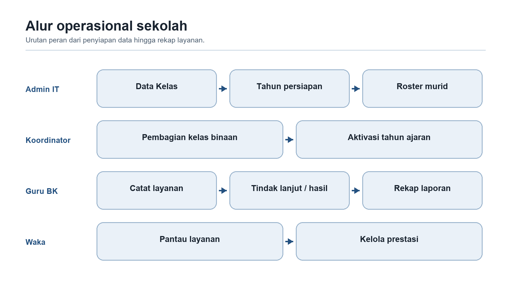

1. Petugas memasang aplikasi, basis data, akses aman HTTPS, dan penjadwal tugas, lalu membuat akun Admin IT pertama.
2. Admin IT membuat akun, menata Data Kelas, menyiapkan tahun ajaran, serta meninjau dan mengimpor daftar murid. Impor berarti memasukkan data dari berkas atau sistem sumber ke Ruang BK.
3. Koordinator menugaskan Guru BK pada kelas yang dipakai, memeriksa kesiapan, lalu mengaktifkan tahun ajaran.
4. Admin IT meninjau e-Tatib, yaitu aplikasi sumber catatan pelanggaran tata tertib murid. Admin IT mencocokkan identitas sebelum menyinkronkan data atau mengaktifkan jadwal otomatis.
5. Guru BK mencatat dan menangani layanan; Waka memantau ringkasan dan mengelola prestasi. Guru atau Koordinator membuat rekap sesuai kewenangan.
6. Saat tahun berganti, ulangi persiapan daftar murid dan penugasan pada tahun baru. Riwayat lama tetap mengikuti cakupan akses serta ketentuan retensi (masa penyimpanan data).

## 1.3 Masuk dan penggantian sandi pertama
### Masuk menggunakan akun sekolah

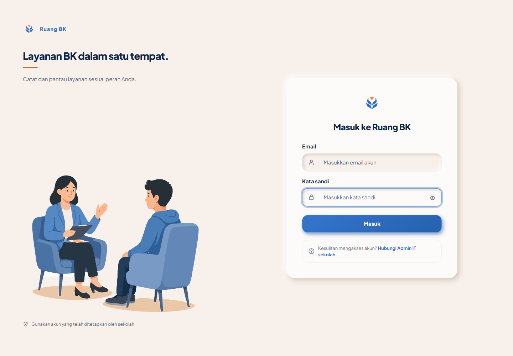

**Sebelum mulai:** akun pribadi sudah dibuat dan masih aktif. Gunakan alamat aplikasi sekolah yang diawali HTTPS.

1. Buka halaman masuk pada alamat yang diserahkan sekolah.
2. Isi **Email** dan **Kata sandi** yang diberikan Admin IT.
3. Jika perlu memeriksa ketikan, gunakan ikon mata hanya saat layar Anda tidak terlihat orang lain.
4. Pilih **Masuk**. Akun yang sudah memakai sandi pribadi menuju Dashboard; akun baru atau akun yang sandinya diatur ulang menuju penggantian sandi sementara.
5. Jika gagal masuk, periksa email dan kata sandi. Jika percobaan masuk dibatasi, tunggu hingga masa pembatasan berakhir sebelum mencoba lagi.

Hubungi Admin IT jika akun tidak aktif atau sandi sementara sudah kedaluwarsa.
### Mengganti sandi sementara

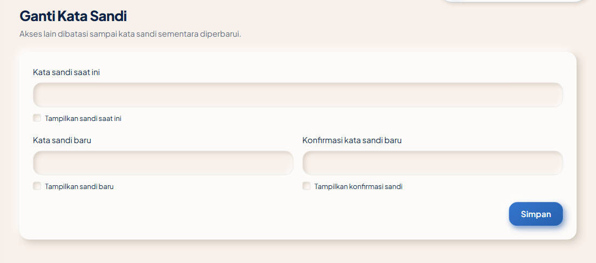

**Sebelum mulai:** berhasil masuk menggunakan sandi sementara yang belum kedaluwarsa. Masa berlaku bawaan adalah 24 jam.

1. Pada halaman penggantian sandi, isi **Kata sandi saat ini** dengan sandi sementara.
2. Isi sandi baru minimal delapan karakter yang mengandung huruf dan angka, serta berbeda dari sandi saat ini.
3. Ulangi sandi baru pada kolom konfirmasi.
4. Pilih **Simpan**. Jika ditolak, perbaiki kolom yang disebut; setelah berhasil, lanjutkan ke Dashboard.

Simpan sandi secara pribadi. Jangan memotret atau membagikannya kepada pengguna lain.

## 1.4 Menggunakan daftar dan formulir
### Mencari, menyaring, mengurutkan, dan membuka halaman daftar


Gunakan **Filter** untuk membatasi data yang ditampilkan, misalnya hanya murid dari kelas tertentu. Pilihan pencarian dan penyaring mengikuti halaman yang sedang dibuka.

1. Isi pencarian dan pilih penyaring yang tersedia, misalnya kelas, jenis, status, atau tahun ajaran.
2. Pilih **Filter**. Gunakan **Reset** bila tersedia untuk mengembalikan pilihan awal.
3. Pilih judul kolom bertanda panah untuk mengurutkan daftar.
4. Gunakan nomor halaman untuk melihat bagian daftar berikutnya; bila daftar menyediakan ikon kaca pembesar, gunakan untuk membaca rincian yang diizinkan.

Jika murid tidak ditemukan, periksa penyaring, tahun ajaran, dan kelas binaan Anda.
### Memeriksa draf dan hasil simpan formulir

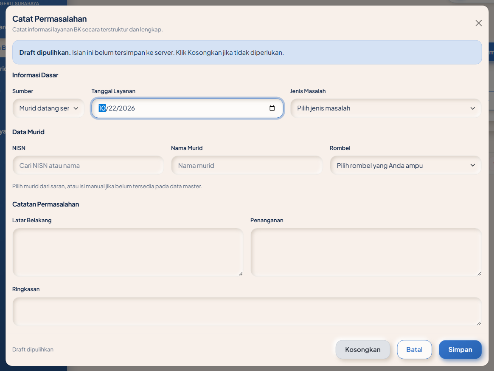

Beberapa formulir menyimpan draf, yaitu isian sementara pada peramban (browser) perangkat. Draf belum menjadi catatan resmi sampai penyimpanan berhasil.

1. Lengkapi kolom bertanda bintang. Untuk murid, pilih saran yang benar agar identitas tidak salah.
2. Pilih **Simpan**.
3. Periksa pesan berhasil dan kemunculan catatan pada daftar.
4. Jika pesan **belum tersimpan** muncul, koreksi kolom yang disebut dan simpan lagi.
5. Gunakan **Kosongkan** untuk membuang draf yang tidak dipakai. Saat Anda menutup formulir yang isinya berubah, aplikasi dapat meminta konfirmasi.
6. Jika perubahan ditolak karena catatan telah diperbarui di tempat lain, muat ulang dan bandingkan isinya sebelum mengulang.

Gunakan **Keluar** setelah bekerja pada komputer bersama agar draf pada peramban ikut dibersihkan.

## 1.5 Akun Saya dan keluar
### Memeriksa akun sendiri

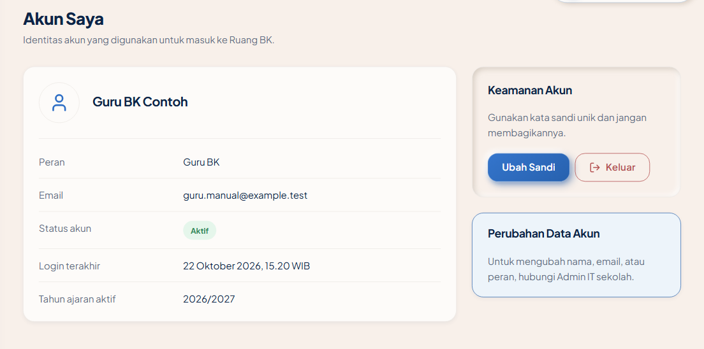

1. Buka **Akun Saya** melalui menu samping atau menu profil kanan atas.
2. Periksa nama, email, peran, status, login terakhir, dan konteks tahun ajaran yang ditampilkan.
3. Untuk koreksi nama, email, atau peran, hubungi Admin IT sesuai penugasan sekolah.

### Mengganti sandi pribadi

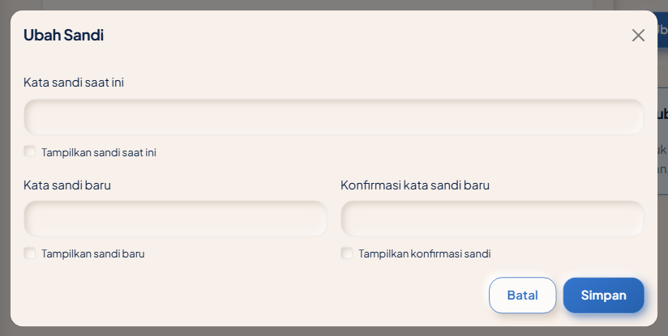

**Sebelum mulai:** masih mengetahui sandi saat ini. Jika lupa, minta Admin IT menerbitkan sandi sementara yang baru.

1. Pada **Akun Saya**, pilih **Ubah Sandi**.
2. Isi sandi saat ini, sandi baru, dan konfirmasinya. Sandi baru mengikuti ketentuan pada bagian 1.3.
3. Pilih **Simpan** dan periksa pesan berhasil. Jika sandi saat ini atau konfirmasi tidak sesuai, perbaiki dahulu.

Setelah sandi berubah, sesi masuk akun Anda pada perangkat lain akan diakhiri.
### Keluar dari aplikasi

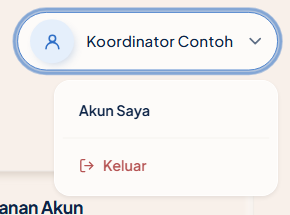

Keluar setelah pekerjaan selesai, terutama pada komputer bersama.

1. Selesaikan penyimpanan catatan atau buang draf yang tidak dipakai.
2. Buka menu profil kanan atas atau **Akun Saya**, lalu pilih **Keluar**.
3. Pastikan halaman masuk kembali tampil sebelum meninggalkan perangkat.

**Hasil:** sesi perangkat diakhiri dan draf pengguna pada peramban dibersihkan. Menutup tab saja tidak menggantikan tombol Keluar.

# 2 Panduan Guru BK

Mencatat permasalahan dan menindaklanjutinya sampai siap direkap.

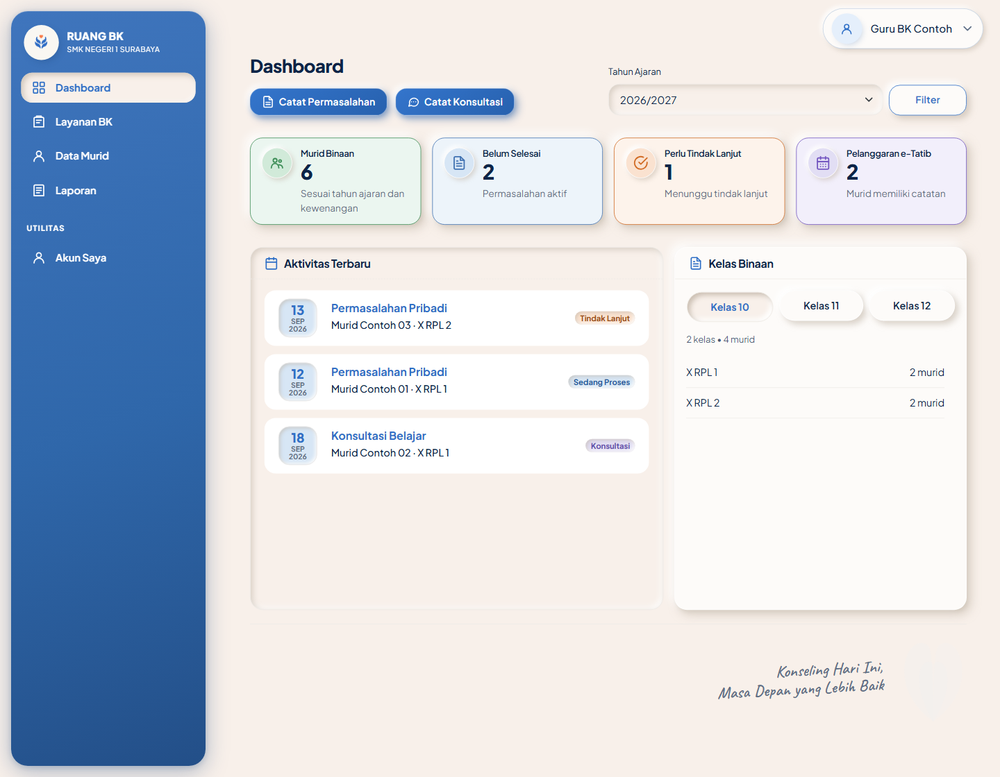

### Alur kerja Guru BK

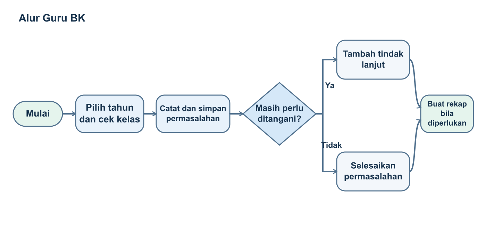

Guru BK bekerja dengan murid di kelas binaan aktifnya. Koordinator BK dapat membaca catatan dari berbagai guru, tetapi tetap tidak dapat mengubah catatan milik guru lain. Akun yang memiliki peran Koordinator BK sekaligus Guru BK tetap memerlukan kelas binaan aktif untuk mencatat layanan.

Riwayat layanan dari tahun ajaran lama dan layanan sebelum murid resmi keluar dapat dibaca sesuai hak akses serta masa penyimpanan data. Catatan lama tersebut tidak dapat diubah atau diarsipkan.

Menu kerja Guru BK adalah **Dashboard**, **Layanan BK**, **Data Murid**, dan **Laporan**. Pengelolaan akun pribadi dijelaskan pada Bab 1.

## 2.1 Dashboard dan kelas binaan

### Memeriksa ringkasan dan kelas binaan

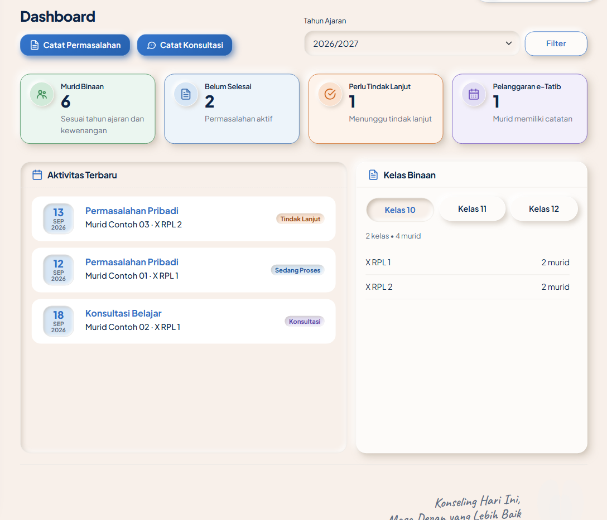

**Sebelum mulai:** akun Guru BK aktif. Kelas binaan muncul setelah Koordinator memberikan penugasan.

1. Buka **Dashboard** dan pilih **Tahun Ajaran**.
2. Pilih **Filter** untuk menerapkan pilihan atau **Reset** untuk kembali ke pilihan awal.
3. Baca kartu murid binaan, permasalahan, tindak lanjut, e-Tatib, dan ringkasan aktivitas terbaru.
4. Pada **Kelas Binaan**, pilih **Kelas 10**, **Kelas 11**, atau **Kelas 12**. Pilih **Lihat Semua** jika masih ada kelas yang belum tampak.
5. Untuk mencatat layanan, pilih **Catat Permasalahan** atau **Catat Konsultasi**.

**Jika kosong:** periksa tahun aktif, daftar murid, dan penugasan dari Koordinator BK.

## 2.2 Catatan Permasalahan

### Mencari dan membaca permasalahan

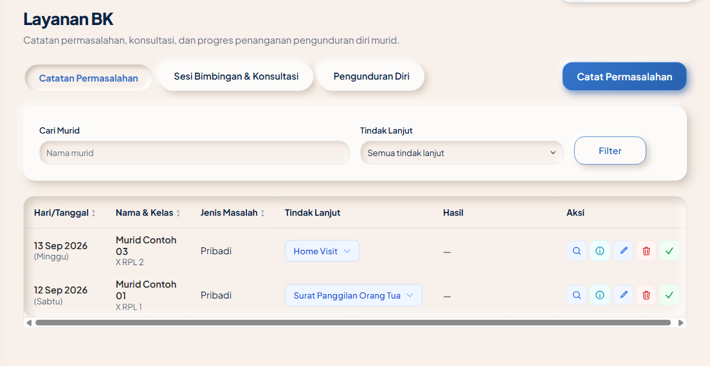

**Sebelum mulai:** akun dapat membaca layanan murid terkait.

1. Buka **Layanan BK > Catatan Permasalahan**.
2. Isi **Cari Murid** atau pilih **Tindak Lanjut**, lalu pilih **Filter**. Pilih **Reset** bila tersedia untuk menghapus penyaring.
3. Pilih label di kolom **Tindak Lanjut** untuk membaca riwayat.
4. Pilih ikon kaca pembesar untuk membaca sumber dan isi catatan di bawah baris.
5. Pilih ikon **Lihat selengkapnya** untuk membuka rincian lengkap.

**Jika tidak ditemukan:** periksa penyaring, tahun ajaran, kelas binaan, dan status catatan.

### Mencatat permasalahan dari murid atau rujukan

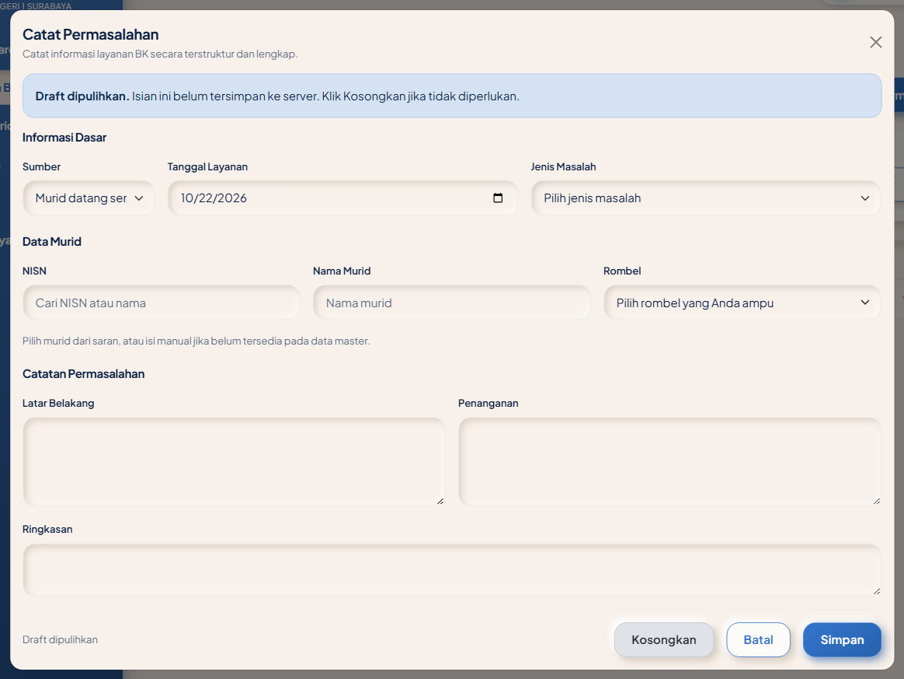

**Sebelum mulai:** akun memiliki peran Guru BK, tahun ajaran aktif, dan kelas binaan aktif.

1. Pilih **Catat Permasalahan** pada tab atau Dashboard.
2. Pilih **Sumber** berupa murid datang sendiri, temuan Guru BK, atau rujukan. Jika rujukan, isi **Sumber Rujukan**.
3. Pada **NISN**, cari nomor induk siswa nasional (NISN) atau nama, lalu pilih saran yang benar agar identitas dan rombongan belajar (rombel) terisi. Bila murid belum masuk data utama, isi NISN dan nama sementara, lalu pilih rombel dari kelas binaan Anda.
4. Periksa **Tanggal Layanan** dan pilih **Jenis Masalah**.
5. Isi **Latar Belakang** dan **Penanganan**. **Ringkasan** dapat diisi saat hasil tersedia.
6. Pilih **Simpan**.

**Hasil:** kasus baru muncul berstatus **Sedang Proses**. **Jika ditolak:** periksa kolom wajib, identitas atau NISN, dan rombel binaan. **Kosongkan** membuang draf setelah konfirmasi bila isian telah berubah.

### Mencatat permasalahan dengan referensi e-Tatib

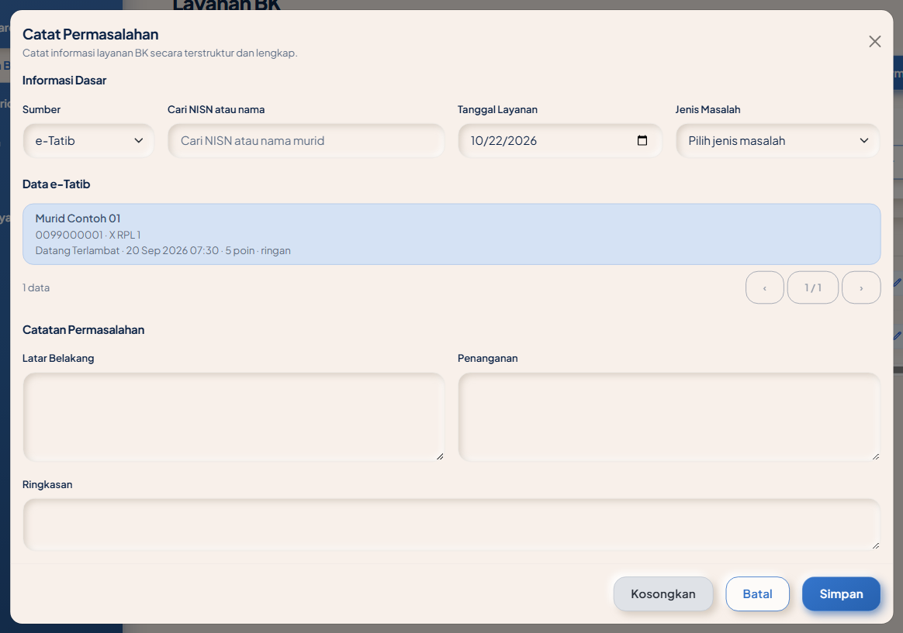

**Tujuan:** mencatat layanan berdasarkan data pelanggaran resmi yang sudah tersinkron. **Sebelum mulai:** hak pencatatan Guru BK dan data e-Tatib yang dapat dipilih.

1. Buka **Catat Permasalahan**, lalu pilih **Sumber: e-Tatib**.
2. Cari NISN atau nama, lalu pilih pelanggaran yang tepat.
3. Periksa tanggal, kategori, poin, serta muridnya. Pilih **Ganti** bila salah pilih.
4. Jika rombel e-Tatib tidak cocok dengan penugasan, pilih **Rombel Layanan** yang Anda bina.
5. Pilih **Tanggal Layanan** dan **Jenis Masalah**.
6. Isi **Latar Belakang** serta **Penanganan**, lalu pilih **Simpan**.

**Hasil:** kasus tersimpan dengan sumber e-Tatib; data pelanggaran sumber tetap menjadi rujukan. **Jika data tidak ada:** periksa sinkronisasi bersama Admin IT; jangan membuat ulang pelanggaran sumber berdasarkan ingatan.

### Mengedit permasalahan

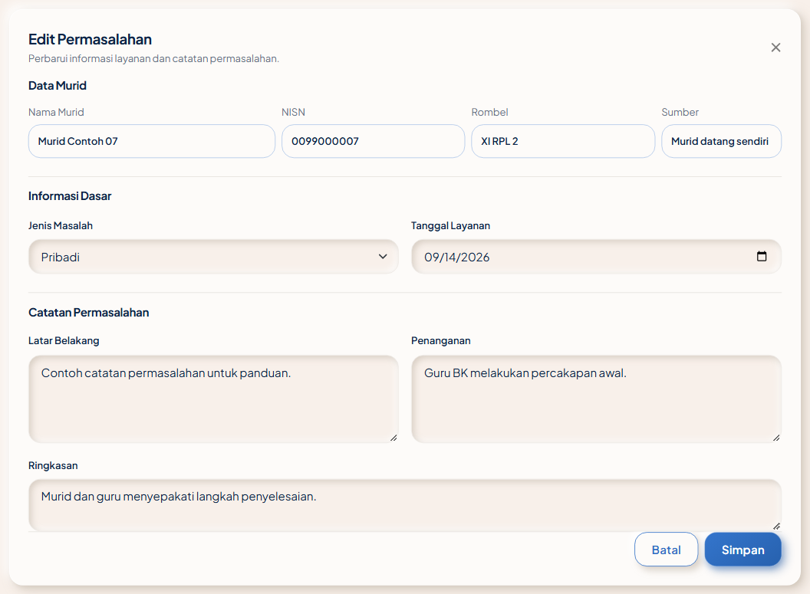

**Tujuan:** memperbaiki tanggal, jenis, atau isi catatan kasus sendiri. **Sebelum mulai:** Anda pemilik kasus dan tahun catatan masih aktif.

1. Pada tab **Catatan Permasalahan**, cari kasus dan pilih ikon **Edit**. Jika kasus sudah **Selesai**, setujui konfirmasi untuk membuka formulir.
2. Periksa nama, NISN, rombel, serta sumber yang tampil sebagai informasi tetap.
3. Perbarui tanggal layanan, jenis masalah, **Latar Belakang**, **Penanganan**, atau **Ringkasan** yang perlu diperbaiki.
4. Pilih **Simpan**.

**Hasil:** catatan terbaru tersimpan tanpa mengganti murid, sumber, pemilik, atau status. **Jika catatan telah diperbarui pengguna lain:** muat ulang sebelum mengedit lagi; perubahan pengguna lain tidak ditimpa.

### Menambahkan tindak lanjut kasus

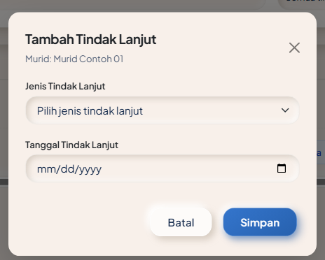

**Tujuan:** mencatat langkah penanganan lanjutan. **Sebelum mulai:** kasus milik Anda masih aktif dan jenis tindak lanjut belum dipakai pada kasus itu.

1. Pada baris kasus, pilih label **Tindak Lanjut** untuk membuka riwayat.
2. Pilih **Tambah Tindak Lanjut**.
3. Pilih **Jenis Tindak Lanjut** yang tersedia dan isi **Tanggal Tindak Lanjut**.
4. Pilih **Simpan**, lalu buka lagi label pada baris untuk memastikan catatan masuk.

**Hasil:** riwayat bertambah; penambahan pertama mengubah status kasus menjadi **Tindak Lanjut**. **Jika jenis tidak tersedia:** jenis itu sudah dipakai atau semua jenis aktif telah habis. Satu jenis tidak boleh dicatat dua kali pada kasus yang sama.

### Menyelesaikan permasalahan

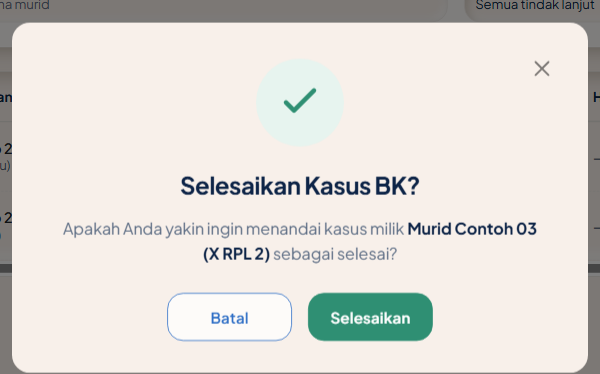

**Tujuan:** menetapkan hasil akhir kasus sendiri. **Sebelum mulai:** kasus belum selesai dan **Ringkasan** hasil telah disimpan; tindak lanjut tidak wajib.

1. Bila hasil belum ada, pilih **Edit**, isi **Ringkasan**, dan **Simpan**.
2. Kembali ke baris kasus, pilih ikon **Selesaikan Permasalahan**.
3. Periksa nama murid pada konfirmasi, lalu pilih **Selesaikan**.

**Hasil:** status menjadi **Selesai** dan riwayat tetap dapat dibaca di profil murid. **Jika aksi ditolak:** periksa Ringkasan, kepemilikan, dan apakah versi kasus berubah sejak dibuka.

### Mengarsipkan permasalahan

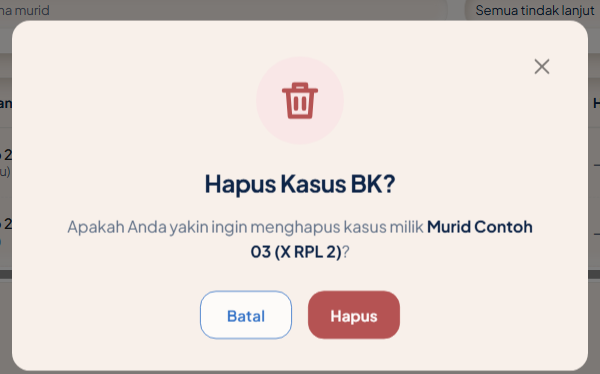

Tombol **Hapus** pada konfirmasi memindahkan catatan dari daftar aktif ke arsip. **Sebelum mulai:** kasus milik Anda, tahun ajaran aktif, dan kasus belum selesai.

1. Temukan kasus di **Catatan Permasalahan** dan pilih ikon **Arsipkan**.
2. Periksa murid dan kelas pada dialog.
3. Pilih **Hapus** untuk mengonfirmasi pengarsipan.

**Jika ikon tidak aktif:** kasus sudah selesai atau Anda tidak mempunyai hak arsip.

## 2.3 Sesi Bimbingan & Konsultasi

### Mencari dan membaca konsultasi

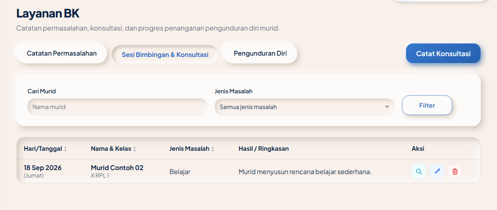

**Sebelum mulai:** Anda memiliki izin membaca layanan murid tersebut. Koordinator BK dapat membaca catatan lintas guru.

1. Buka **Layanan BK > Sesi Bimbingan & Konsultasi**.
2. Cari nama murid atau pilih **Jenis Masalah**, lalu pilih **Filter**. Pilih judul kolom yang mendukung pengurutan bila perlu.
3. Baca **Ringkasan / Hasil** pada daftar.
4. Pilih ikon kaca pembesar untuk membaca latar belakang dan penanganan. Buka rincian penuh bila perlu.

**Hasil:** konsultasi tampil sebagai catatan mandiri tanpa status atau tindak lanjut kasus. **Jika kosong:** periksa pencarian dan cakupan murid.

### Mencatat konsultasi

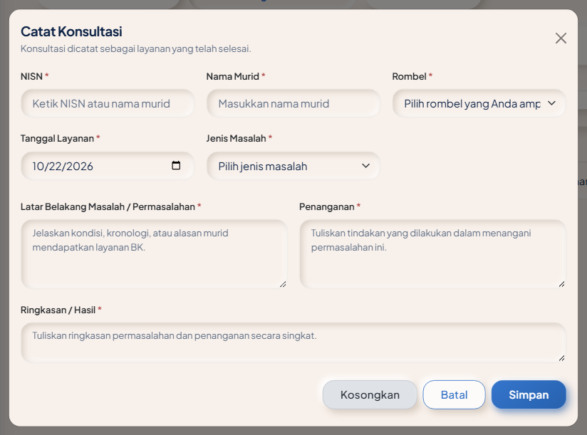

**Sebelum mulai:** akun memiliki peran Guru BK dan kelas binaan aktif.

1. Pilih **Catat Konsultasi** pada tab atau Dashboard.
2. Pada **NISN**, ketik NISN atau nama dan pilih murid dari saran. Bila belum tersedia, isi NISN dan nama, lalu pilih rombel binaan secara manual.
3. Isi tanggal, **Jenis Masalah**, **Latar Belakang Masalah / Permasalahan**, **Penanganan**, serta **Ringkasan / Hasil**.
4. Pilih **Simpan**.

**Hasil:** catatan konsultasi muncul di daftar dan profil murid. **Jika gagal:** periksa kelengkapan kolom wajib, termasuk **Ringkasan / Hasil**. **Kosongkan** membersihkan isian dan draf pada perangkat.

### Mengedit konsultasi

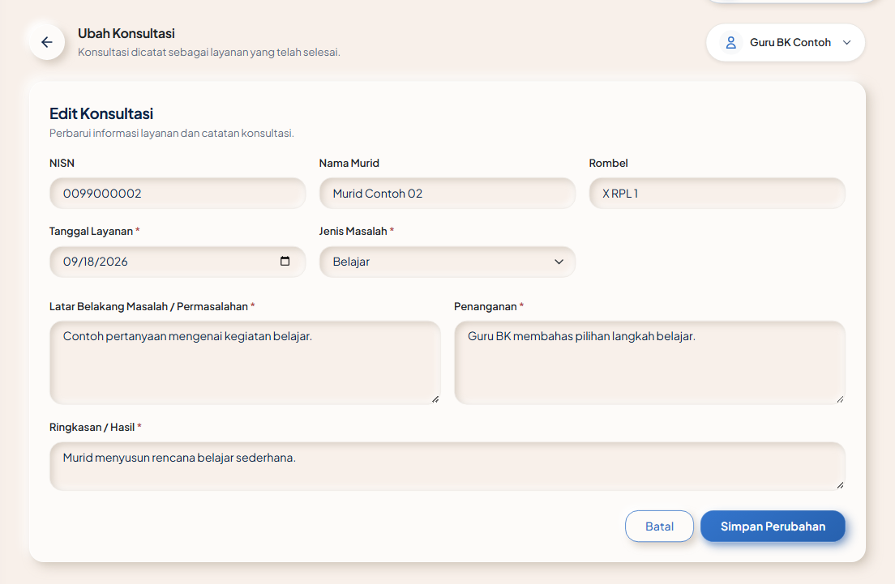

**Tujuan:** memperbaiki catatan konsultasi sendiri. **Sebelum mulai:** Anda pencatat, masih berwenang atas murid, dan tahun catatan aktif.

1. Pada tab konsultasi, pilih ikon **Edit** pada baris milik Anda.
2. Periksa identitas murid yang tidak dapat diganti. Ubah tanggal, jenis, atau uraian layanan yang diperlukan.
3. Pilih **Simpan Perubahan** dan periksa Ringkasan / Hasil di daftar.

**Hasil:** konsultasi diperbarui. **Jika catatan telah diperbarui pengguna lain:** muat ulang catatan sebelum mencoba lagi; layanan tahun lama dan catatan guru lain tidak dapat diedit.

### Mengarsipkan konsultasi

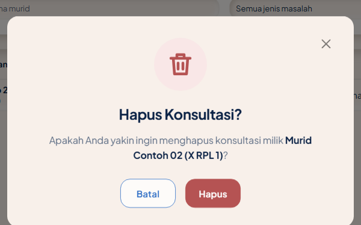

Tombol **Hapus** pada konfirmasi memindahkan konsultasi dari daftar aktif ke arsip. **Sebelum mulai:** Anda pencatat konsultasi, masih berwenang atas murid, dan tahun catatan aktif.

1. Cari konsultasi pada tab **Sesi Bimbingan & Konsultasi**.
2. Pilih ikon **Arsipkan**. Periksa identitas murid pada dialog.
3. Pilih **Hapus** untuk mengonfirmasi pengarsipan.

**Jika ikon tidak ada:** periksa kepemilikan, kewenangan atas murid, dan tahun ajaran.

## 2.4 Progres penanganan pengunduran diri

Gunakan fitur ini untuk mencatat pendampingan dan perkembangan berkas pengunduran diri. Pencatatan progres tidak menetapkan status resmi keluar atau alumni. Penetapan status keluar resmi belum tersedia melalui profil murid; jangan mengubahnya langsung pada basis data. Ketentuan penyimpanan data alumni dijelaskan pada bagian 6.3.

### Mencari catatan dan riwayat progres

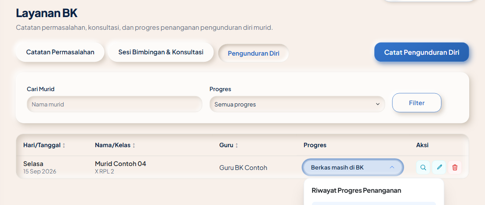

**Tujuan:** memeriksa perkembangan berkas dan catatan awal. **Sebelum mulai:** akses baca layanan murid; Koordinator membaca lintas guru.

1. Buka **Layanan BK > Pengunduran Diri**.
2. Isi **Cari Murid** atau pilih **Progres**, lalu pilih **Filter**.
3. Pilih label progres untuk membaca **Riwayat Progres Penanganan**.
4. Pilih ikon kaca pembesar untuk membaca **Catatan** awal di bawah baris.

**Hasil:** progres terbaru dan riwayatnya terlihat. **Jika kosong:** periksa pilihan penyaring. Catatan pengunduran diri berbeda dari keputusan resmi keluar.

### Mencatat penanganan pengunduran diri

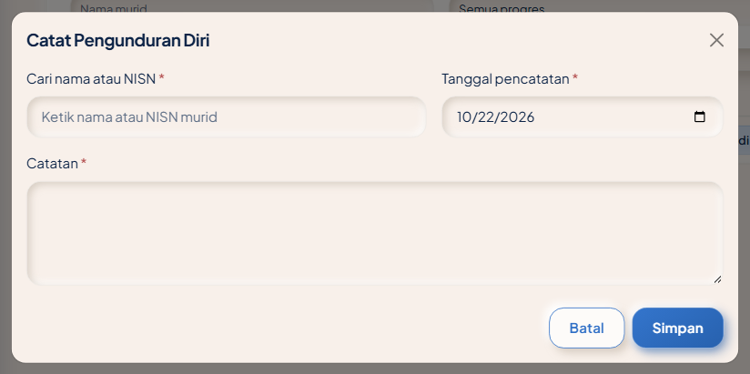

**Tujuan:** membuat catatan awal penanganan. **Sebelum mulai:** peran Guru BK, murid dalam penugasan aktif, dan belum mempunyai catatan pengunduran diri.

1. Pilih **Catat Pengunduran Diri** dari tab.
2. Ketik nama atau NISN, lalu pilih murid dari saran.
3. Periksa nama dan rombel yang terisi.
4. Isi **Tanggal pencatatan** dan **Catatan**, kemudian pilih **Simpan**.

**Hasil:** satu catatan awal tersimpan dengan progres **Berkas masih diproses**; status aktif murid tidak berubah. **Jika murid tidak tersedia:** periksa penugasan atau apakah ia sudah memiliki catatan awal.

### Menambahkan progres penanganan

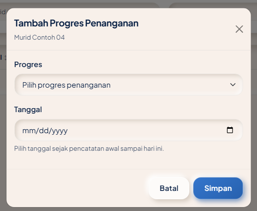

**Tujuan:** merekam perkembangan setelah catatan awal. **Sebelum mulai:** murid masih dalam penugasan Guru BK aktif dan catatan awal tersedia.

1. Pilih label progres pada baris untuk membuka riwayat.
2. Pilih **Tambah Progres Penanganan**.
3. Pilih **Berkas masih diproses**, **Berkas masih di BK**, atau **Berkas sudah masuk TU**.
4. Isi **Tanggal** dalam rentang sejak catatan awal hingga hari ini.
5. Pilih **Simpan**, lalu buka riwayat lagi untuk memeriksa catatan baru.

**Hasil:** riwayat bertambah; progres yang tampil mengikuti entri bertanggal terbaru. **Jika menambah tanggal lebih lama:** entri tetap disimpan tetapi progres terkini tidak berubah.

### Mengedit catatan awal pengunduran diri

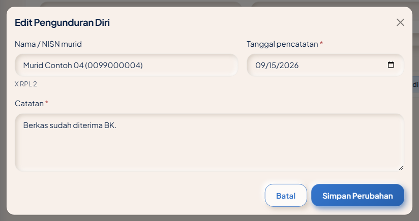

**Tujuan:** mengoreksi catatan awal, bukan menimpa riwayat progres. **Sebelum mulai:** murid masih dalam penugasan Guru BK aktif.

1. Pilih ikon **Edit** pada tab **Pengunduran Diri**.
2. Periksa nama dan NISN yang tidak dapat diubah. Ubah **Tanggal pencatatan** atau **Catatan** sesuai kebutuhan.
3. Pilih **Simpan Perubahan**.

**Hasil:** catatan awal diperbarui dan riwayat progres tetap terpisah. **Jika ditolak:** periksa tanggal yang tidak boleh melewati hari ini dan kewenangan kelas.

### Menghapus catatan penanganan pengunduran diri

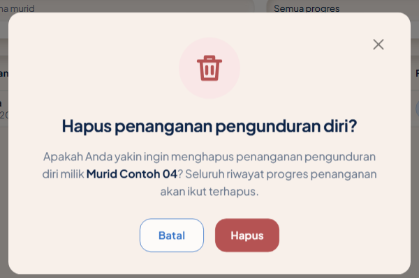

**Tujuan:** menghapus catatan penanganan yang dibuat keliru. **Sebelum mulai:** murid masih dalam penugasan Guru BK aktif.

1. Cari baris murid pada tab **Pengunduran Diri**.
2. Pilih ikon **Hapus**. Periksa nama murid pada dialog.
3. Konfirmasi **Hapus** hanya setelah memastikan catatan yang dipilih.

**Hasil:** catatan penanganan keluar dari daftar; tindakan ini tidak mengubah keputusan resmi keluar murid. **Jika aksi tidak ada:** periksa hak atas murid.

## 2.5 Data Murid dan informasi prestasi

### Mencari murid

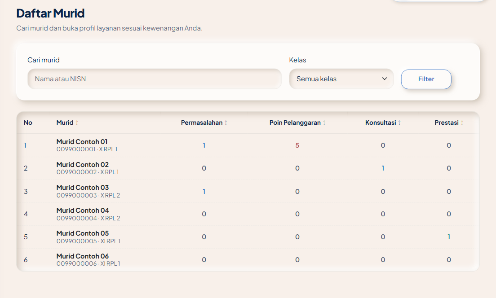

**Tujuan:** menemukan profil murid dalam cakupan. **Sebelum mulai:** akun Guru BK atau Koordinator BK aktif.

1. Buka **Data Murid**.
2. Isi **Cari murid** dengan nama atau NISN dan pilih **Kelas**, lalu pilih **Filter**.
3. Baca jumlah permasalahan, poin pelanggaran, konsultasi, dan prestasi.
4. Pilih nama murid untuk membuka profilnya.

**Hasil:** **Profil Murid** terbuka. **Jika tidak ditemukan:** periksa kelas dan tahun aktif atau minta Admin IT memeriksa daftar murid.

### Membaca profil dan riwayat permasalahan


**Tujuan:** melihat konteks murid sebelum menangani layanan. **Sebelum mulai:** profil murid dapat dibaca menurut cakupan peran.

1. Pilih nama murid pada **Data Murid**.
2. Periksa NISN, kelas, tahun ajaran, ringkasan layanan, poin, prestasi, dan riwayat kelas.
3. Buka tab **Permasalahan**; pilih kaca pembesar pada baris untuk sumber, latar belakang, dan penanganan yang diizinkan.

Untuk memperbaiki catatan, buka **Layanan BK**. Penyuntingan mengikuti kepemilikan dan tahun ajaran aktif.

### Membaca data e-Tatib murid

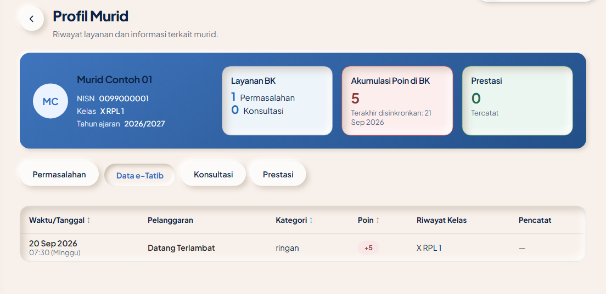

**Tujuan:** memeriksa referensi pelanggaran yang sudah disinkron. **Sebelum mulai:** akses profil murid.

1. Buka **Profil Murid > Data e-Tatib**.
2. Baca tanggal, jenis pelanggaran, kategori, poin, riwayat kelas, dan pencatat.
3. Perhatikan label **Dibatalkan sumber** atau **Arsip**; catatan yang dibatalkan sumber tidak menambah poin aktif.

**Hasil:** konteks e-Tatib tersedia sebagai data baca saja. **Jika data belum tersedia:** tanyakan sinkronisasi kepada Admin IT; jangan menyunting data sumber dari profil.

### Membaca riwayat konsultasi murid

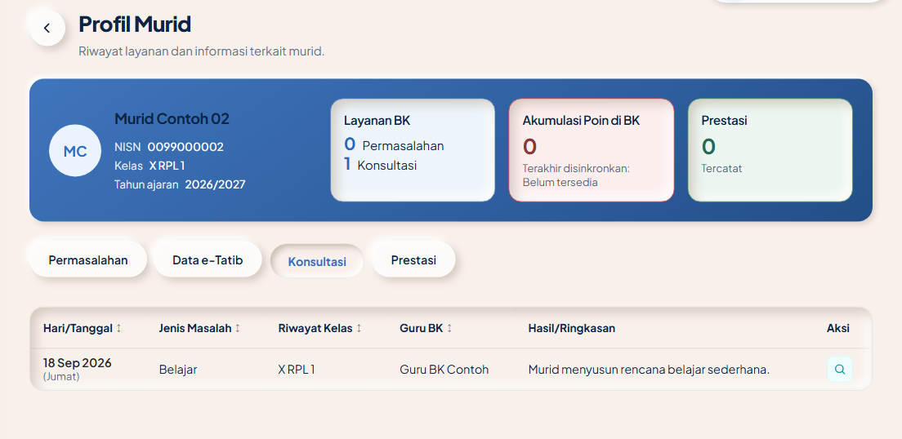

**Tujuan:** melihat layanan konsultasi sebelumnya yang sah. **Sebelum mulai:** akses profesional atas murid atau peran Koordinator BK.

1. Buka **Profil Murid > Konsultasi**.
2. Baca tanggal, jenis, Guru BK, dan **Hasil/Ringkasan**.
3. Pilih kaca pembesar untuk latar belakang dan penanganan yang boleh dibaca.

**Hasil:** riwayat konsultasi tampil sesuai kewenangan. **Jika tab tidak muncul:** akun tidak mempunyai hak baca konsultasi pada profil tersebut.

### Membaca prestasi pada profil murid

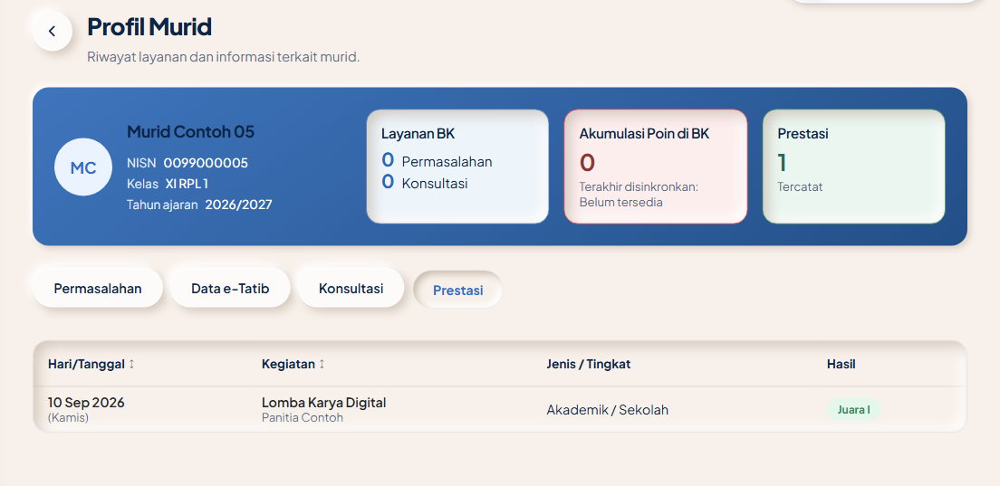

**Tujuan:** mempertimbangkan riwayat prestasi saat memberi layanan. **Sebelum mulai:** akses profil murid.

1. Buka **Profil Murid > Prestasi**.
2. Baca kegiatan, penyelenggara, jenis/tingkat, tanggal, dan hasil.
3. Buka kembali tab layanan bila perlu membandingkan riwayat.

**Hasil:** prestasi terbaca tanpa hak edit. **Jika kosong:** belum ada prestasi yang tercatat atau dapat dibaca.

## 2.6 Laporan dan dokumen rekap

### Menyaring dan membaca laporan layanan

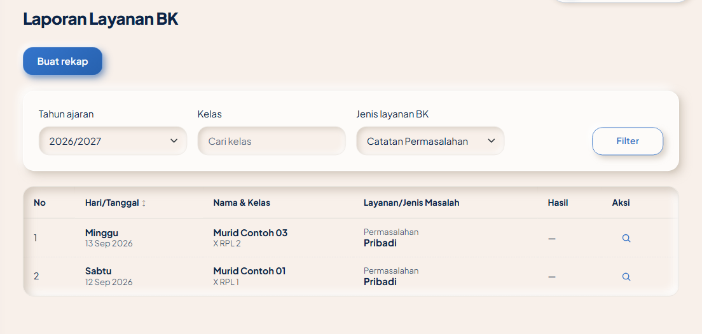

**Tujuan:** meninjau catatan sebelum membuat dokumen. **Sebelum mulai:** Guru BK atau Koordinator BK aktif; data mengikuti cakupan masing-masing.

1. Buka **Laporan**.
2. Pilih **Tahun ajaran**, cari **Kelas**, lalu pilih **Jenis layanan BK**: permasalahan, konsultasi, atau pengunduran diri.
3. Pilih **Filter**.
4. Buka ikon kaca pembesar untuk membaca uraian layanan yang diizinkan. Pindah halaman bila perlu.
5. Gunakan **Reset** untuk kembali ke pilihan awal.

**Hasil:** daftar dengan nomor halaman tampil sesuai cakupan Guru BK atau gabungan sekolah untuk Koordinator. **Jika penyaring ditolak:** kelas harus cocok dengan tahun dan hak akses. Penyuntingan dan pengarsipan dilakukan di Layanan BK.

### Membuat pratinjau dan mengatur periode

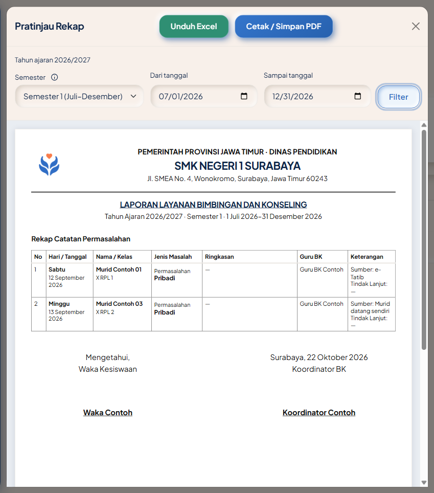

**Sebelum mulai:** pastikan pilihan penyaring sesuai kebutuhan. Batas bawaan satu dokumen rekap adalah **2.500 catatan**. Rentang tanggal harus berada dalam satu semester.

1. Pilih **Buat rekap** pada **Laporan**. Periode awal mencakup paling banyak 30 hari kalender hingga hari ini, dibatasi semester dan tahun ajaran pilihan. Untuk tahun ajaran lampau, periode berakhir pada hari terakhir tahun tersebut; untuk tahun mendatang, periode memakai hari pertama.
2. Buka **Atur periode**, pilih **Semester 1 (Juli-Desember)** atau **Semester 2 (Januari-Juni)**, lalu isi **Dari tanggal** dan **Sampai tanggal**.
3. Pilih **Filter** dalam jendela dan tunggu pratinjau terbaru selesai.
4. Periksa jenis layanan, rentang tanggal, catatan, dan penandatangan sebelum mencetak.

Jika jumlah catatan melebihi batas dokumen, persempit periode atau kelas. Jika pratinjau gagal dimuat, pilih **Coba lagi** atau **Buka di halaman baru**. Periksa juga urutan tanggal dan semester yang dipilih.

### Mengatur periode rekap di ponsel

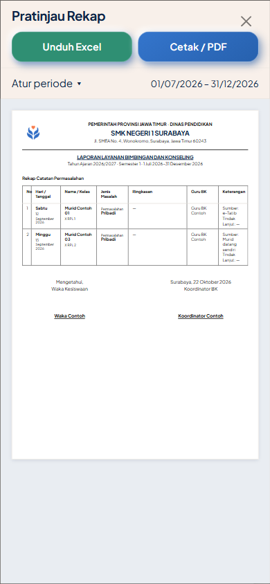

**Sebelum mulai:** jendela pratinjau terbuka di ponsel.

1. Ketuk ringkasan tanggal pada **Atur periode** untuk membuka isian.
2. Pilih semester dan isi **Dari tanggal** serta **Sampai tanggal** di dalam semester itu.
3. Ketuk **Filter** dan tunggu ringkasan tanggal serta pratinjau diperbarui.

Setelah pilihan diterapkan, pengaturan terlipat dan periode tetap terlihat. Jika tombol unduh atau cetak belum aktif, tunggu hingga pratinjau terbaru selesai dimuat.

### Mengunduh Excel atau mencetak PDF


**Sebelum mulai:** pratinjau terbaru berhasil dimuat.

1. Periksa kembali periode dan jumlah catatan pada **Pratinjau Rekap**.
2. Pilih **Unduh Excel** untuk berkas tabel, atau **Cetak / Simpan PDF** untuk membuka pilihan pencetak atau PDF pada peramban.
3. Simpan berkas hanya pada lokasi sekolah yang diizinkan.
4. Pilih **Tutup** untuk kembali ke daftar dengan pilihan penyaring dan posisi yang sama.

**Hasil:** dokumen memakai seluruh data yang lolos penyaringan, bukan hanya halaman daftar yang tampak. **Jika tombol nonaktif:** periode sedang diubah, dimuat, atau pratinjau gagal. Berkas Excel tidak memuat blok tanda tangan seperti hasil cetak.

# 3 Panduan Koordinator BK

Menyiapkan pembagian kelas, mengaktifkan tahun ajaran, lalu memantau layanan.

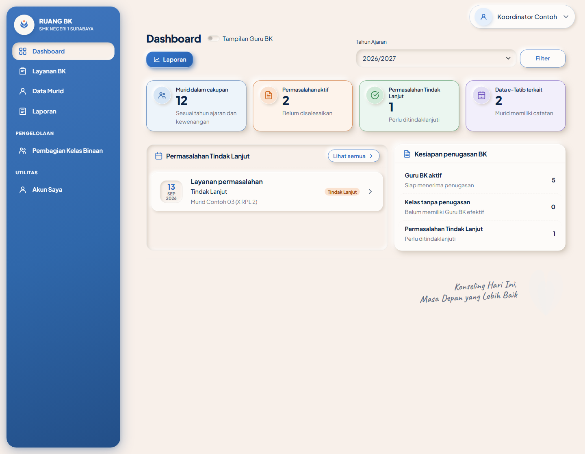

### Alur kerja Koordinator BK

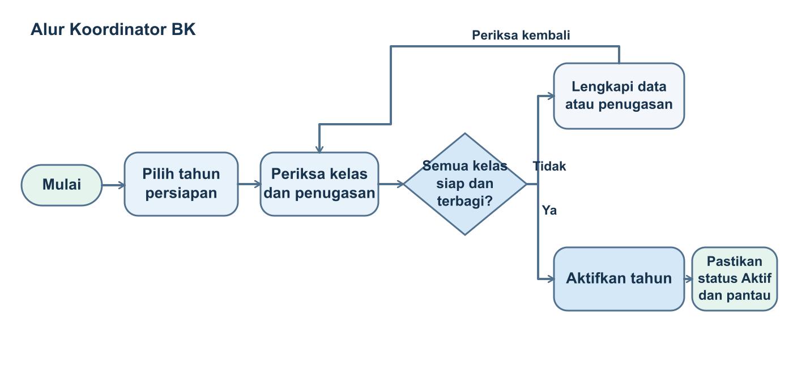

Koordinator dapat membaca **Dashboard**, **Layanan BK**, **Data Murid**, prestasi, dan **Laporan** lintas Guru BK dengan mengikuti langkah pada Bab 2. Koordinator juga membagi kelas binaan dan mengaktifkan tahun ajaran. Peran Koordinator saja tidak memberi izin mencatat layanan atau mengedit catatan guru lain. Jika Anda juga memiliki peran Guru BK, izin mencatat tetap mengikuti kelas binaan aktif, sedangkan izin mengedit mengikuti pemilik atau pencatat yang berwenang.

## 3.1 Pemantauan sekolah

### Memeriksa Dashboard Koordinator dan tampilan Guru BK

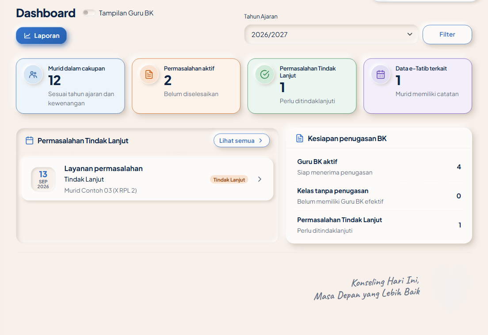

Gunakan halaman ini untuk memantau kesiapan dan layanan sekolah. Jika akun Anda juga memiliki peran Guru BK, Anda dapat melihat ringkasan kelas binaan sendiri melalui sakelar tampilan.

1. Buka **Dashboard**, pilih **Tahun Ajaran**, lalu pilih **Filter**.
2. Baca indikator dan panel kesiapan penugasan pada tampilan Koordinator.
3. Jika ada, nyalakan **Tampilan Guru BK** untuk ringkasan, aktivitas, e-Tatib, dan kelas binaan sendiri; padamkan untuk kembali ke Koordinator.

Tahun yang dipilih tetap berlaku saat tampilan berganti. Sakelar hanya muncul jika akun memiliki peran Koordinator dan Guru BK.

## 3.2 Pembagian Kelas Binaan

### Memilih tahun dan memeriksa penugasan

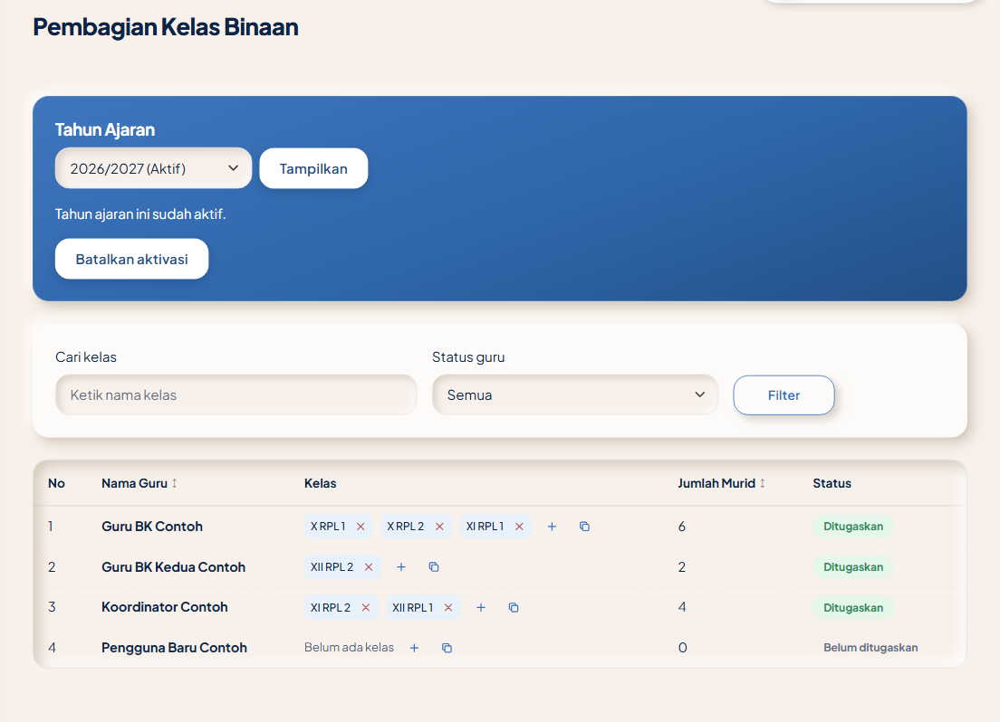

Pastikan Admin IT telah menyiapkan tahun dan kelas sebelum Anda memeriksa pembagian kelas binaan.

1. Buka **Pembagian Kelas Binaan**.
2. Pada bagian **Tahun Ajaran**, pilih tahun **Aktif** atau **Persiapan**, lalu **Tampilkan**.
3. Isi **Cari kelas** atau pilih **Status guru**: **Semua**, **Ditugaskan**, atau **Belum ditugaskan**. Lalu pilih **Filter**.
4. Periksa nama Guru BK, penanda kelas, jumlah murid, dan status. Setiap kelas yang berjalan hanya dapat ditugaskan kepada satu Guru BK.

Jika tahun belum tersedia, minta Admin IT membuat tahun persiapan dan menyiapkan daftar murid.

### Menambahkan kelas binaan

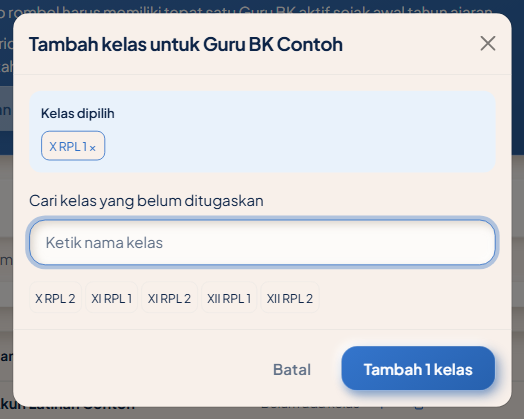

Pilih tahun terlebih dahulu. Kelas yang akan diberikan harus tersedia dan belum ditugaskan kepada Guru BK lain.

1. Pada baris guru yang tepat, pilih ikon **Tambah kelas**.
2. Cari kelas yang belum ditugaskan, lalu pilih satu atau beberapa kelas di jendela yang terbuka.
3. Periksa **Kelas dipilih** dan pilih **Tambah kelas**.

Penanda kelas akan muncul pada guru tersebut. Jika yang diubah adalah tahun aktif, cakupan muridnya langsung bertambah. Kelas yang tidak tersedia mungkin sudah ditugaskan atau belum masuk daftar kelas tahun itu.

### Menyalin kelas binaan dari tahun sebelumnya

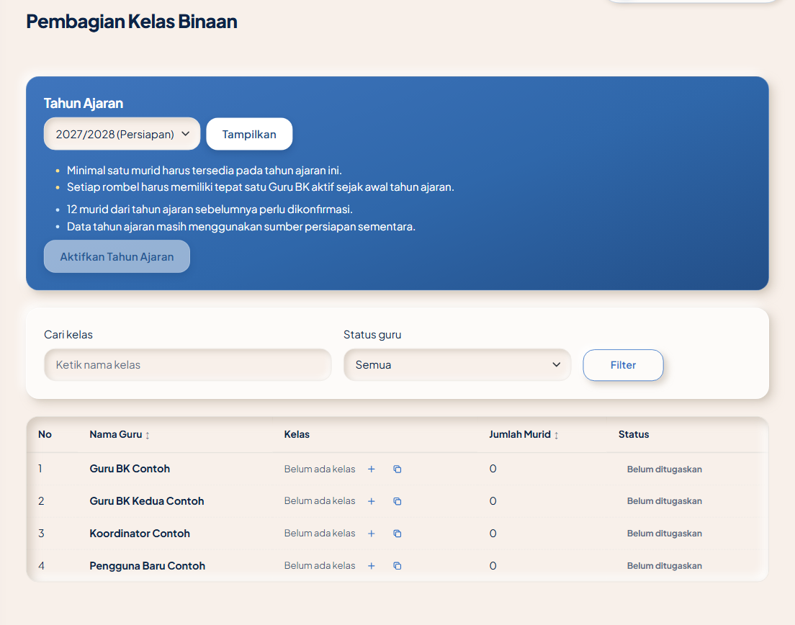

Anda dapat memakai penugasan tahun sebelumnya sebagai awal pembagian kelas tahun persiapan. Guru harus memiliki kelas pada tahun sebelumnya, dan kelas tujuan harus tersedia.

1. Pilih tahun **Persiapan** pada **Pembagian Kelas Binaan**.
2. Cari guru yang tepat dan pilih ikon **Salin kelas binaan tahun sebelumnya** pada barisnya.
3. Periksa penanda kelas hasil penyalinan dan tambahkan kelas yang belum terisi.

Hanya kelas yang memenuhi syarat yang ditambahkan pada tahun pilihan. Jika daftar tidak berubah, tidak ada kelas sebelumnya yang dapat disalin atau kelas tujuan sudah ditugaskan.

### Melepas penugasan kelas

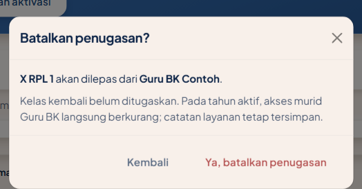

Gunakan langkah ini untuk mengoreksi kelas yang masih ditugaskan kepada guru tersebut.

1. Pilih ikon silang pada penanda kelas yang hendak dilepas.
2. Baca dialog **Batalkan penugasan?** dan cocokkan nama kelas serta guru.
3. Pilih **Ya, batalkan penugasan**, lalu siapkan pengganti bila kelas tetap aktif.

Kelas kembali berstatus belum ditugaskan. Jika ini terjadi pada tahun aktif, izin guru untuk membaca dan mencatat layanan murid di kelas itu langsung berkurang; catatan lama tetap tersimpan. Jika kelas atau guru pada dialog keliru, pilih **Kembali**.

## 3.3 Aktivasi tahun ajaran

### Mengaktifkan tahun ajaran persiapan

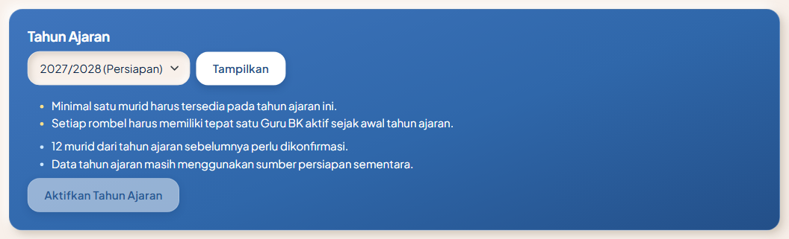

Aktivasi menjadikan daftar murid dan penugasan baru sebagai tahun yang digunakan untuk layanan. Sebelumnya, Admin IT harus menyiapkan tahun dan minimal satu murid. Tidak boleh ada murid dengan dua penempatan aktif, dan setiap rombel aktif harus memiliki tepat satu Guru BK aktif.

1. Di **Pembagian Kelas Binaan**, pilih tahun **Persiapan** dan pilih **Tampilkan**.
2. Baca masalah dan peringatan kesiapan. Selesaikan masalah penugasan atau daftar murid bersama Admin IT. Peringatan **Perlu Konfirmasi** atau peringatan terkait asal data tidak selalu menghalangi aktivasi.
3. Jika tombol tersedia, pilih **Aktifkan Tahun Ajaran**.
4. Periksa label **Aktif**, lalu minta Guru BK meninjau kembali kelas binaannya.

Tahun pilihan menjadi satu-satunya tahun aktif. Layanan baru mengikuti pembagian kelas tahun itu. Jika tombol tidak dapat ditekan, perbaiki masalah kesiapan yang ditampilkan terlebih dahulu.

### Membatalkan aktivasi untuk kembali ke tahun sebelumnya

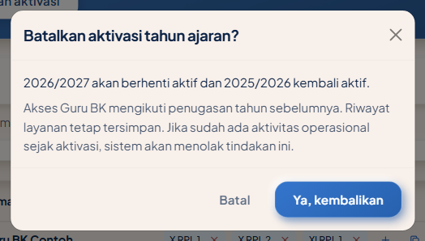

Pembatalan hanya tersedia jika tahun sebelumnya dapat dipastikan dan siap digunakan kembali, serta belum ada aktivitas operasional sejak aktivasi tahun baru.

1. Buka **Pembagian Kelas Binaan** pada tahun yang baru aktif.
2. Jika tersedia, pilih **Batalkan aktivasi** dan baca tahun tujuan serta akibatnya pada dialog.
3. Konfirmasi pembatalan, lalu periksa kembali tahun bertanda **Aktif** dan cakupan guru.

Tahun sebelumnya kembali aktif. Jika **Batalkan aktivasi** tidak tersedia atau pembatalan ditolak, syarat pemulihan belum terpenuhi. Jangan mengubah tanggal catatan untuk memindahkan layanan.

# 4 Panduan Waka Kesiswaan

Memantau kebutuhan tindak lanjut atau mencatat prestasi sesuai keperluan.

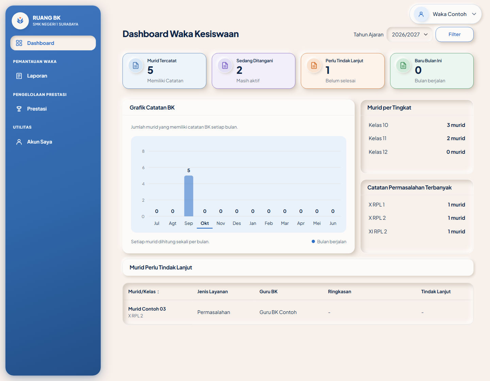

### Alur kerja Waka Kesiswaan

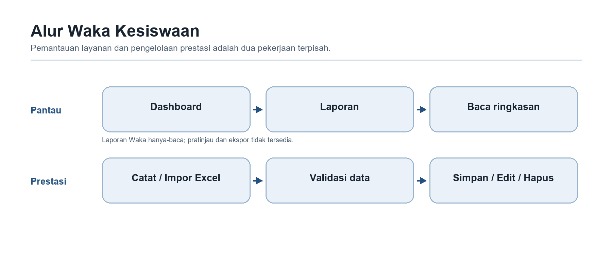

Waka Kesiswaan memantau ringkasan layanan BK dan mengelola prestasi melalui **Dashboard**, **Laporan**, **Prestasi**, dan **Akun Saya**. Guru BK tetap bertanggung jawab mencatat dan mengubah layanan konseling. Waka tidak memiliki akses untuk mengekspor layanan konseling secara massal.

## 4.1 Dashboard Waka
### Memantau indikator dan tindak lanjut sekolah

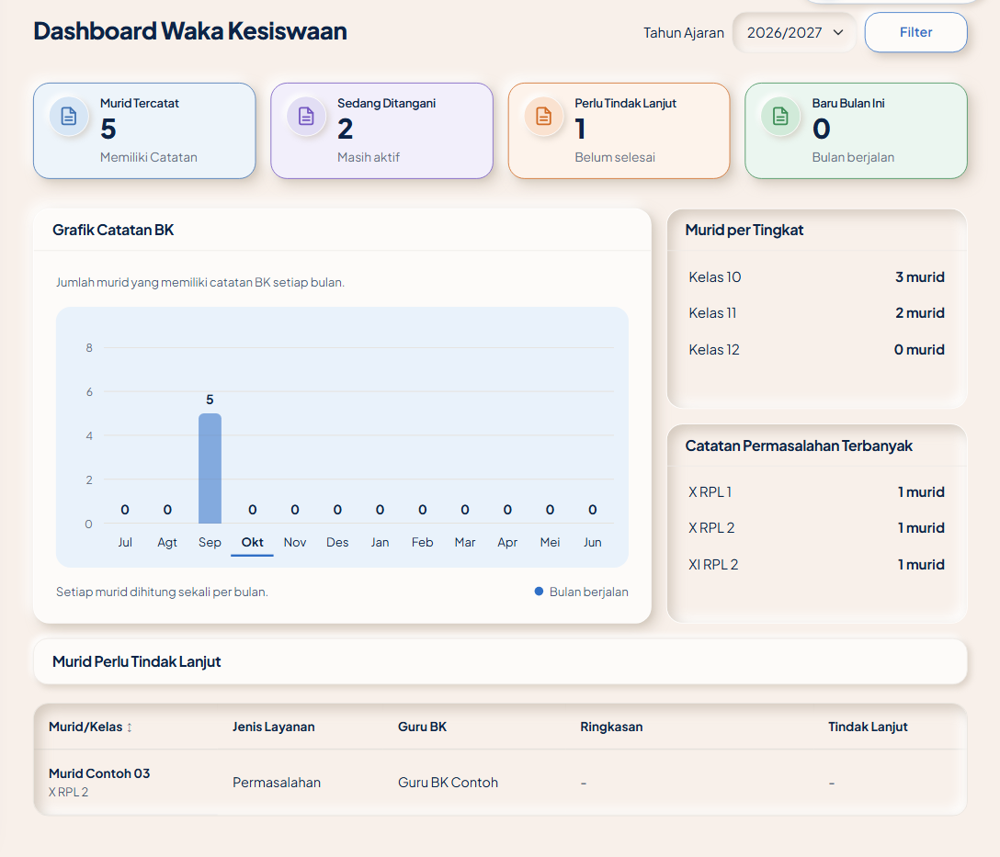

Akun Waka harus aktif. Indikator layanan akan terisi jika sudah ada data pada tahun yang dipilih.

1. Buka **Dashboard Waka Kesiswaan**, pilih **Tahun Ajaran**, lalu terapkan **Filter** bila diminta.
2. Baca jumlah Murid Tercatat, Sedang Ditangani, Perlu Tindak Lanjut, dan Baru Bulan Ini. Setiap indikator menghitung murid yang berbeda, bukan jumlah seluruh sesi.
3. Baca Grafik Catatan BK. Setiap murid dihitung satu kali pada setiap bulan ketika ia mendapat layanan, bukan sebanyak jumlah kejadian. Periksa Murid per Tingkat dan paling banyak tiga kelas pada Catatan Permasalahan Terbanyak.
4. Pada **Murid Perlu Tindak Lanjut**, baca Murid/Kelas, Jenis Layanan, Guru BK, Ringkasan, dan Tindak Lanjut. Satu murid dapat memiliki lebih dari satu layanan yang masih ditangani.

Jika angkanya berbeda dari daftar e-Tatib, periksa tahun, jenis layanan, dan cara menghitung murid.

## 4.2 Laporan Layanan BK
### Menyaring dan membaca ringkasan layanan

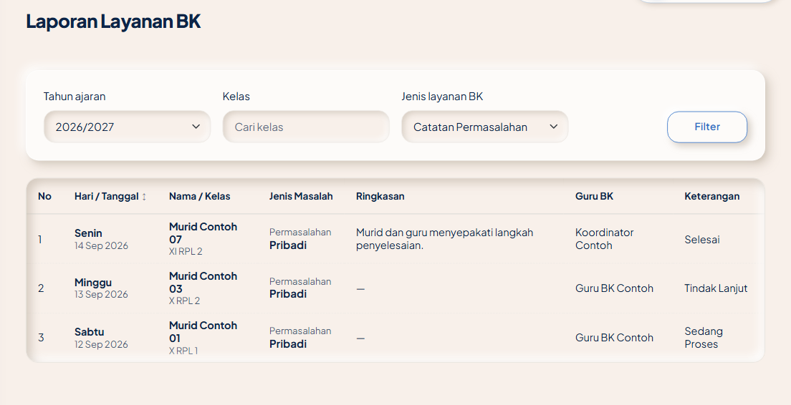

1. Buka **Laporan**, pilih **Tahun ajaran**, **Kelas**, dan **Jenis layanan BK**.
2. Pilih **Filter**, lalu baca daftar. Gunakan nomor halaman untuk melihat data berikutnya.
3. Untuk permasalahan/konsultasi, baca identitas layanan, Ringkasan / Hasil, Guru BK, dan Keterangan. Untuk pengunduran diri, Keterangan memuat progres berkas terbaru.
4. Koordinasikan kebutuhan lanjutan dengan Guru BK yang ditampilkan melalui prosedur sekolah.

Waka hanya dapat membaca ringkasan yang ditampilkan. Uraian lengkap layanan, perubahan catatan, dan cetak atau unduh rekap layanan tidak tersedia untuk peran ini.

## 4.3 Pencatatan prestasi
### Mencatat prestasi secara manual

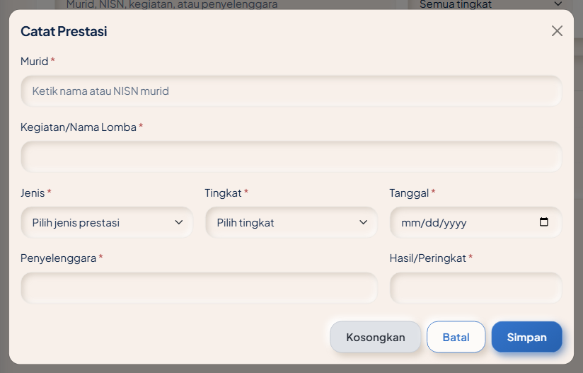

Pastikan murid terdaftar resmi dan masih aktif, serta pilihan jenis dan tingkat prestasi tersedia. Tanggal prestasi tidak boleh berada di masa depan.

1. Buka **Prestasi**, lalu pilih **Catat Prestasi**.
2. Cari nama atau NISN dan pilih murid dari saran; periksa identitas serta rombelnya.
3. Isi Kegiatan/Nama Lomba, Jenis, Tingkat, Tanggal, Penyelenggara, dan Hasil/Peringkat.
4. Pilih **Simpan**, lalu periksa kegiatan baru pada daftar. **Batal** menutup formulir; **Kosongkan** menghapus isian yang belum disimpan.

Jika murid tidak ditemukan, periksa daftar murid bersama Admin IT sebelum mencatat prestasi.

## 4.4 Templat dan impor prestasi
### Mengunduh, mengisi, dan mengimpor templat prestasi

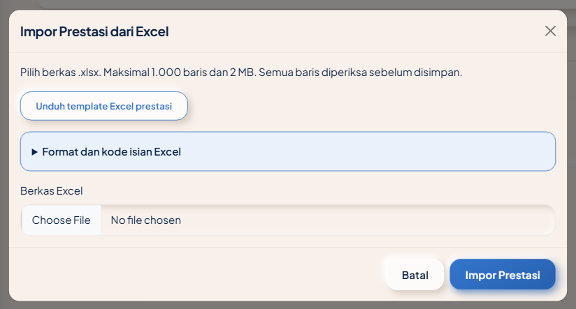

Pastikan daftar murid aktif serta pilihan jenis dan tingkat prestasi sudah tersedia.

1. Pada **Prestasi**, pilih **Impor Excel**, lalu **Unduh template Excel prestasi**.
2. Jangan ubah judul kolom `nisn`, `jenis`, `tingkat`, `kegiatan`, `penyelenggara`, `tanggal`, dan `hasil`. Simpan NISN sebagai teks agar angka nol di awal tidak hilang.
3. Isi kode jenis dan tingkat dari **Format dan kode isian Excel**; gunakan tanggal `YYYY-MM-DD` atau tanggal Excel yang sah. Jangan memakai tanggal masa depan atau rumus.
4. Simpan sebagai `.xlsx` maksimal 1.000 baris data dan 2 MB. Pilih **Berkas Excel**, lalu **Impor Prestasi**.
5. Jika impor ditolak, baca daftar kesalahan, perbaiki berkas, pilih kembali, lalu ulangi. Aplikasi memeriksa seluruh baris sebelum menyimpan; berkas yang gagal diperiksa tidak tersimpan sebagian.
6. Setelah berhasil, periksa jumlah dan contoh kegiatan pada daftar. Jangan mengunggah ulang berkas yang sama hanya untuk mengecek hasil.

## 4.5 Mencari, mengoreksi, dan menghapus prestasi
### Mencari dan mengurutkan daftar prestasi

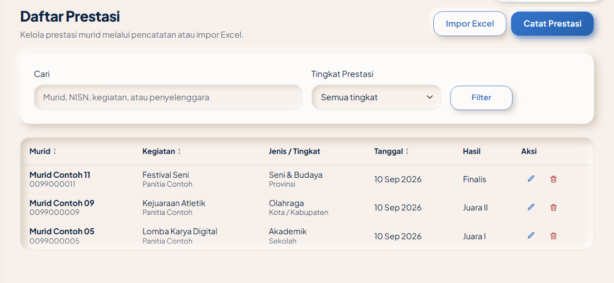

Pencarian dapat memakai murid, NISN, kegiatan, atau penyelenggara.

1. Buka **Prestasi**, isi **Cari** atau pilih **Tingkat Prestasi**.
2. Pilih **Filter** untuk melihat hasil.
3. Pilih kolom Murid, Kegiatan, atau Tanggal untuk mengurutkan. Gunakan nomor halaman bila diperlukan.

Jika tidak ada hasil, kurangi pilihan pencarian.
### Mengedit prestasi

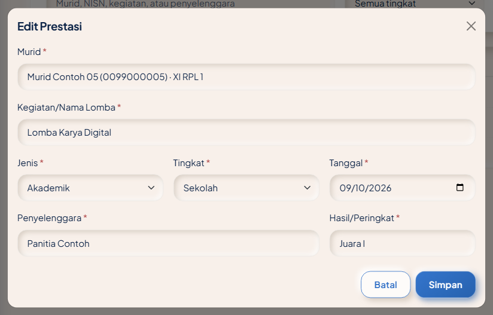

Anda harus masuk sebagai Waka dan memilih catatan prestasi yang sudah ada.

1. Pilih ikon **Edit prestasi** pada baris target.
2. Koreksi kegiatan, jenis, tingkat, tanggal, penyelenggara, atau hasil. Identitas murid tidak diganti melalui edit.
3. Pilih **Simpan**, lalu periksa nilai terbaru pada daftar.

Jika perubahan ditolak karena pengguna lain sudah memperbarui data, muat ulang halaman dan bandingkan isinya sebelum mencoba lagi. Guru BK dan Koordinator hanya dapat membaca prestasi sesuai cakupan aksesnya.
### Menghapus catatan prestasi yang keliru


Tombol **Hapus prestasi** mengarsipkan catatan sehingga tidak tampil lagi dalam daftar. Halaman ini tidak menyediakan tombol pemulihan.

1. Pilih **Hapus prestasi** pada baris yang tepat.
2. Baca kembali kegiatan dan murid pada dialog konfirmasi.
3. Pilih **Ya, hapus** hanya bila target benar; gunakan **Batal** jika ragu.
4. Periksa bahwa catatan tidak lagi tampil pada daftar aktif.

# 5 Panduan Admin IT

Menyiapkan akun dan data murid sebelum penugasan oleh Koordinator BK.


### Alur kerja Admin IT


Admin IT menyiapkan akun, daftar kelas, daftar murid, sumber pembaruan data, dan tampilan web. Menu yang dipakai ialah **Dashboard**, **Manajemen Web**, **Kelola Akun**, **Data Master**, **Data Kelas**, dan **Akun Saya**. Peran ini tidak memberi akses ke isi layanan BK. Koordinator BK bertanggung jawab membagi kelas binaan dan mengaktifkan tahun ajaran.

> Pada awal tahun, rapikan **Data Kelas**, buat tahun persiapan di **Data Master > Dapodik**, lalu impor daftar murid melalui API Siswa atau berkas CSV/Excel. Setelah itu, minta Koordinator membagi kelas binaan dan mengaktifkan tahun ajaran.

## 5.1 Dashboard Admin IT

### Membaca kesiapan akun dan integrasi


1. Buka **Dashboard**; pilih **Tahun Ajaran** bila perlu melihat periode tertentu.
2. Baca **Akun Aktif**, **Akun Nonaktif**, **Konflik Sinkronisasi**, dan **Integrasi Bermasalah**.
3. Pilih jumlah konflik untuk membuka **Data Master > Sinkronisasi**; periksa **Status sinkronisasi terbaru** dan **Status Integrasi** sebelum menindaklanjuti.

Indikator menunjukkan hal yang perlu diperiksa; halaman ini tidak menguji sambungan secara langsung. Jika pembaruan otomatis e-Tatib gagal, periksa tab **e-Tatib** dan riwayatnya sebelum mencoba lagi.

## 5.2 Kelola Akun

### Mencari dan memeriksa akun


1. Buka **Kelola Akun**; isi **Cari nama atau email** atau pilih **Peran**, lalu **Filter**.
2. Urutkan **Nama** atau **Status** bila daftar panjang.
3. Pilih ikon **Lihat Informasi** pada akun untuk memeriksa email, login terakhir, dan status sandi.

### Membuat akun


1. Pilih **Tambah Akun**, isi **Nama** dan **Email**, lalu pilih minimal satu peran.
2. Pilih Admin IT, Waka Kesiswaan, Guru BK, atau Koordinator BK secara terpisah; hanya Guru BK dan Koordinator BK yang boleh digabung.
3. Pilih **Buat akun**.

Akun baru muncul di daftar. Jika email telah dipakai atau kombinasi peran ditolak, perbaiki isian sebelum mencoba lagi.

### Memeriksa informasi akun


1. Buka informasi akun melalui ikon **Lihat Informasi** pada baris akun.
2. Periksa email, waktu login terakhir, dan status sandi.
3. Tutup panel informasi setelah selesai.

Sandi sementara tidak ditampilkan pada panel ini. Gunakan **Reset Sandi** untuk menerbitkan sandi baru bagi akun lain.

### Mengedit identitas dan status akun


1. Pilih ikon **Edit Akun** pada baris yang tepat.
2. Koreksi nama atau email, atau pilih **Status**: **Aktif** atau **Nonaktif**.
3. Simpan dan periksa status baru pada daftar.

Akun nonaktif tidak dapat masuk. Admin IT tidak dapat menonaktifkan akunnya sendiri.

### Mengubah peran akun


1. Pilih penanda peran atau ikon **Tambah Peran** pada akun tujuan.
2. Pilih kombinasi peran yang diizinkan, lalu **Simpan peran**.
3. Periksa penanda peran baru pada daftar.

Izin akun mengikuti peran baru. Admin IT tidak dapat mengganti perannya sendiri. Jika pilihan ditolak, periksa kembali kombinasi perannya.

### Mereset sandi akun lain


1. Pilih ikon **Reset Sandi** pada akun tujuan dan periksa nama akun di konfirmasi.
2. Pilih **Ya, Reset Sandi**.
3. Salin sandi sementara baru dari informasi akun yang terbuka seperti langkah sebelumnya.

Sandi lama tidak berlaku dan sesi lama berakhir. Jika panel sandi tertutup sebelum sandi baru disalin, terbitkan sandi sementara lagi. Untuk mengganti sandi sendiri, gunakan **Akun Saya**.

## 5.3 Data Kelas

### Melihat katalog rombel


1. Buka **Data Kelas** dan pilih jurusan yang akan diperiksa.
2. Pilih **Lihat Rombel** untuk melihat nama, status, dan jumlah murid.
3. Cocokkan rombel aktif dengan daftar sekolah sebelum membuat tahun persiapan.

Rombel aktif tersedia untuk tahun berjalan dan tahun persiapan. Jumlah murid yang ditampilkan berasal dari tahun aktif.

### Menambah rombel


1. Pada **Data Kelas**, pilih **Tambah Rombel** bila perlu membuka formulir.
2. Isi **Nama rombel** sesuai daftar sekolah.
3. Pilih **Tambah Rombel** dan periksa baris baru.

Rombel baru masuk daftar kelas. Jika namanya sudah dipakai, koreksi nama atau aktifkan kembali rombel lama yang sesuai.

### Mengedit atau menonaktifkan rombel


1. Pilih nama rombel untuk membuka **Edit Rombel**.
2. Koreksi **Nama Rombel** atau pilih **Status** Aktif/Nonaktif.
3. Pilih **Simpan** dan periksa hasil pada daftar.

Daftar kelas berubah tanpa mengganti nama pada riwayat tahun sebelumnya. Rombel yang masih memiliki murid atau penugasan tidak dapat dinonaktifkan sebelum penempatannya diselesaikan.

## 5.4 Tahun ajaran persiapan

### Membuat tahun persiapan


1. Pastikan rombel aktif sudah benar, lalu buka **Data Master > Dapodik**.
2. Isi nama tahun pada bagian **Buat Tahun Ajaran** sesuai sumber sekolah.
3. Pilih **Buat Tahun Ajaran**, lalu siapkan daftar murid melalui API Siswa atau berkas.

Tahun baru berstatus persiapan dan belum digunakan untuk layanan. Rombel aktif tersedia secara otomatis. Nama tahun dalam data dari API atau berkas harus sama persis.

### Membatalkan persiapan yang keliru


1. Di daftar **Tahun Ajaran**, pilih aksi pembatalan untuk tahun persiapan yang keliru.
2. Periksa nama tahun dan akibatnya di dialog.
3. Pilih **Ya, batalkan persiapan** hanya untuk tahun yang memang akan dibatalkan.

Jika syaratnya terpenuhi, tahun persiapan beserta penempatan murid dan penugasan khusus tahun itu dihapus. Tahun yang pernah aktif atau sudah memiliki layanan maupun data terverifikasi tidak dapat dibatalkan di sini.

## 5.5 Tautan API Siswa dan e-Tatib

Tautan API adalah alamat penghubung yang dipakai aplikasi untuk mengambil data dari sistem sumber sekolah. Anda cukup memasukkan alamat resmi yang diberikan pengelola sistem tersebut; langkah ini tidak memerlukan pemrograman.

### Mengenali kolom tautan API


1. Buka tab **Dapodik** untuk **Tautan API Siswa** atau tab **e-Tatib** untuk tautan e-Tatib.
2. Pastikan alamat yang akan dipakai adalah HTTPS sumber resmi sekolah.
3. Pilih langkah di bawah sesuai kebutuhan: menyimpan alamat, memakai alamat sementara, mengubahnya, atau menampilkannya.

Kolom ini mengatur alamat yang dipakai aplikasi. Status sumber pada halaman tidak berarti sambungan telah diuji secara langsung.

### Menyimpan tautan resmi


1. Isi **Tautan API Siswa/e-Tatib** pada tab yang tepat, lalu pilih **Simpan**.
2. Pada jendela yang terbuka, periksa alamat dan isi **Kata sandi saat ini**.
3. Pilih **Simpan tautan**; setelah berhasil, kolom menampilkan penanda tersamar.

Alamat tersimpan dalam bentuk terenkripsi. Jika alamat, sumber, atau kata sandi ditolak, perbaiki isian tanpa menyalin alamat rahasia ke laporan masalah.

### Memakai tautan tersimpan


1. Biarkan **Gunakan API tersimpan** tercentang.
2. Pilih **Tinjau Data** pada tab sumber yang tepat.
3. Periksa pratinjau sebelum mengimpor atau menyinkronkan.

**Tinjau Data** memakai alamat tersimpan tanpa menampilkan alamat aslinya. Langkah ini hanya menampilkan pratinjau; data belum diimpor atau disinkronkan. Jika data gagal diambil, Admin IT memeriksa alamat API. Petugas server membantu memeriksa layanan dan jaringan bila diperlukan.

### Mengubah tautan tersimpan


1. Pilih **Ubah** di kolom tautan tersimpan.
2. Isi alamat HTTPS baru serta **Kata sandi saat ini**.
3. Simpan dan lakukan **Tinjau Data** lagi sebelum menggunakan sumber baru.

Jika alamat e-Tatib diubah, pembaruan otomatis berhenti sampai pratinjau dan aktivasi ulang berhasil. Meninjau alamat baru saja belum mengaktifkannya kembali.

### Menampilkan lalu menyembunyikan tautan


1. Pilih **Tampilkan** hanya bila perlu memeriksa alamat tersimpan.
2. Masukkan **Kata sandi saat ini** dan baca alamat di tempat privat.
3. Pilih **Sembunyikan** atau tutup jendela segera setelah pemeriksaan.

Jangan menyertakan alamat API rahasia dalam tangkapan layar atau pesan pelaporan masalah.

### Meninjau alamat sekali pakai


1. Lepas centang **Gunakan API tersimpan**.
2. Isi tautan HTTPS sementara pada kolom yang sama.
3. Pilih **Tinjau Data** dan periksa pratinjau sumber.

Alamat sementara hanya dipakai untuk peninjauan ini. **Tinjau Data** belum menyimpan alamat atau menyinkronkan data, dan alamat tersimpan tetap sama.

## 5.6 Daftar murid dari API Siswa

### Meninjau data API Siswa


1. Buat dahulu tahun yang tercantum di sumber; pada **Data Master > Dapodik** pilih **Tinjau Data**.
2. Di **Pratinjau API Siswa**, periksa jumlah baris, murid baru/cocok, nama berbeda, dan kesiapan tiap tahun.
3. Baca konflik tahun, rombel, atau identitas sebelum melanjutkan.

Pratinjau belum mengubah daftar murid. Jika tahun atau rombel tidak cocok, atau data dari sumber gagal diambil, perbaiki sumber lalu tinjau kembali.

### Memilih baris NISN ganda


1. Temukan setiap kelompok NISN yang muncul lebih dari sekali dalam tahun sama.
2. Bandingkan nama dan rombel dengan data resmi, lalu pilih **satu** baris yang benar per kelompok.
3. Pastikan tidak ada konflik pemblokir lain sebelum menekan impor.

**Impor Data** tersedia setelah setiap kelompok dipilih dengan benar. Jangan menebak hanya berdasarkan kemiripan nama.

### Mengimpor hasil tinjauan API


1. Dari pratinjau yang telah diperiksa, pilih **Impor Data**.
2. Tunggu pemeriksaan ulang sumber dan baca pesan hasil jumlah baris, murid baru/cocok, dan rombel baru.
3. Beri tahu Koordinator BK tentang rombel baru agar guru binaan ditugaskan.

Identitas dan riwayat murid yang cocok tidak digandakan. Jika data dari sumber berubah sejak pratinjau, pilih **Tinjau Data** lagi sebelum mengimpor.

## 5.7 Daftar murid dari CSV atau Excel

### Mengunduh dan mengisi templat


1. Di **Data Master > Dapodik**, buka **Impor CSV atau Excel jika API belum tersedia** dan pilih **Unduh template impor**.
2. Isi kolom `nisn`, `nama`, `rombel`, dan `tahun_pelajaran`. Simpan NISN sebagai teks agar angka nol di awal tidak hilang.
3. Gunakan tahun yang telah dibuat dan rombel sekolah yang benar. Untuk CSV gunakan UTF-8 dengan urutan empat kolom sama.

Tahun persiapan harus sudah dibuat. Berkas dibatasi hingga 2 MiB dan 5.000 baris. Berkas Excel harus berformat `.xlsx`, berisi satu lembar, dan tidak menggunakan rumus.

### Meninjau berkas Excel sebelum impor


1. Pilih **Pilih berkas CSV atau Excel**, pilih berkas, lalu **Tinjau / Impor Berkas**.
2. Untuk Excel, baca **Pratinjau Excel Daftar Murid** dan periksa tahun, rombel, serta konflik.
3. Pilih **Impor Data** hanya setelah isinya benar. Untuk CSV, ikuti hasil/validasi setelah pengiriman.

Jika ditolak, periksa ekstensi, judul kolom, ukuran, NISN, tahun, dan rombel. Tinjau lagi setelah memperbaiki berkas.

### Memeriksa hasil impor berkas


1. Baca pesan jumlah baris, murid baru/cocok, dan rombel baru setelah impor.
2. Periksa contoh murid pada **Data Murid** bersama petugas yang berwenang.
3. Serahkan daftar rombel baru kepada Koordinator BK untuk penugasan.

Daftar murid yang sah masuk tanpa mengganti identitas atau riwayat murid yang cocok. Aplikasi tidak menyimpan berkas aslinya.

## 5.8 e-Tatib manual

### Meninjau catatan dan identitas sumber


1. Pastikan daftar murid tersedia, lalu buka **Data Master > e-Tatib** dan pilih **Tinjau Data**.
2. Periksa jumlah catatan, identitas yang belum cocok, catatan lama yang tidak dikirim lagi, dan kejadian tanpa tanggal.
3. Jika identitas berbeda, bandingkan NISN, nama, dan rombel. Pilih murid yang cocok hanya jika Anda yakin. Bila buktinya belum cukup, pilih **Lewati dulu, belum tertaut**.

Pratinjau belum menyinkronkan data. NISN pada master Dapodik menjadi acuan pencocokan otomatis; perbedaan nama e-Tatib tidak menghalangi penautan. Nama master tetap dipakai sebagai identitas resmi. Jika NISN sumber belum ditemukan, periksa kandidat secara manual berdasarkan bukti resmi sekolah.

### Menyetujui kelompok kejadian identik


1. Pada pratinjau, periksa tiap kelompok baris identik terhadap sumber.
2. Bila memang satu kejadian, centang **anggap sebagai satu kejadian** pada kelompok itu.
3. Ulangi untuk semua kelompok baru sebelum sinkronisasi.

Sinkronisasi tertahan jika masih ada kelompok baru yang belum diputuskan. Keputusan sebelumnya dapat dilihat pada **Keputusan Duplikasi**.

### Membatalkan keputusan duplikasi lama


1. Pada tab **e-Tatib**, buka **Keputusan Duplikasi** dan temukan kelompok yang keliru disetujui.
2. Pilih **Batalkan Keputusan** dan periksa kelompok pada dialog konfirmasi.
3. Konfirmasi pembatalan, lalu tinjau ulang sebelum sinkronisasi berikutnya.

Pada sinkronisasi berikutnya, Anda perlu memeriksa kelompok itu lagi. Riwayat keputusan tetap tersimpan.

### Menjalankan sinkronisasi manual


1. Setelah pratinjau layak, pilih **Sinkronkan Data**.
2. Baca pesan berhasil, peringatan, atau gagal setelah kembali ke halaman.
3. Bila otomatis sudah aktif, **Sinkronkan Sekarang** menjalankan pembaruan manual dari tautan tersimpan.

Catatan dari sumber disalin ke aplikasi tanpa mengubah data di e-Tatib. Catatan lama yang tidak lagi dikirim sumber tidak otomatis terhapus. Jika proses gagal, periksa sumber, kesiapan data utama, dan keputusan tentang kejadian identik. Tinjau kembali jika data sumber berubah.

## 5.9 e-Tatib otomatis

### Mengaktifkan pembaruan otomatis


1. Pastikan alamat resmi tersimpan dan penjadwal pada server berjalan.
2. Di **Data Master > e-Tatib**, pilih **Tinjau Data** dan selesaikan identitas/duplikasi yang perlu diputus.
3. Pilih **Aktifkan Otomatis**, isi **Kata sandi saat ini**, lalu konfirmasi.

Aplikasi menyinkronkan data terlebih dahulu, lalu mengaktifkan pembaruan otomatis jika proses berhasil. Jika aktivasi ditolak, periksa pratinjau dan kata sandi.

### Mengatur hari dan jam pembaruan


1. Pada **Jadwal Pembaruan e-Tatib**, pilih hari dan jam WIB; bawaan adalah setiap hari pukul 10.00, 13.00, dan 15.00.
2. Gunakan **Tambah jam** atau **Hapus** untuk mengubah jam.
3. Isi kata sandi saat ini dan pilih **Simpan jadwal**.

Jadwal baru berlaku pada waktu pembaruan berikutnya. Pilih sedikitnya satu hari dan satu jam, dengan paling banyak 24 waktu berbeda per hari. Menyimpan jadwal tidak mengaktifkan kembali pembaruan yang sedang nonaktif.

### Menonaktifkan pembaruan otomatis


1. Pada **Nonaktifkan Pembaruan Otomatis**, isi kata sandi saat ini.
2. Pilih **Nonaktifkan** dan baca konfirmasi.
3. Setujui untuk menghentikan jadwal otomatis.

Alamat tersimpan tetap dapat dipakai untuk pratinjau atau sinkronisasi manual. Jika jadwal sebelumnya tidak berjalan, periksa riwayat dan penjadwal server.

## 5.10 Konflik identitas dan duplikasi e-Tatib

### Mencari identitas yang belum cocok


1. Pilih **Perlu Ditinjau** dari **Data Master** atau buka **Konflik e-Tatib > Belum Cocok**.
2. Cari nama/NISN dan baca **Identitas Sumber**, **Rombel Sumber**, alasan, dan jumlah pelanggaran.
3. Tentukan apakah bukti cukup untuk mencocokkan identitas secara otomatis atau manual.

Identitas yang belum diputuskan tetap belum terhubung dengan murid. Jangan memilih murid hanya berdasarkan nama jika masih ada keraguan.

### Mempratinjau pencocokan otomatis


1. Pilih **Berdasarkan NISN**. Pencocokan otomatis hanya memakai NISN master; nama bukan kunci pencocokan.
2. Periksa pasangan identitas sumber dan data utama yang ditampilkan. Jika hasilnya lebih dari satu atau tidak ada, tangani secara manual.
3. Centang konfirmasi dan pilih **Terapkan Pencocokan** hanya untuk pasangan tunggal yang benar.

Pencocokan tersimpan di aplikasi dan tercatat dalam riwayat. Identitas pada sistem sumber tidak berubah.

### Mencocokkan satu identitas secara manual


1. Pada baris konflik, pilih ikon **Cocokkan**.
2. Cari murid pada data utama, lalu bandingkan NISN, nama, dan rombel.
3. Pilih kandidat yang benar, centang konfirmasi, lalu simpan.

Pencocokan manual tersedia jika NISN sumber belum ditemukan pada master. NISN yang sudah ada pada master tidak dapat dialihkan ke murid lain. Jika bukti belum cukup, biarkan identitas berstatus belum cocok. Pelanggaran yang sudah terkait kasus BK tidak dapat dipindahkan ke murid lain melalui sinkronisasi atau pencocokan.

### Mengubah target pencocokan manual


1. Buka tab **Pencocokan Manual** dan temukan relasi yang salah.
2. Pilih **Ubah Pencocokan**, bandingkan murid pengganti dengan data sumber, lalu simpan pilihan yang benar.
3. Periksa target baru pada daftar.

Perubahan dapat ditolak jika catatan sudah terkait dengan kasus BK. Ikuti prosedur koreksi data resmi sekolah.

### Membatalkan pencocokan manual


1. Pada tab **Pencocokan Manual**, pilih relasi yang tidak lagi sah.
2. Pilih **Batalkan Pencocokan** dan periksa pasangan pada konfirmasi browser.
3. Setujui konfirmasi browser untuk melepas pencocokan.

Setelah pencocokan manual dibatalkan, aturan pencocokan otomatis berlaku kembali. Keputusan sebelumnya tetap tercatat dalam riwayat.

## 5.11 Masalah dan riwayat sinkronisasi

### Meninjau masalah


1. Buka **Data Master > Sinkronisasi**.
2. Pada **Masalah Sinkronisasi**, baca sumber, data, alasan, dan status pemeriksaan.
3. Pilih ikon **Tinjau** untuk membuka rincian di bawah baris.

Rincian masalah tampil tanpa mengubah data sumber. Tangani konflik identitas melalui **Cocokkan identitas murid**.

### Menyimpan tindakan untuk beda kelas


1. Bandingkan kelas e-Tatib dengan penempatan sekolah pada tanggal kejadian.
2. Jika bukti jelas, pilih kelas sekolah atau kelas e-Tatib yang benar **untuk kejadian itu**, lalu **Simpan tindakan**.
3. Jika belum jelas, pilih **Belum dapat menentukan; perlu koreksi data**, isi **Catatan singkat**, lalu simpan.

Keputusan ini tidak mengubah kelas murid pada data utama. Jika Anda memilih koreksi pada sumber, masalah tetap terbuka. Jangan menebak kelas jika tidak ada data pembanding.

### Membaca riwayat


1. Pada tab **Sinkronisasi**, pilih **Tampilkan Riwayat** di **Riwayat Keputusan Kelas** atau **Riwayat Sinkronisasi**.
2. Baca keputusan dan hasil proses; gunakan halaman berikutnya bila perlu.
3. Cocokkan waktu dan sumber dengan masalah yang sedang diperiksa.

## 5.12 Manajemen Web

### Mengganti logo web/sekolah


1. Buka **Manajemen Web**, bagian **Logo web**.
2. Pilih **Unggah logo baru**, pilih PNG/JPEG resmi maksimal 2 MB dan 2048 × 2048 piksel.
3. Pilih **Simpan** dan periksa pratinjau.

Logo dipakai pada aplikasi, ikon tab, dan sisi sekolah pada kop laporan. Jika berkas ditolak, periksa format, ukuran, resolusi, dan keasliannya.

### Mengganti logo dinas pada kop


1. Pada halaman yang sama, buka **Logo dinas untuk kop laporan**.
2. Pilih gambar resmi PNG/JPEG dengan batas ukuran dan resolusi yang sama.
3. Pilih **Simpan** dan periksa pratinjau.

Jika kedua logo tersedia, logo dinas berada di kiri dan logo sekolah di kanan pada kop laporan.

### Memilih atau memulihkan tema


1. Di **Tema warna**, pilih **Bawaan**, **Navy**, **Logo SMKN 1**, atau **Modern Logo**.
2. Pilih **Simpan tema** dan lihat hasil pada halaman.
3. Untuk kembali ke palet bawaan, pilih **Kembalikan ke default**.

Tema berlaku pada aplikasi dan halaman masuk. Anda dapat memilih empat tema yang tersedia; warna status dan kertas laporan tetap sama. Gambar di atas menunjukkan letak pengaturan pada versi sebelumnya; nama pilihan mengikuti daftar terbaru pada langkah 1.

## 5.13 Akun pribadi dan keluar

Ikuti gambar dan langkah pada bagian 1.5 untuk membuka **Akun Saya**, mengubah sandi, dan **Keluar**. Admin IT tidak dapat mereset sandinya sendiri melalui **Kelola Akun**. Jika sandi sementara kedaluwarsa, minta Admin IT lain menerbitkan sandi baru.

# 6 Instalasi dan operasional server sekolah

Petugas teknis dapat mengikuti contoh pemasangan pada VPS Ubuntu/Debian dengan Nginx, PHP-FPM, MySQL, dan satu akun Linux aplikasi. Jika server memakai panel web, sesuaikan langkahnya melalui panel dan terminal yang tersedia.

Ganti domain `bk.example.sch.id`, lokasi `/var/www/sibk`, nama akun, dan database sesuai server sekolah. Gunakan repo rilis sekolah yang disiapkan Ibnu dan cocokkan versinya dengan `RELEASE.json`. Pembaruan dari repo pengembangan disalurkan sebagai rilis resmi ke repo sekolah. Gunakan alamat repo dan versi yang tercantum dalam serah terima.


## 6.1 Siapkan server

Persyaratan pada bab ini dan `composer.json` menggantikan nomor versi PHP lama pada dokumen Word atau gambar contoh. Pihak sekolah menjalankan pemasangan, pembaruan runtime, dan verifikasi server; repo serta ZIP hanya menyediakan aplikasi dan petunjuknya.


1. Arahkan DNS (pengarah domain) ke VPS dan siapkan sertifikat HTTPS. Sediakan Nginx, MySQL, PHP-FPM dan PHP CLI **8.4.27 atau lebih baru pada cabang 8.4, atau 8.5.12 atau lebih baru pada cabang 8.5**, Composer 2, serta layanan `cron` aktif. Web, CLI, dan cron harus memakai runtime yang sudah diperbaiki serta ekstensi yang sesuai.
2. [PHP2Shell (CVE-2026-109618 dan CVE-2026-109619)](https://www.php.net/archive/2026.php#2026-10-21-5) adalah kerentanan runtime PHP; perubahan source aplikasi atau dependency Composer tidak menambalnya. Sebelum memasang dependency, periksa `php -v` dan jalankan `composer check-platform-reqs --lock --no-dev`. Jika gagal, hentikan instalasi dan minta administrator hosting memperbarui runtime. Paket distributor juga harus memenuhi batas `composer.json`; jangan memakai `--ignore-platform-reqs` atau `config.platform` untuk melewatinya. Periksa PHP web/FPM melalui panel hosting atau administrator; versi CLI saja tidak membuktikan web/FPM telah diperbarui. Jangan memasang `phpinfo()` pada server publik.
3. Pasang `pdo_mysql` pada PHP-FPM dan PHP CLI untuk koneksi MySQL, cURL (libcurl minimal 7.49), GD untuk logo dan Excel, serta ekstensi lain yang diminta lockfile. Periksa `php --ri pdo_mysql`, `composer -V`, lalu `composer check-platform-reqs --no-dev` setelah dependensi terpasang. Pastikan `pdo_mysql` juga aktif pada PHP-FPM. Node.js/npm yang kompatibel dengan Vite diperlukan di server atau mesin builder untuk aset. Jangan memakai `php artisan serve` atau `npm run dev` sebagai layanan produksi.
4. Buat akun Linux aplikasi, misalnya `sibk`, tanpa hak root. Taruh source rilis di `/var/www/sibk`. Proses PHP dan akun cron perlu membaca source serta menulis ke `storage/` dan `bootstrap/cache/`; `storage/app/private/branding` harus dapat ditulis untuk logo. Atur owner/grup sesuai akun proses PHP, tanpa izin `777`. Berkas `.env` hanya boleh dibaca akun yang memerlukannya.
5. Buat database MySQL khusus SIBK dan akun database khusus dengan hak hanya pada database itu, bukan root atau hak global. Migrasi (perubahan struktur database) memerlukan hak `CREATE`, `ALTER`, `INDEX`, dan `DROP` selain baca/tulis. Sesudahnya, hak akun runtime dapat dipersempit. Siapkan akun backup terpisah. Jangan memakai database pengembangan bersama.

Ikuti pula [advisori PHP tanggal 23 Oktober 2026](https://www.php.net/archive/2026.php#2026-10-23-1): `session.upload_progress.enabled=0` disarankan sampai rilis bugfix rutin berikutnya untuk jalur RCE tambahan dengan kondisi konfigurasi tertentu. Terapkan di `php.ini` atau konfigurasi PHP-FPM sebelum parsing request dan restart seluruh worker; `ini_set()` atau `.user.ini` bukan pengganti konfigurasi tersebut. Pengaturan ini tidak menggantikan pembaruan PHP. Periksa perkembangan advisori saat pemasangan.


Contoh blok Nginx, dengan socket PHP-FPM dan jalur sertifikat disesuaikan server. Terbitkan sertifikat sebelum membuka akses pengguna:

```nginx
server {
    listen 80;
    server_name bk.example.sch.id;
    return 301 https://$host$request_uri;
}
server {
    listen 443 ssl;
    server_name bk.example.sch.id;
    root /var/www/sibk/public;
    index index.php;
    ssl_certificate /etc/letsencrypt/live/bk.example.sch.id/fullchain.pem;
    ssl_certificate_key /etc/letsencrypt/live/bk.example.sch.id/privkey.pem;
    location / { try_files $uri $uri/ /index.php?$query_string; }
    location ~ \.php$ {
        try_files $uri =404;
        include fastcgi_params;
        fastcgi_param SCRIPT_FILENAME $realpath_root$fastcgi_script_name;
        fastcgi_pass unix:/run/php/php8.4-fpm.sock;
    }
    location ~ /\. { deny all; }
}
```

Pada panel hosting, pilih PHP 8.4.27+ pada cabang 8.4 atau 8.5.12+ pada cabang 8.5 dan ekstensi yang sama untuk web/CLI, aktifkan HTTPS, dan atur *document root* (direktori yang dilayani web) tepat ke `public/`. Jalankan langkah terminal berikut melalui terminal panel atau bantuan administrator hosting. Jangan arahkan domain ke root proyek.

Setelah menyimpan konfigurasi Nginx sebagai situs aplikasi, jalankan `sudo nginx -t`. Hanya bila hasilnya sukses, muat ulang dengan `sudo systemctl reload nginx`.

Pada VPS berbasis systemd, `sudo systemctl enable --now cron` mengaktifkan layanan cron setelah boot. Pengelolaan layanan memerlukan petugas dengan akses administratif. Pemasang cron aplikasi tetap dijalankan sebagai akun aplikasi, bukan root.

**Batas unggahan.** Atur PHP-FPM agar `upload_max_filesize` minimal 2M dan `post_max_size` lebih besar, misalnya 8M. Pada Nginx, `client_max_body_size 8m;` di blok server memberi ruang untuk formulir multipart. Batas aplikasi tetap 2 MB untuk unggahan yang bersangkutan. Muat ulang PHP-FPM/Nginx sesudah mengubah konfigurasinya. Sesuaikan nama unit PHP-FPM dengan versi CLI yang dipilih.

Nama paket PHP bisa berbeda menurut OS atau panel. Gunakan paket resmi yang kompatibel dan periksa hasil `composer check-platform-reqs --no-dev`.

## 6.2 Instalasi pertama


1. Masuk sebagai akun aplikasi ke `/var/www/sibk`. Dari source rilis repo sekolah, salin `.env.example` ke `.env` **hanya bila belum ada**. Isi domain dan akses database di server. Pertahankan `APP_ENV=production`, `APP_DEBUG=false`, `APP_URL=https://bk.example.sch.id`, `DB_CONNECTION=mysql`, `SESSION_DRIVER=database`, `CACHE_STORE=database`, `QUEUE_CONNECTION=sync`, dan `FILESYSTEM_DISK=local`. Batasi akses ke `.env`.
2. Buat nilai rahasia `ALUMNI_RETENTION_KEY` untuk instalasi baru dengan perintah berikut dan salin hasilnya ke `.env`. Simpan bersama backup rahasia. Kunci 32 byte ini harus tetap sama ketika `APP_KEY` dirotasi atau server dipindah.

   ```sh
   php -r "echo 'base64:'.base64_encode(random_bytes(32)),PHP_EOL;"
   ```


3. Jalankan di server. Dua perintah npm boleh dijalankan di mesin builder; kirim `public/build` hasil build dari rilis source yang sama ke server. Jangan memakai `composer setup` karena skripnya otomatis membuat kunci dan menjalankan migrasi.

   ```sh
   composer check-platform-reqs --lock --no-dev
   composer install --no-dev --prefer-dist --optimize-autoloader
   composer check-platform-reqs --no-dev
   npm ci --ignore-scripts
   npm run build
   # Hanya instalasi baru ketika APP_KEY masih kosong:
   php artisan key:generate --force
   php artisan migrate --force
   php artisan db:seed --force
   php artisan storage:link
   php artisan config:cache
   php artisan view:cache
   ```

   `key:generate` hanya untuk pemasangan pertama tanpa `APP_KEY`. `migrate --force` memperbarui skema tanpa mereset data. Dalam produksi, `db:seed --force` hanya mengisi peran dan referensi; akun dan data murid tidak dibuat. Jangan gunakan `migrate:fresh`, reset database, atau seeder akun uji. `storage:link` membuat tautan disk publik. Logo unggahan tersimpan di `storage/app/private/branding` dan ditampilkan melalui aplikasi.


4. Buat Admin IT pertama: jalankan `php artisan tinker` di terminal server, lalu masukkan kode berikut. Ganti nama dan email contoh dengan petugas sekolah yang sah. Kode menolak pembuatan jika Admin IT sudah ada.

   ```php
   $admin = Illuminate\Support\Facades\DB::transaction(function () {
       if (App\Models\User::whereHas('roles', fn ($q) => $q->where('slug', 'admin_it'))->exists()) {
           throw new RuntimeException('Admin sudah ada; gunakan akun tersebut.');
       }
       $role = App\Models\Role::where('slug', 'admin_it')->firstOrFail();
       $user = App\Models\User::create([
           'name' => 'Administrator Sekolah',
           'email' => 'admin@example.sch.id',
           'password' => Illuminate\Support\Str::random(64),
           'is_active' => true,
       ]);
       $user->roles()->attach($role);
       return $user;
   });
   $result = app(App\Services\TemporaryPasswordService::class)->issue($admin);
   echo $result->plainTextPassword;
   ```

   Sampaikan sandi sementara lewat saluran privat; pengguna wajib menggantinya saat login. Untuk akun Admin IT aktif yang kehilangan akses, gunakan `php artisan sibk:reset-admin-password` secara interaktif pada terminal server. Jangan gunakan akun demo.

**Contoh pengaturan server.** Salin templat produksi utuh. Ganti nilai dalam huruf besar dengan nilai server sekolah.

```dotenv
APP_NAME="Ruang BK"
APP_ENV=production
APP_DEBUG=false
APP_URL=https://bk.example.sch.id
DB_CONNECTION=mysql
DB_HOST=127.0.0.1
DB_PORT=3306
DB_DATABASE=NAMA_DATABASE_SEKOLAH
DB_USERNAME=AKUN_DATABASE_APLIKASI
DB_PASSWORD="ISI_RAHASIA_DI_SERVER"
SESSION_DRIVER=database
SESSION_ENCRYPT=true
SESSION_SECURE_COOKIE=true
CACHE_STORE=database
FILESYSTEM_DISK=local
QUEUE_CONNECTION=sync
```

`APP_KEY` dibuat saat instalasi pertama. Isi `ALUMNI_RETENTION_KEY` sekali dengan nilai acak khusus instalasi ini. Pertahankan opsi lain pada templat produksi, termasuk pengamanan integrasi dan batas dokumen. Setelah mengubah `.env`, jalankan `php artisan config:cache`. Jangan memakai `.env` lokal atau konfigurasi demo di server sekolah.

## 6.3 Scheduler dan retensi


1. Sebelum mengaktifkan cron pada database yang sudah berisi data, jalankan `php artisan sibk:hapus-alumni`. Perintah tanpa `--execute` hanya menampilkan pratinjau jumlah **memenuhi syarat** dan **ditunda**. Jangan menghapus relasi atau penanda secara manual untuk memaksa retensi.

   `ALUMNI_RETENTION_ENABLED=false` menonaktifkan penghapusan secara bawaan. Pratinjau tetap tersedia, jadwal e-Tatib tetap berjalan, dan pemeriksaan penanda saat impor tetap berlaku. `--execute` ditolak selama penghapusan nonaktif. Setelah aktivasi terpisah, scheduler menjalankan penghapusan pukul 02.00 WIB. Hanya alumni dengan keputusan **lulus**, status **resmi keluar**, dan tanggal efektif yang telah mencapai satu tahun kalender yang dapat diproses. Murid aktif, pindah, dalam penanganan pengunduran diri, berstatus proses atau batal, serta alumni yang belum jatuh tempo tidak ikut dihapus. Konflik relasi atau keanggotaan yang masih aktif dapat menunda penghapusan.

   Menu pencatatan kelulusan resmi belum tersedia pada versi ini. Pertahankan penghapusan nonaktif sampai alur dan data kelulusan, kebijakan penyimpanan, pratinjau, dan uji pemulihan cadangan siap. Aktivasi dilakukan dengan `ALUMNI_RETENTION_ENABLED=true` lalu `php artisan config:cache`. Untuk menghentikan eksekusi berikutnya, kembalikan ke `false` dan perbarui cache konfigurasi; proses yang sudah berjalan tidak dibatalkan.

   Setelah pemeriksaan keselamatan, proses ini membersihkan data identitas, layanan/arsip/tindak lanjut, prestasi, mirror e-Tatib, dan relasi audit lokal terkait. Sumber Dapodik dan e-Tatib tidak menerima perintah hapus. Penanda HMAC mencegah identitas yang telah dihapus diimpor ulang. Jika `ALUMNI_RETENTION_KEY` hilang atau berubah saat penanda sudah ada, impor dan penghapusan berhenti sampai kunci asli dipulihkan.


2. Pastikan layanan `cron` aktif. Jalankan sebagai akun aplikasi `sibk`, **bukan root**, dari `/var/www/sibk`:

   ```sh
   php artisan sibk:pasang-scheduler --dry-run
   php artisan sibk:pasang-scheduler
   crontab -l
   php artisan schedule:list
   ```

    `--dry-run` hanya memperlihatkan rencana. Pemasang menambah satu pemicu `schedule:run` setiap menit pada crontab akun itu, memakai path PHP/aplikasi yang terdeteksi, dan mengarahkan output ke `storage/logs/scheduler.log`. Entri lain tetap terjaga; pemasang berhenti jika menemukan entri scheduler berbeda. Periksa cron, timer, dan tugas panel agar pemicu tidak ganda.

    `schedule:list` hanya menampilkan definisi jadwal. Untuk membuktikan pemicu berjalan, tunggu satu menit; periksa waktu/log `storage/logs/scheduler.log` dan log layanan cron; lalu periksa hasil tugas yang memang jatuh tempo. Jangan menjalankan penghapusan `--execute` hanya untuk membuktikan cron.
3. Jika panel hosting tidak menyediakan `crontab`, buat **satu** tugas panel setiap menit dengan akun aplikasi dan PHP CLI yang sesuai:

   ```cron
   * * * * * cd /var/www/sibk && /usr/bin/php artisan schedule:run >> storage/logs/scheduler.log 2>&1
   ```

    Sesuaikan path PHP. Hari dan jam sinkronisasi e-Tatib diatur lewat Data Master (WIB) dan memakai pemicu Laravel yang sama; jangan buat cron e-Tatib terpisah.

    Sambungan langsung ke penyedia resmi belum tersedia (status `unavailable`). Gunakan **Data Master** untuk mengatur API Siswa dan e-Tatib. Jadwal e-Tatib mulai bekerja setelah diaktifkan di aplikasi. Dengan `QUEUE_CONNECTION=sync`, pemasangan ini tidak memerlukan pekerja antrean terpisah.


## 6.4 Pemeriksaan dan pembaruan


1. Buka `https://bk.example.sch.id/up` dan halaman login melalui HTTPS. Pastikan HTTP dialihkan ke HTTPS, aset tampil, dan source tidak dapat dibuka langsung. Login Admin IT sekolah, ganti sandi sementara, buat tahun ajaran, lalu periksa Data Master. Dengan akun sah per peran, periksa menu dan izin Guru BK, Koordinator BK, serta Waka Kesiswaan; akses tanpa izin harus ditolak. Uji impor murid, layanan, laporan, unggah logo, dan logout dengan data uji yang disetujui sekolah.
2. Pantau kapasitas disk, backup, MySQL/PHP-FPM/Nginx, `storage/logs/laravel.log`, `storage/logs/scheduler.log`, dan log cron. Rotasikan `scheduler.log` melalui kebijakan rotasi log server agar log setiap menit tidak memenuhi disk. Pastikan jam server sinkron; tanggal operasional, tampilan waktu, serta jadwal retensi/e-Tatib otomatis memakai WIB (`Asia/Jakarta`), tanpa pengaturan tambahan pengguna. Pertahankan `config/app.php` pada UTC untuk timestamp internal; jangan menggeser data lama atau jam sumber e-Tatib secara manual. Jika pembaruan otomatis e-Tatib sudah diaktifkan, periksa status sinkronisasi terakhir pada UI dan error log.
3. Uji rilis di lingkungan validasi. Sebelum maintenance atau menjeda cron produksi, jalankan `composer check-platform-reqs --lock --no-dev` dari folder rilis baru yang masih terpisah dari aplikasi aktif. Pastikan PHP CLI, web/FPM, dan cron memenuhi persyaratan rilis baru; jika gagal, hentikan pembaruan aplikasi dan minta administrator menyiapkan runtime yang sesuai. Setelah pemeriksaan lulus, jeda **hanya** pemicu cron Ruang BK melalui panel atau `crontab -e` dan catat entri semula; jangan gunakan `crontab -r`. Jalankan `php artisan down --with-secret` sebagai akun aplikasi dan simpan URL bypass yang dihasilkan secara privat untuk penguji berwenang. Tunggu seluruh penulisan data, termasuk sinkronisasi, retensi, impor, dan perintah manual yang sedang berjalan, selesai **sebelum** backup, penggantian source, atau migrasi.
4. Ambil satu set backup database, `storage/app`, dan `.env` dari keadaan yang sama sesuai 6.5, tanpa menjalankan langkah pembukaan akses atau pemulihan cron di akhir prosedur backup. Pertahankan `.env`, `storage`, `APP_KEY`, dan `ALUMNI_RETENTION_KEY`. Tempatkan source rilis baru, jalankan `composer install --no-dev --prefer-dist --optimize-autoloader` sesuai `composer.lock`, serta bangun atau serahkan `public/build` dari rilis source yang sama. Jalankan `php artisan migrate --force`, `php artisan config:cache`, dan `php artisan view:cache`. Jangan mengulang `key:generate` atau membuat ulang kunci retensi.
5. Setelah dependensi, migrasi, dan cache siap, gunakan URL bypass privat untuk uji login, logo, skema, dan menu serta izin tiap peran saat akses umum masih dalam maintenance; URL ini tidak melewati login. Periksa `php artisan schedule:list` untuk definisi jadwal saja. Jika semua pemeriksaan berhasil, jalankan `php artisan up`, pulihkan **satu** pemicu cron yang dicatat, lalu periksa log dan hasil tugas yang benar-benar jatuh tempo. Bila lokasi rilis berubah, arahkan satu pemicu itu ke lokasi baru; jangan menyunting crontab bersamaan dengan pemasang scheduler. Jika pembaruan atau pemeriksaan gagal, biarkan maintenance dan jeda cron tetap aktif, lalu selidiki atau pulihkan dari backup sesuai 6.5 tanpa reset database.

## 6.5 Backup dan pemulihan


Tetapkan jadwal dan masa simpan cadangan. Jeda hanya pemicu scheduler Ruang BK melalui panel atau crontab -e, dan catat entri semula; jangan gunakan crontab -r. Jika aplikasi belum dalam mode pemeliharaan, jalankan php artisan down. Jika sudah, pertahankan mode dan URL bypass yang ada. Tunggu seluruh proses yang mengubah data selesai, termasuk sinkronisasi, retensi, impor, dan perintah manual. Jangan melakukan pembaruan aplikasi selama pencadangan. Dengan demikian, database, storage/app, dan .env berasal dari keadaan yang sama.

Sediakan Bash, mysqldump, tar, sha256sum, dan age. Petugas menyiapkan /srv/backup/sibk dengan akses terbatas, serta /etc/sibk/backup-recipients.txt berisi kunci publik penerima cadangan. Simpan kunci privat pasangannya secara terpisah untuk pemulihan. Akun backup memerlukan hak baca serta hak routines/triggers yang sesuai. Sandi MySQL diminta melalui -p; jangan menuliskannya pada perintah.

Jalankan satu blok berikut melalui Bash dari direktori aplikasi:

```bash
(
set -euo pipefail
umask 077
BACKUP_DIR="/srv/backup/sibk/$(date -u +%Y%m%dT%H%M%SZ)"
RECIPIENTS=/etc/sibk/backup-recipients.txt
mkdir -m 700 "$BACKUP_DIR"
mysqldump --single-transaction --no-tablespaces \
  --set-gtid-purged=OFF --routines --triggers \
  -h 127.0.0.1 -u NAMA_AKUN_BACKUP -p NAMA_DATABASE \
  | age -R "$RECIPIENTS" -o "$BACKUP_DIR/database.sql.age"
tar -czf - storage/app \
  | age -R "$RECIPIENTS" -o "$BACKUP_DIR/files.tar.gz.age"
age -R "$RECIPIENTS" -o "$BACKUP_DIR/config.env.age" .env
cd "$BACKUP_DIR"
sha256sum database.sql.age files.tar.gz.age config.env.age > SHA256SUMS
printf 'Cadangan selesai: %s\n' "$BACKUP_DIR"
)
```

Jalankan satu blok Bash di atas dari direktori aplikasi. Blok berhenti bila ada perintah gagal; direktori baru bertanggal UTC mencegah cadangan lama tertimpa. Jika gagal, jangan pakai hasil sebagian sebagai cadangan. Periksa tiga berkas terenkripsi, checksum, dan kemampuan pemulihannya. Salin satu set lengkap ke penyimpanan terbatas di luar server utama; simpan kunci dekripsi secara terpisah. SHA256SUMS mendeteksi perubahan berkas, bukan membuktikan asalnya. Hanya untuk pencadangan mandiri yang berhasil, buka akses dengan perintah berikut jika sebelumnya ditutup khusus untuk pencadangan dan pulihkan pemicu cron yang sebelumnya dijeda. Saat pembaruan sesuai 6.4, lewati perintah berikut sampai seluruh pemeriksaan rilis berhasil; pemulihan cron juga menunggu saat itu.

```sh
php artisan up
```


Untuk uji atau pemulihan, pilih satu set cadangan dari waktu yang sama dan rilis aplikasi yang cocok. Siapkan database kosong serta akun pemulihan yang hanya berhak mengakses database itu. Siapkan direktori induk privat /srv/restore dan kunci dekripsi di lokasi terpisah. Sesuaikan tiga path dan nama database pada blok berikut; hasil dekripsi disimpan di direktori baru, di luar web publik.

```bash
(
set -euo pipefail
umask 077
# Ganti dengan direktori cadangan yang dipilih.
BACKUP_DIR=/srv/backup/sibk/20261023T030000Z
RESTORE_DIR="/srv/restore/sibk-$(date -u +%Y%m%dT%H%M%SZ)"
IDENTITY=/media/aman/sibk-backup.key
mkdir -m 700 "$RESTORE_DIR"
cd "$BACKUP_DIR"
sha256sum -c SHA256SUMS
age -d -i "$IDENTITY" -o "$RESTORE_DIR/database.sql" database.sql.age
age -d -i "$IDENTITY" -o "$RESTORE_DIR/files.tar.gz" files.tar.gz.age
age -d -i "$IDENTITY" -o "$RESTORE_DIR/.env" config.env.age
tar -xzf "$RESTORE_DIR/files.tar.gz" -C "$RESTORE_DIR"
mysql -h 127.0.0.1 -u NAMA_AKUN_PEMULIHAN -p \
  NAMA_DATABASE_PEMULIHAN < "$RESTORE_DIR/database.sql"
printf 'Hasil pemulihan: %s\n' "$RESTORE_DIR"
)
```

Pasang hasil storage/app dan .env pada salinan aplikasi pemulihan yang terisolasi. Pertahankan APP_KEY dan ALUMNI_RETENTION_KEY; sesuaikan koneksi ke database pemulihan dan domain uji. Tetapkan ALUMNI_RETENTION_ENABLED=false sebelum menjalankan aplikasi. Jangan memasang cron di lingkungan pemulihan; batasi akses keluar ke API sumber. Bangun ulang cache konfigurasi agar aplikasi tidak memakai koneksi produksi yang tersimpan sebelumnya.

Pulihkan izin berkas, vendor, dan public/build dari rilis yang sama. Jalankan storage:link, config:cache, dan view:cache melalui php artisan pada salinan pemulihan. Periksa login, jumlah dan relasi data, logo, berkas, serta hak akses setiap peran. Uji pemulihan dinyatakan berhasil setelah semua pemeriksaan sesuai. Catat hasilnya dan lindungi atau hapus berkas dekripsi sesuai kebijakan sekolah.

Saat pemulihan produksi diperlukan, hentikan akses dan seluruh penulis data sebelum penggantian. Cadangan lama dapat memunculkan kembali alumni yang pernah dihapus; tinjau pratinjau retensi sebelum membuka akses. Jangan menimpa database produksi yang masih aktif, memakai migrate:fresh, atau menghapus penanda identitas. Aktifkan kembali satu pemicu cron setelah validasi; penghapusan alumni tetap nonaktif sampai pemeriksaannya selesai. Cadangan dan unduhan lama mempunyai masa simpan terpisah dari penghapusan data aplikasi.

Rujukan perintah: [age](https://github.com/FiloSottile/age) dan [mysqldump MySQL 8.4](https://dev.mysql.com/doc/refman/8.4/en/mysqldump.html).

## 6.6 Gangguan yang sering muncul


| Gejala | Periksa dan tindakan |
| --- | --- |
| 403 pada halaman tertentu | Periksa status akun, peran, dan izin; penolakan bisa memang benar. Jika seluruh situs gagal, periksa document root `public/` serta izin baca source. |
| 419 saat mengirim formulir | Periksa HTTPS, `APP_URL`, cookie sesi aman, waktu server, `SESSION_DRIVER=database`, dan tabel sesi. Hapus cookie lama setelah perubahan domain. |
| 500/halaman kosong | Periksa `storage/logs/laravel.log`, log PHP-FPM, izin `storage/` dan `bootstrap/cache/`, koneksi database, ekstensi PHP, dan cache konfigurasi. Jangan aktifkan `APP_DEBUG=true` untuk pengguna produksi. |
| CSS/JavaScript hilang | Pastikan `public/build/manifest.json` dan aset dari rilis yang sama ada; periksa HTTPS serta document root. |
| Logo hilang | Periksa berkas privat `storage/app/private/branding`, izin proses PHP, dan route logo. `storage:link` membuat tautan disk publik, bukan lokasi logo privat. |
| Tautan API dari Data Master ditolak | Periksa URL HTTPS publik, DNS, koneksi, dan format respons API Siswa/e-Tatib. Alamat jaringan privat ditolak. |
| Konektor provider resmi ditolak | Periksa driver, alamat sumber yang disetujui, kontrak, HTTPS, dan jaringan. Jangan melonggarkan pembatasan alamat agar uji lolos. |
| Scheduler/e-Tatib berhenti | Periksa layanan cron, akun dan path PHP pada `crontab -l`, izin `storage/logs`, `scheduler.log`, serta hari/jam e-Tatib di UI. `schedule:list` bukan bukti eksekusi. |
| Impor tertahan setelah restore | Cocokkan `ALUMNI_RETENTION_KEY` dengan database penanda dari backup yang sama dan periksa log; pulihkan kunci asli, jangan hapus penanda. |

# 7 Latihan dan pemeriksaan sebelum digunakan

## 7.1 Skenario latihan satu siklus

Lakukan latihan dengan data murid contoh pada lingkungan uji. Jangan memasukkan data latihan atau mencoba penghapusan di server sekolah. Setiap peran mengikuti langkah pada babnya.

1. **Admin IT:** buat akun Guru BK, Koordinator BK, dan Waka sesuai perannya. Siapkan dua rombel contoh dan satu tahun ajaran persiapan. Unduh templat daftar murid dan penempatan rombel; isi dengan murid contoh dan NISN sebagai teks. Tinjau hasilnya sebelum impor, lalu periksa pesan dan jumlah data yang masuk.

   
2. **Koordinator BK:** pilih tahun persiapan, bagi setiap rombel kepada Guru BK, periksa kesiapan, lalu aktifkan. Masuk sebagai Guru BK untuk melihat kelas dan murid yang ditugaskan.

   
3. **Guru BK:** buat permasalahan dari sumber selain e-Tatib untuk murid contoh. Periksa status **Sedang Proses**, tambahkan tindak lanjut, isi **Ringkasan**, lalu selesaikan. Buat konsultasi dengan hasil lengkap dan periksa kedua catatan pada profil murid.

   
4. **Guru BK:** catat penanganan pengunduran diri untuk murid contoh lain dan tambahkan progres berkas. Periksa bahwa status murid tidak berubah menjadi alumni atau resmi keluar.

   
5. **Waka:** buka **Dashboard** dan **Laporan** untuk tahun dan kelas yang sama. Periksa ringkasannya; tombol untuk mengubah atau mengunduh uraian layanan tidak tersedia. Catat satu prestasi, lalu coba impor prestasi lain memakai templat.

   
6. **Guru BK atau Koordinator BK:** buka **Laporan**, pilih jenis layanan dan kelas, lalu tekan **Buat rekap**. Atur tanggal dalam satu semester. Unduh Excel dan simpan PDF; periksa identitas, jumlah, periode, kop, dan penandatangan. Buka juga pratinjau di ponsel.

   
7. **Admin IT:** periksa logo dan tema. Jika sekolah menyediakan API untuk uji, tinjau data e-Tatib sebelum sinkronisasi manual. Aktifkan jadwal otomatis setelah alamat tujuan dan data benar.

   
8. **Petugas server:** periksa satu pemicu cron, log eksekusi, status sinkronisasi pada jadwalnya, serta hasil uji cadangan dan pemulihan di database terpisah. Gunakan pratinjau retensi; jangan menghapus alumni untuk menguji cron.

   

## 7.2 Daftar pemeriksaan sebelum digunakan sekolah


- **Petugas server:** pastikan domain HTTPS, document root `public/`, PHP web/CLI, database, dan aset produksi berfungsi. Halaman error tidak menampilkan rahasia.
- **Admin IT:** pastikan akun pribadi setiap peran dibuat dan penggantian sandi sementara berhasil. Email penandatangan serta jumlah akun aktif yang memegang peran terkait sudah benar.
- **Admin IT dan Koordinator BK:** periksa tahun ajaran aktif, daftar murid, rombel, dan pembagian kelas.
- **Guru BK dan Admin IT:** periksa bahwa Guru BK dapat mencatat murid sesuai kewenangannya dan peran lain tidak memperoleh hak menulis layanan yang tidak semestinya.
- **Waka:** periksa bahwa ringkasan dapat dibaca dan prestasi dapat dikelola, sementara uraian lengkap dan unduhan layanan yang dibatasi tetap tidak tersedia.
- **Admin IT dan Waka:** periksa bahwa templat daftar murid dan prestasi dapat diunduh dan berkas yang salah menampilkan kesalahan yang jelas tanpa impor sebagian.
- **Guru BK atau Koordinator BK:** periksa bahwa rekap dan dokumen contoh sesuai periode satu semester, termasuk logo, orientasi, dan penandatangan.
- **Petugas server dan Admin IT:** periksa bahwa cron aktif, tidak ganda, dan memiliki bukti eksekusi. Cocokkan hari/jam e-Tatib dengan pengaturan di aplikasi, bukan sekadar pengaturan di server.
- **Petugas server:** pastikan kunci aplikasi dan kunci retensi disimpan aman. Uji pemulihan backup utuh dan tetapkan masa simpan backup/unduhan.

## 7.3 Pertanyaan penggunaan sehari-hari

### Bagaimana jika murid tidak muncul saat dicari?


1. **Guru BK:** periksa tahun ajaran, kelas binaan, dan status murid. **Admin IT:** periksa keberhasilan impor.
2. **Guru BK:** jika formulir mendukung identitas sementara, isi NISN/nama dan rombel yang sah. Jangan memakai identitas murid lain.

### Mengapa catatan guru lain tidak dapat diedit?


1. **Guru BK:** periksa siapa pencatat atau pemilik catatan. Hak membaca tidak otomatis memberi hak menulis.
2. **Guru BK:** koordinasikan koreksi dengan pemilik catatan; jangan mengganti peran agar tombol edit muncul.

### Mengapa rekap kosong atau tidak dapat diunduh?


1. **Guru BK atau Koordinator BK:** periksa jenis layanan, kelas, tanggal, semester, dan catatan dalam cakupan.
2. **Guru BK atau Koordinator BK:** persempit filter bila hasil melebihi batas bawaan 2.500 catatan per dokumen. Petugas server dapat mengatur batas ini.
3. **Guru BK atau Koordinator BK:** tunggu pratinjau selesai dimuat sebelum memilih Excel atau cetak/PDF.

### Mengapa data e-Tatib belum berubah?


1. **Admin IT:** periksa hasil dan waktu sinkronisasi terakhir serta pencocokan identitas.
2. **Admin IT:** periksa hari/jam otomatis. **Petugas server:** periksa log scheduler. Data yang tidak dikirim lagi oleh sumber tidak otomatis menghapus salinan lama.

### Mengapa data alumni belum terhapus setelah satu tahun?


1. **Admin IT bersama petugas yang berwenang atas data murid:** periksa keputusan lulus resmi dan tanggal efektif yang sah.
2. **Petugas server:** periksa scheduler dan alasan penundaan. Nama yang absen dari API atau progres pengunduran diri bukan penetapan alumni.

# 8 Istilah dan rujukan

## 8.1 Istilah yang dipakai

**Penggunaan aplikasi**

- **Dashboard:** halaman ringkasan yang tampil setelah Anda masuk ke aplikasi. Isinya mengikuti peran akun.
- **Tab:** pilihan bagian di dalam halaman, misalnya tab **Dapodik**, **e-Tatib**, dan **Sinkronisasi** pada **Data Master**.
- **Filter:** pilihan untuk membatasi data yang ditampilkan, misalnya berdasarkan kelas atau tahun ajaran.
- **Templat (template):** berkas contoh dengan susunan kolom yang disediakan aplikasi. Isi berkas tersebut tanpa mengganti judul kolomnya.
- **NISN:** singkatan dari Nomor Induk Siswa Nasional, yaitu nomor identitas murid.
- **Dapodik:** Data Pokok Pendidikan, sumber data murid dan rombel yang dipakai sekolah.
- **TU:** Tata Usaha, bagian administrasi sekolah yang menangani berkas, termasuk berkas pengunduran diri murid.
- **API:** penghubung untuk mengambil data dari aplikasi lain. Ruang BK memakai API Siswa dan e-Tatib untuk mengambil data dari sistem sumber.
- **e-Tatib:** aplikasi sumber yang mencatat pelanggaran tata tertib murid. Guru BK dapat membaca salinannya di Ruang BK; catatan layanan konseling dibuat tersendiri.
- **Sinkronisasi:** proses memperbarui salinan data e-Tatib dari sumbernya. Periksa hasilnya pada riwayat sinkronisasi.
- **Impor:** memasukkan data dari sistem sumber atau berkas ke Ruang BK. Ikuti pemeriksaan yang diminta pada fitur yang digunakan.
- **Ekspor:** mengunduh hasil dari aplikasi, misalnya rekap dalam Excel.
- **Roster:** daftar murid dan penempatan rombel pada tahun ajaran tertentu.
- **Rombel (rombongan belajar):** kelompok murid yang terdaftar dalam satu kelas.
- **Persiapan:** tahun ajaran/data sementara yang disiapkan sebelum operasional, dengan status verifikasi sesuai sumbernya.
- **Kelas binaan:** kelas yang ditugaskan kepada Guru BK dan menentukan kewenangan pencatatan aktif.
- **Draf:** isian sementara yang belum berhasil disimpan sebagai catatan resmi.
- **Mirror e-Tatib:** salinan catatan e-Tatib yang tersimpan di Ruang BK untuk dibaca Guru BK.
- **Pratinjau:** tampilan untuk memeriksa isi sebelum diimpor atau dicetak. Periksa pesan berhasil setelah menyimpan hasil impor.
- **Arsip layanan:** catatan yang dikeluarkan dari daftar aktif. Pengarsipan berbeda dari penghapusan permanen pada proses retensi alumni.

**Pemeliharaan server**

- **Scheduler:** pengatur tugas aplikasi yang memeriksa tugas yang jatuh tempo.
- **Cron:** layanan server yang memicu scheduler aplikasi setiap menit.
- **Retensi alumni:** pembersihan permanen data BK alumni yang memenuhi syarat setelah satu tahun kalender, disertai penanda pencocokan HMAC untuk mencegah impor ulang.
- **HMAC:** penanda pencocokan identitas yang digunakan retensi untuk menolak impor ulang data alumni yang telah dihapus. Kunci penandanya harus tetap sama.
- **Cadangan (backup):** salinan database, berkas privat, dan kunci dari titik waktu yang sama untuk pemulihan.

## 8.2 Rujukan instalasi


Gunakan konfigurasi sesuai versi rilis Ruang BK yang diterima sekolah. Periksa persyaratan PHP dan dependensi melalui `composer.lock` serta perintah `composer check-platform-reqs`. Dokumentasi berikut membantu petugas memasang dan memelihara server.

- Laravel Deployment: [https://laravel.com/framework/docs/13.x/deployment](https://laravel.com/framework/docs/13.x/deployment) untuk pengaturan direktori web dan produksi.
- Laravel Task Scheduling: [https://laravel.com/framework/docs/13.x/scheduling](https://laravel.com/framework/docs/13.x/scheduling) untuk pemicu dan pemeriksaan jadwal.
- Laravel File Storage: [https://laravel.com/framework/docs/13.x/filesystem](https://laravel.com/framework/docs/13.x/filesystem) untuk penyimpanan berkas privat dan publik.
- MySQL mysqldump: [https://dev.mysql.com/doc/refman/8.4/en/mysqldump.html](https://dev.mysql.com/doc/refman/8.4/en/mysqldump.html) untuk pembuatan cadangan database.

Catat domain, versi rilis, lokasi aplikasi, penanggung jawab, jadwal sinkronisasi, lokasi cadangan, dan cara pemulihan pada catatan serah terima sekolah. Simpan sandi, `APP_KEY`, `ALUMNI_RETENTION_KEY`, dan URL API rahasia secara aman.
